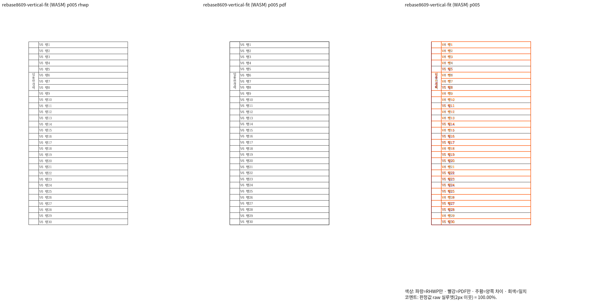
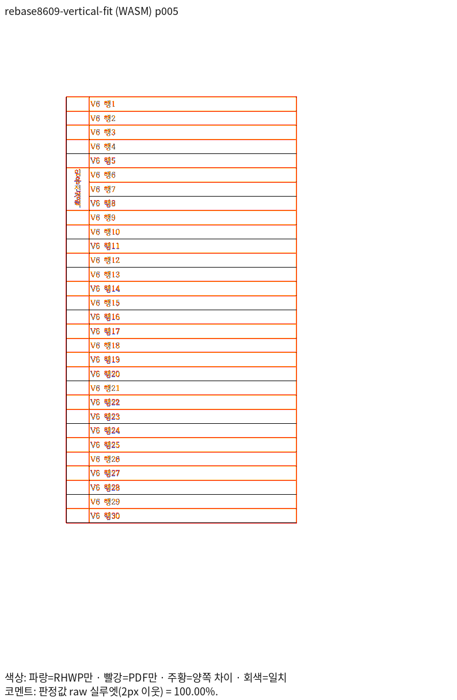
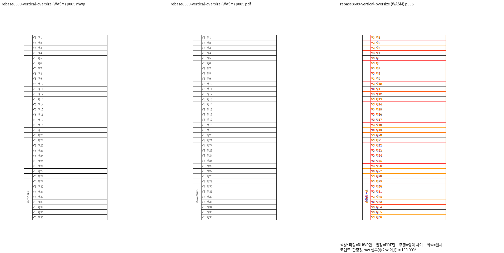
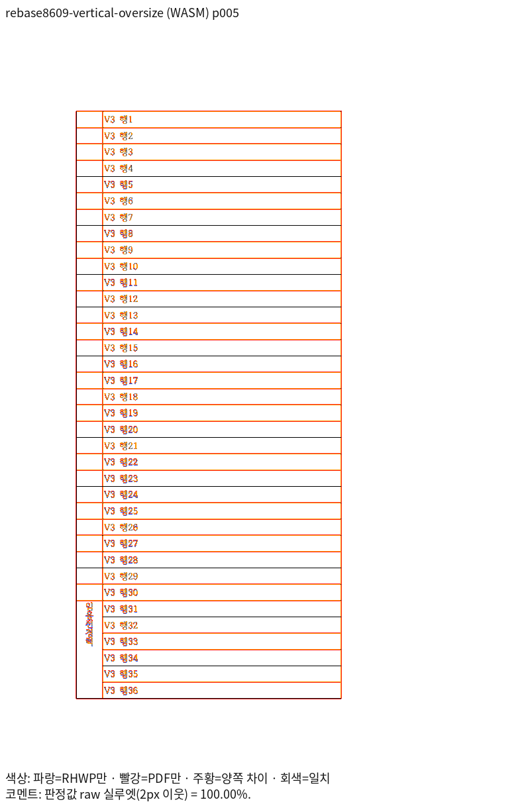
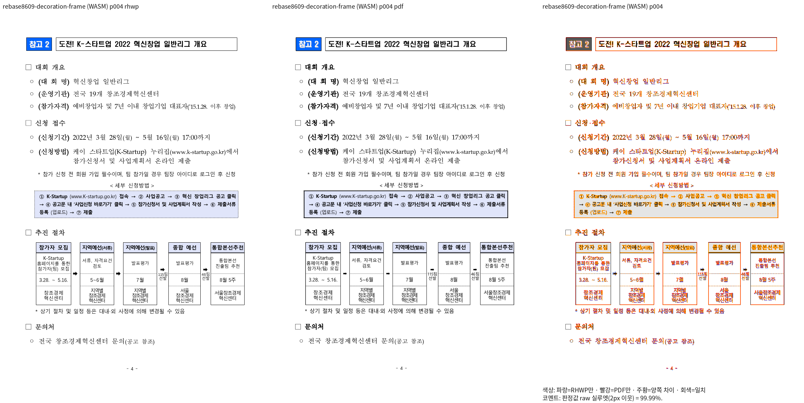
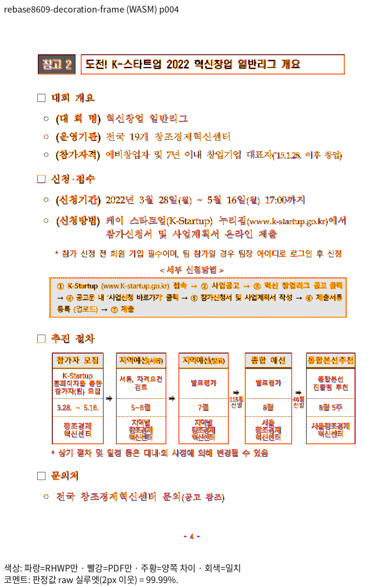
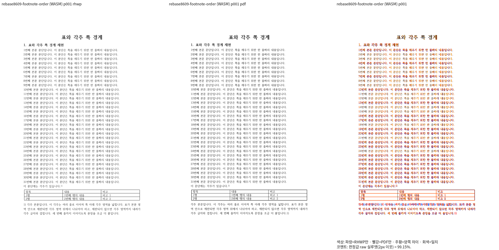
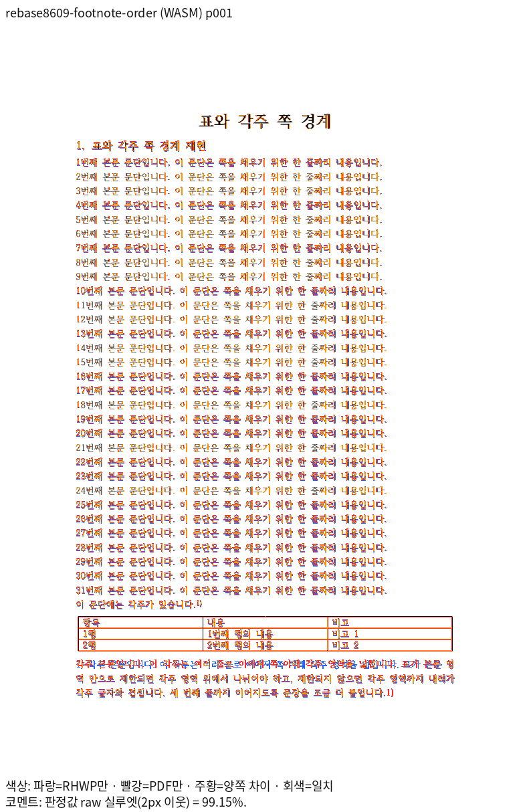

# 최신 fresh WASM의 주장 쪽 직접 판독

제품 source `ba2ebfd34a4ebf402bce8e002254b672a09ef764`. 2026-11-05 KST에 같은 입력·기존 독립 Print를 96 DPI·Print profile로 비교했다.
[10입력·43쪽의 전쪽 TSV와 제품 SHA](wasm-own-validation.md)는 원본별 전쪽 최저값을 포함한다.
review와 별도 overlay를 실제로 열어 판독했다. raw 통과와 남은 기존 차이를 구분하며 원본·PDF를 재출력하지 않았다.

## PR #8475 · vertical-fit · 5쪽

| fresh WASM review | 같은 쪽의 별도 overlay |
| --- | --- |
|  |  |

최신 fresh WASM의 5쪽에서 임용전경력 다섯 글자가 한 세로줄로 모두 칸 안에 보존된다. V6 행 1~30의 순서·인접 셀·표 종료를 확인했다. raw 100%는 선의 두께·색까지 완전한 픽셀 일치를 뜻하지 않는다.

| 제출 그림 | SHA-256 |
| --- | --- |
| `review` | `6ba28827a2f910d585d2c670a880415f9a4b788a784819992b4606f86ce62dde` |
| `overlay` | `7c98c73d86f7b068425976d3b9b20432e70264bc8cb7ede38181708fe41b186a` |

## PR #8475 · vertical-oversize · 5쪽

| fresh WASM review | 같은 쪽의 별도 overlay |
| --- | --- |
|  |  |

최신 fresh WASM의 5쪽에서 임용전경력 다섯 글자가 한 세로줄로 모두 칸 안에 보존된다. V3 행 1~36의 순서·인접 셀·표 종료를 확인했다. raw 100%는 선의 두께·색까지 완전한 픽셀 일치를 뜻하지 않는다.

| 제출 그림 | SHA-256 |
| --- | --- |
| `review` | `e222a22030769a13612e003f960ac2da5085aca54af2c033878dbbadcfd38b2b` |
| `overlay` | `e80dbc19f724fa430623f96ca75078639dfbe8f2f5479ff556a8a14ff6407c48` |

## PR #8512 · decoration-frame · 4쪽

| fresh WASM review | 같은 쪽의 별도 overlay |
| --- | --- |
|  |  |

제목 틀 뒤 대회 개요·신청 접수·세부 신청방법·추진 절차·문의처의 순서와 빈 host 문단의 점유를 확인했다. 신청방법 상자의 점선과 PDF 실선 차이는 남아 있으며 PR의 host 뒤 본문 위치 개선과 구분한다.

| 제출 그림 | SHA-256 |
| --- | --- |
| `review` | `cca1d2f659fca0e4f5e0e1e5d86fa67e9f8e61c8cac64b4007a15cb4787e0699` |
| `overlay` | `7741043f78a1688c5c7c3e21c4e87e47a860298f4ab5d82bdedb99d1917ca2f8` |

## PR #8535 · footnote-order · 1쪽

| fresh WASM review | 같은 쪽의 별도 overlay |
| --- | --- |
|  |  |

본문 1~31의 순서·각주 참조 뒤 표·각주 위에서 끝나는 표를 확인했다. 입력 XML의 autoNum이 각주 본문 뒤에 있는 반면 WASM은 앞에 번호를 표시한다. 이 기존 번호 위치 차이는 scaffold 표 제한 개선과 구분하며 각주 번호 완전 일치를 주장하지 않는다.

| 제출 그림 | SHA-256 |
| --- | --- |
| `review` | `fb2df1cccff16dec0abfd521a5bef1525ba2b897bc3af43dd81140b498c3d9b1` |
| `overlay` | `407cb0d729129360949b2c5f335130e79ece8709d401837fea6bd0cc9eee2770` |

[전체 직접 판독 원장](../direct-reading-current.md)에 실제 입력·PDF·쪽·producer를 연결했다. 새 base와의 기능 보존 대조 및 최종 공통 검증은 별도 완료 항목이다.
