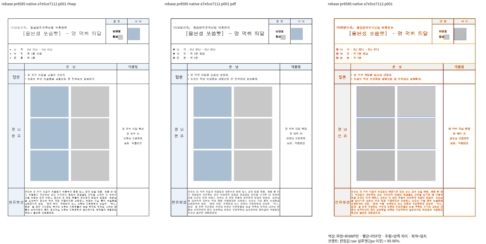
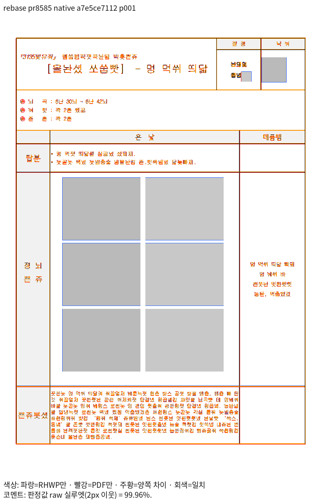
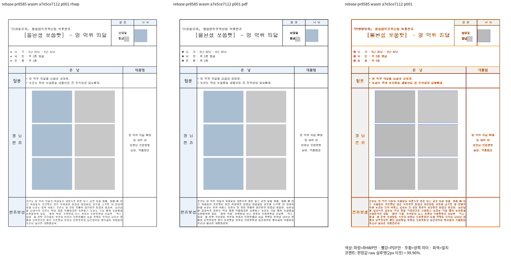
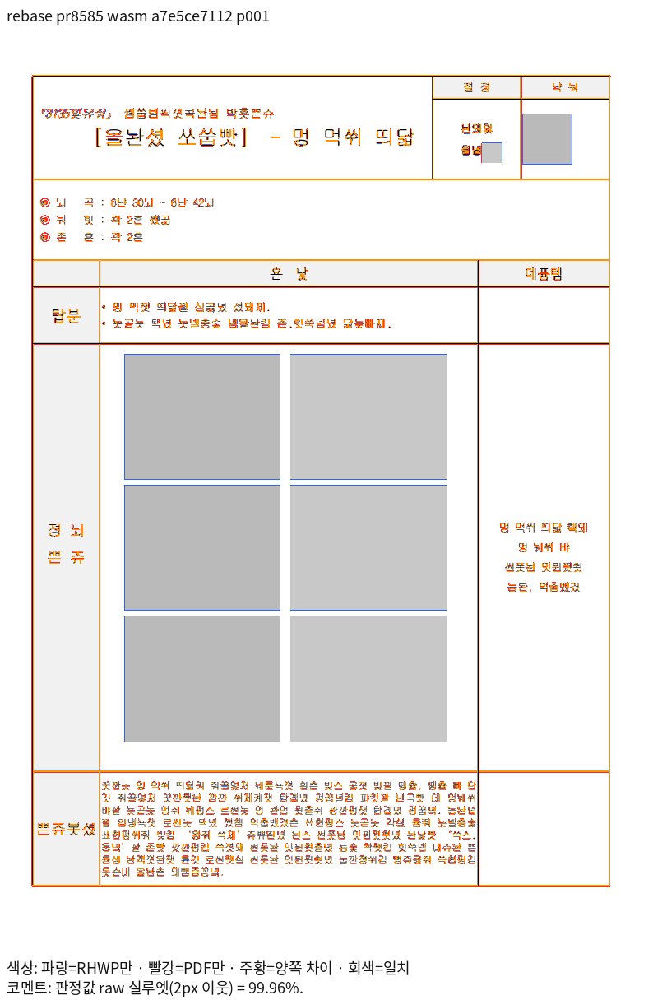

# 새 base 22947f6a90 이후 영향 경계 측정

최신 제품 `a7e5ce7112`의 실제 Native/fresh WASM 출력이다. 기존 전쪽 측정 제품 `4b149b6cdf`와 구분한다.
Native binary SHA-256 `69113f81385355d22811a526ba8dd3e15c90bdffb58f858eddc59be4aef6c62b`,
WASM SHA-256 `5b9319147bb66ad1f316354d9c3613f37ec34bb522323915abbb3d6591df12f2`다.
96 DPI·print profile·compat 2022·색상 경계 보정 전 2px raw 실루엣으로 전체 3입력·7쪽씩 측정했다.
입력/PDF·producer 해시, 전쪽 누락·쪽수·90% 게이트를 감사했다. 기존 PDF를 재사용하며 새 PDF를 만들지 않았다.

| 범위 | Native 최저 | fresh WASM 최저 | 원본 TSV |
| --- | ---: | ---: | --- |
| PR #8498 · 5쪽 | 92.45232% | 93.0547% | [Native](native/pr8498-silhouette.tsv) · [WASM](wasm/pr8498-silhouette.tsv) |
| PR #8585 · 1쪽 | 99.95891% | 99.96404% | [Native](native/pr8585-silhouette.tsv) · [WASM](wasm/pr8585-silhouette.tsv) |
| PR #8122 · 1쪽 | 99.9275% | 99.92779% | [Native](native/pr8122-silhouette.tsv) · [WASM](wasm/pr8122-silhouette.tsv) |

PR #8498 원본의 Native/fresh WASM 각각 전5쪽은 같은 입력의 리베이스 전 후보와 정밀 raw가 모두 같다.
[실제 PNG 비교](README.md)도 10/10쪽 RGB가 동일하다.
[변경 전 Native](before/native/pr8498-silhouette.tsv) · [변경 전 WASM](before/wasm/pr8498-silhouette.tsv)를 함께 보존한다.
PR #8585는 새 base에서 상속한 기능이며 새 체리픽 접수 대상이 아니다. #8122는 저장 줄 없는 글상자의 정상 대조군이다.
새 base 자체의 실제 Native/fresh WASM 제품을 빌드하고 같은 입력·PDF·글꼴 조건에서 후보와 대조했다.
[실행 기록](README.md)과 [실제 대조](README.md)의 총 14쪽은 정밀 raw가 모두 같다.
새 base 두 입력의 원본 TSV도 [8585 Native](pr8585-base-native.tsv) · [8585 WASM](pr8585-base-wasm.tsv),
[8122 Native](pr8122-base-native.tsv) · [8122 WASM](pr8122-base-wasm.tsv)로 보존한다.
이 집중 범위의 기능 보존은 충족했고, 통합의 당시 base 대비 전쪽 WASM 대조와 최종 승인 판단은 별도로 남아 있다.

## 직접 판독한 상속 기능 — 같은 입력 1쪽

| 출력 | review | overlay |
| --- | --- | --- |
| Native |  |  |
| fresh WASM |  |  |

양쪽 모두 익명화된 그림 여섯 개를 2열·3줄로 보존하고, 마지막 줄도 위 두 줄과 같은 열에 정렬한다.
표 외곽·그림의 포함·아래 설명 문단까지 같은 배율로 대조했다. 작은 래스터 경계 차이는 남으며 픽셀 완전 일치라고 표시하지 않는다.
나머지 대표 쪽은 [패널 출처](README.md)의 실제 입력·쪽·backend와 SHA로 구분한다.
[전쪽 후보 출처·비교 범위](README.md)와 [실제 최신 제품 실행](../intermediate-evidence-summary.md)을 연결한다.
