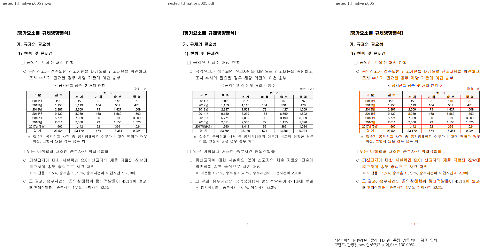
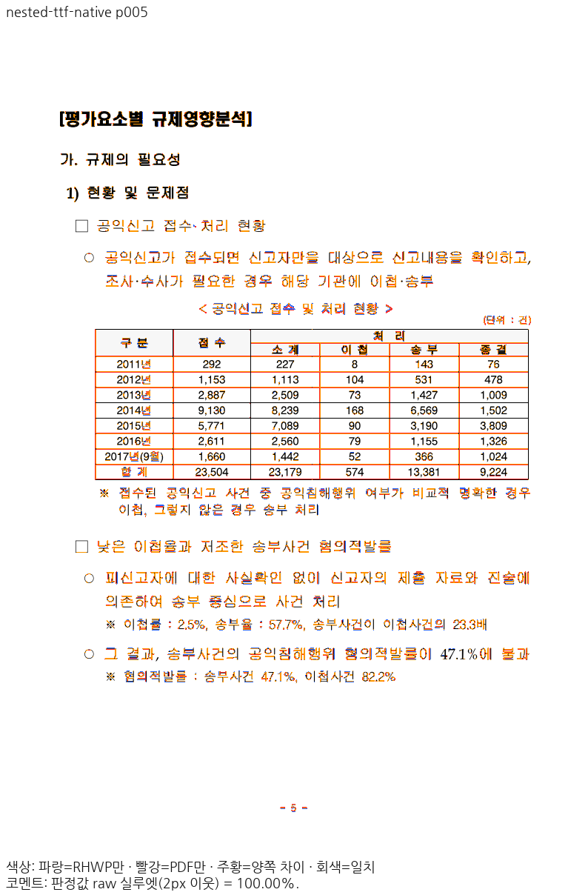
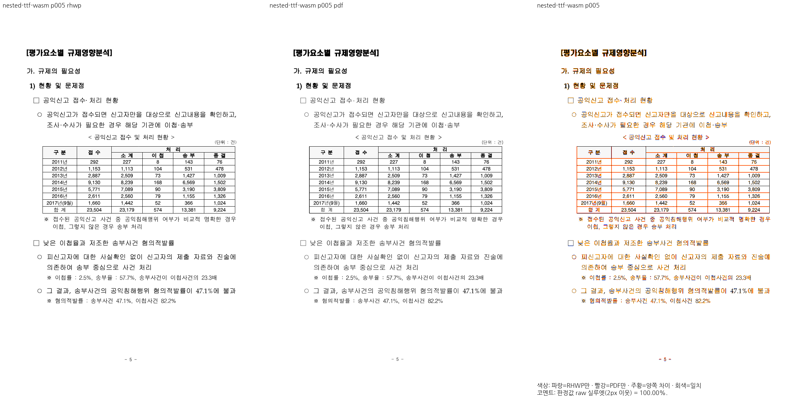
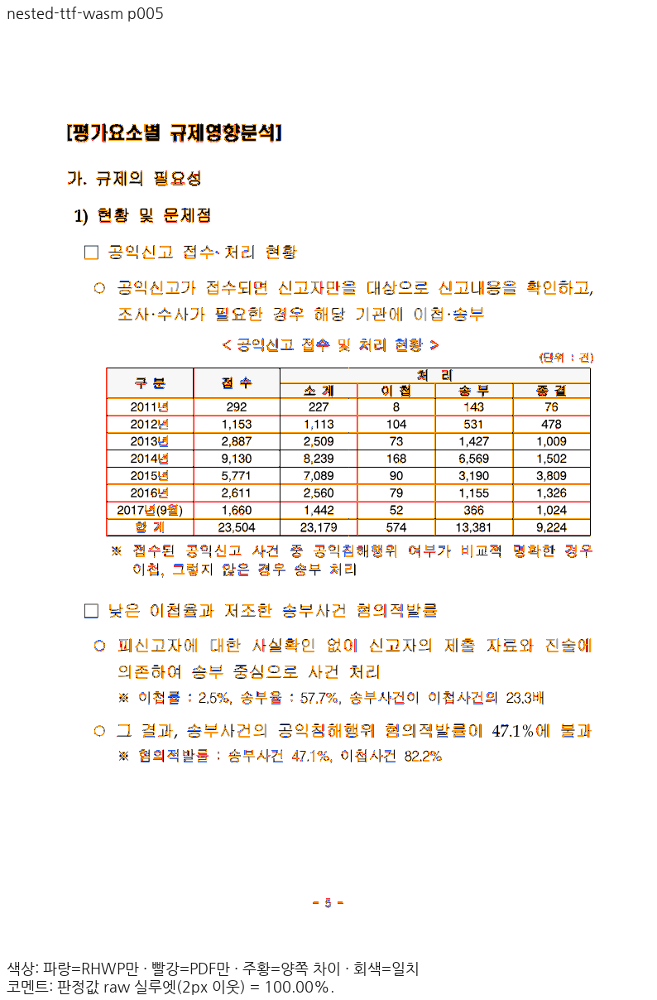

# 원본 프로그램 선택 순서와 #9096 보존 확인

## 현재 판정

중첩 표 원본의 CFF 고정 선택을 실제 설치된 H2GTRM.TTF로 변경한 조건에서
고정 base Native·후보 Native·fresh WASM 각각 17쪽의 정본 보호값 하락은 0쪽이다.
문제였던 5쪽은 세 경로 모두 100.00%, 문서 전체 최저는 각각 99.86%다.
이는 해당 문서의 공급 보정 결과이며 #9096 전체·현재 통합 PR의 최종 승인을 뜻하지 않는다.

## 원인과 선택 계약

`7fbc8ba62b23edd490391c1968bd7ebb87f0c5fe`(#9096)가 추가한
`jinho-von-choi-20261114/font-supply/nested-symbol-slot-environment.json`은
`한양중고딕`에 `openTypeCff: true`, `trueType: false`와 특정 프로그램 신원을 명시했다.
이 선언은 일반 설치 글꼴의 탐색 순서보다 먼저 소비되므로 설치된 TTF가 있어도 자동으로
선택을 바꾸지 않는다. 과거 검증 환경 파일은 당시 증거이므로 변경하지 않았다.

일반 선택은 원본 이름과 검증된 원본 별칭 안에서 TTF → TTC face → OpenType 순서다.
원본 OTF가 있으면 관계없는 대체 family의 TTF로 먼저 치환하지 않는다.
이는 `installed_font_program_order`의 세 관계형 검사와 현재 전체 회귀에서 검증했다.
OTF는 컨테이너이고 현재 CFF 프로그램은 OTF 내부의 CFF 윤곽이다. 확장자와 윤곽 형식을
서로 독립인 두 파일처럼 세어 검증했다고 주장하지 않는다. 독립 raw CFF 파일의 적재를
새로 구현하거나 검증한 결과는 아니다.

사용자가 지정한 TTF 우선 공급을 위해 [새 환경](nested-ttf-environment.json)에서
`한양중고딕`의 선택을 실제 H2GTRM.TTF(HYGothic-Medium / HY중고딕)로 바꿨다.
원본 파일의 SHA-256은 `0b18f81f9d463f6c498853af3bdad577e9c881a5b59dc7ef4c43287588d696d5`이며,
현재 Mac 설치본과 Windows 설치본의 바이트가 일치한다. 프로그램 신원은 파일 바이트 뒤
big-endian face index 0을 붙인 SHA-256이며 파일 자체의 SHA와 구분한다.
비공개 글꼴 바이너리·추출 글꼴은 제출하지 않는다. Unifont 및 PDF에서 복원한 별도 기호
프로그램은 이번 수용 환경에 사용하지 않았다.

## 실제 검증

- 입력: `samples/basic/issue2007_nested_cell_pagination_42065.hwp`.
- 독립 Print: `pdf/review-integration-20261026/issue2007_nested_cell_pagination_42065-2020.pdf`.
- base: `ae9277dda0ca17be279cba89c4deea74fb75dcae`.
- 후보 제품 source: `10d0d6ae43273430f74f7055c39b3d74948c1d7f`.
- compat 2022·96dpi·색상 경계 보정 전 2px 내용 실루엣, 기존 보호 하한 유지.
- Native는 실제 Skia PNG, WASM은 로컬 locked wrapper `--no-opt` 빌드의 실제 브라우저 PNG다.
- [전쪽 하한 대조](floor-audit.json) · [공급 신원](provenance.json).
- [Native 17쪽 TSV](native/silhouette.tsv) · [fresh WASM 17쪽 TSV](wasm/silhouette.tsv).

Native review와 WASM overlay의 5쪽을 직접 판독했다. 두 `※`의 소속·크기·기준선과
뒤 텍스트의 줄 구성이 독립 Print에 대응하며 누락된 기호가 없다. 100.00%는 2px 관용
실루엣 판정값이며 PNG 바이트 또는 모든 색상 픽셀의 동일성을 뜻하지 않는다.

## #9096 기능 보존의 범위

#9096의 실제 merge diff에서 변경된 test module 17개를 추출하고 현재 최소 글꼴 전체 회귀
로그와 대조했다. 해당 module의 실제 PASS 146건을 [실행 목록](pr9096-functional-retention.json)에
보존했다. 바탕쪽·HWP3·속성 저장·CLI 관련 원래 계약의 기능 증거이며 글꼴 공급 시각 검증을
대신하지 않는다. 정본 보호 전체와 최종 실제 소비 경로 검증은 계속 진행 중이다.
