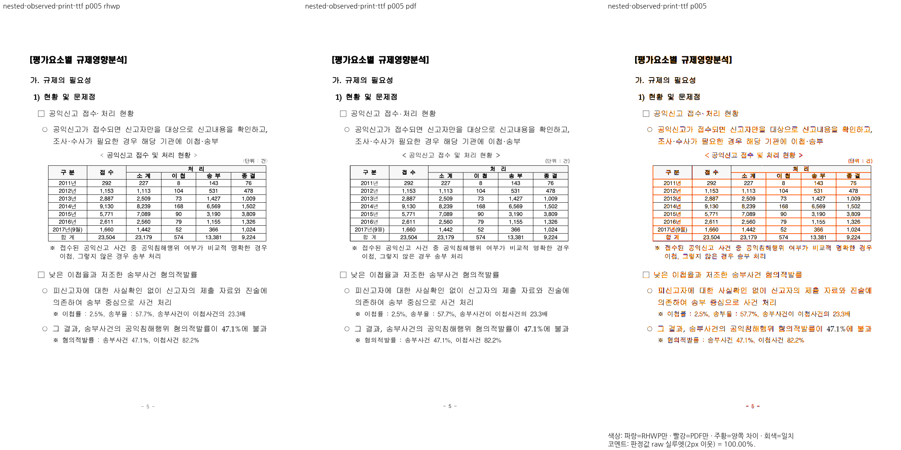
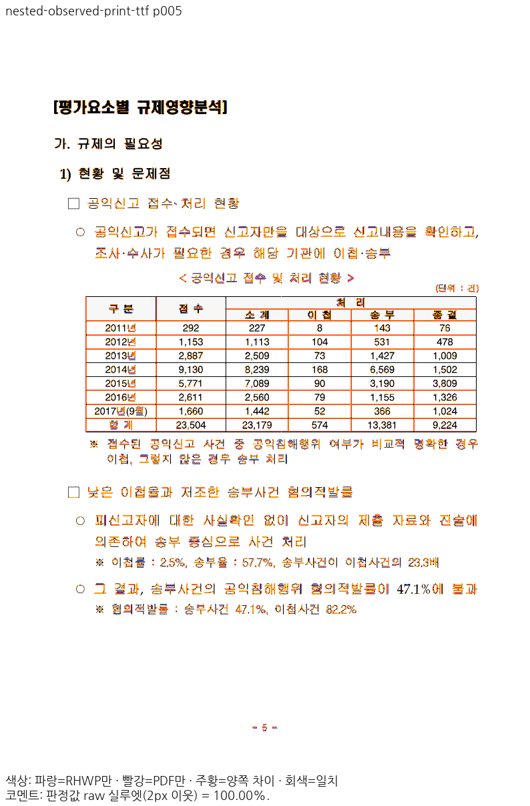
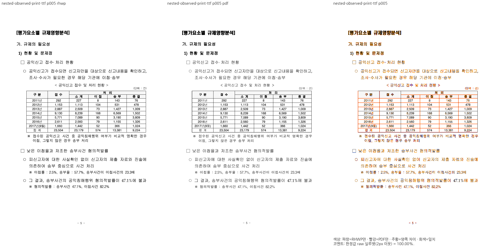
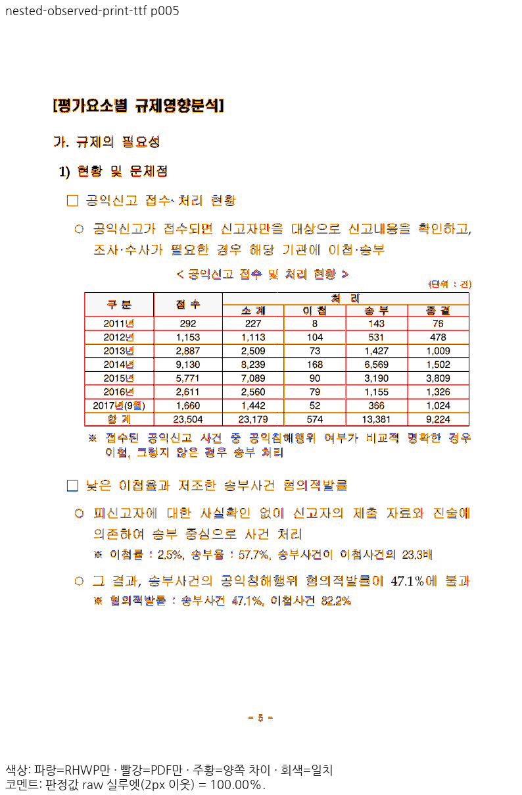

# 한양중고딕 원본 프로그램 선택 보정 검증

`한양중고딕`의 TTF 원본은 `H2GTRM.TTF`다. 설치 이름 `HY중고딕`·`HYGothic-Medium`과
PostScript 이름 `H2gtrM`을 원본 별칭으로 처리한다. 일반 고딕 대체로 분류하지 않는다.

검증한 제품 source는 `0d587554b804183b5cc6d090f396acc47525c089`다. 이후 upstream
`443dafb08107152e066689544e88d90988339567`로 충돌 없이 리베이스한 head는
`6ca77c5ee23d1950399697bf0e2314854d74a462`이며 Rust·Cargo·Visual Sweep 소비 경로의
내용이 동일하다. 새로 들어온 Studio dialog CSS/E2E는 별도 보존 검증 대상이다.
빌드·프로그램 신원과 비교 결과는 [검증 기록](validation.json)에 구분했다.

## 자동 선택과 Print 조건 대조

JSON 없이 실행한 Native와 fresh WASM의 실제 영수증 모두 H2GTRM의 TTF 프로그램을 선택했다.
원본 파일 SHA-256은 `0b18f81f9d463f6c498853af3bdad577e9c881a5b59dc7ef4c43287588d696d5`다.
Native 프로그램 신원은 face index를 포함하며, WASM 정규화 공급 바이트 SHA와 구분한다.
원본 글꼴 바이너리는 커밋하지 않는다.

| 조건 | Native 전쪽 최저 | fresh WASM 전쪽 최저 | Native 5쪽 | fresh WASM 5쪽 |
| --- | ---: | ---: | ---: | ---: |
| JSON 없는 자동 선택, 17쪽 | 97.54% | 97.75% | 99.04% | 99.10% |
| 다른 Print 설정을 유지하고 H2GTRM을 선택, 17쪽 | 99.86% | 99.86% | 100.00% | 100.00% |

JSON 전체를 제거하면 다른 대체·기호·메트릭 설정도 바뀐다. 위 두 행의 차이 전체를 한양중고딕
하나 때문이라고 해석하지 않는다. 명시적 CFF 고정 JSON은 자동 형식 순서보다 우선할 수 있어
과거 기록은 보존하고 [별도 TTF 조건](../nested-ttf-environment.json)을 사용했다.
두 조건 모두 17쪽 전체 TSV를 보존한다.

Native 5쪽 review와 WASM 5쪽 overlay에서 두 `※`의 크기·기준선·본문 소속과 뒤 줄을
직접 확인했다. Print 조건의 100.00%는 2px 관용 실루엣 값이며 모든 색상 픽셀의 동일성이 아니다.

## 기존 기능과 통합 후보의 집중 대조

Native/fresh WASM 각각 현재 통합 6개 입력 18쪽, 위 자동 중첩 표 17쪽, #9096 대표 원본 3개
7쪽과 Print 조건 중첩 표 17쪽으로 총 59쪽씩 118행을 보존했다. #9096의 전체 검증을 대신하지
않는다. 짝수 바탕쪽 `02-both-source`는 주장한 2쪽, `color-source`는 주장한 3쪽을 직접 확인했다.
이 두 원본은 각각 양 backend 3쪽 모두 100.00%다. HWP3 specimen은 양 backend 98.48%다.

별칭·TTF/TTC/CFF 우선순위의 관계형 검사는 최소 글꼴 격리에서 4건 PASS했다.
이 기록은 집중 검증이며 최종 전체 회귀·정본 보호 18문서 전쪽·Studio 실제 소비 경로 통과는
아직 포함하지 않는다. WASM은 locked wrapper의 Mac `--no-opt` 로컬 대체 빌드다.
