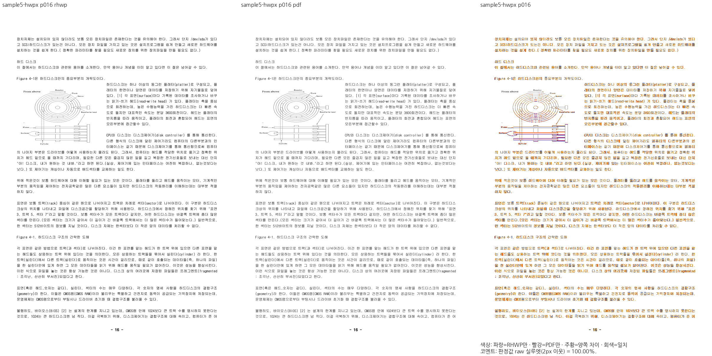
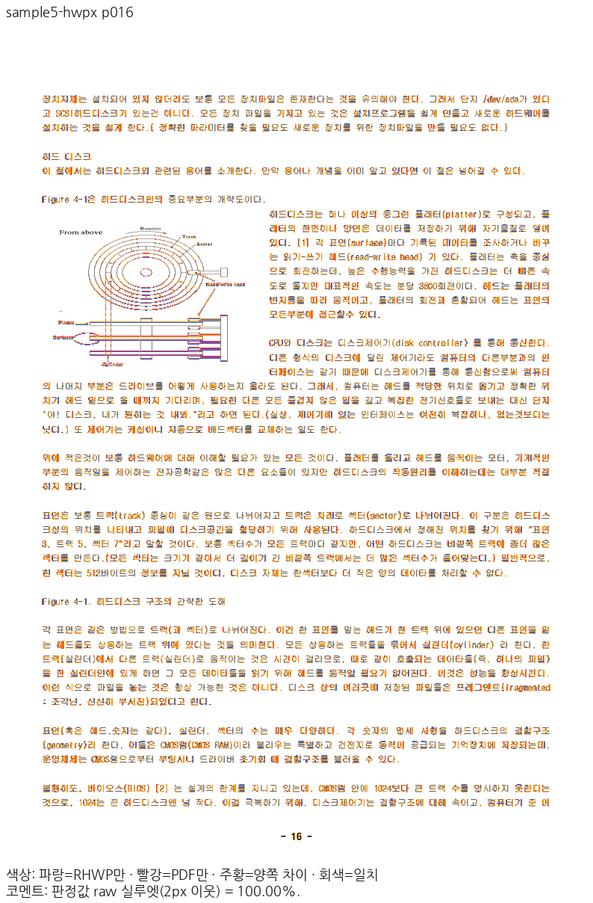

# PR #8734 — 후속 문단의 저장 어울림 줄 상자 보정

원 PR은 그림 바깥 여백을 저장 `cs/sw`에 다시 더하던 오류를 고쳤다. 메인터너 검토에서
같은 입력의 HWPX 16쪽에 남은 별도 소비 오류를 확인했다. 그림 다음 문단 전체의 폭이
일정하면 배치가 저장된 시작점을 버렸고, 그림 아래로 이어지는 문단도 줄별 폭을 잃었다.

원본은 `samples/hwp3-sample5-hwpx.hwpx`, 독립 기준은
`pdf/hwp3-sample5-hwpx-2020.pdf`다. 입력·PDF·지표·판정 기준을 변경하지 않았다.
원본의 그림 옆 저장 줄은 `cs=22800HU`, `sw=28224HU`이며, 아래로 이어지는 줄은
`cs=0`, `sw=51024HU`다. 줄 구성의 개체 폭·세로 구간 근거를 배치도 함께 소비해
저장된 줄 상자를 보존한다. 문서 ID나 쪽별 좌표 보정은 추가하지 않았다.

## 실제 집중 검증

| 대상 | 수정 전 Native | 보정 Native | fresh WASM |
| --- | ---: | ---: | ---: |
| HWPX 16쪽 | 89.80% | 100.00% | 100.00% |

96 DPI·compat 2022·Print·2px raw 실루엣의 공식 두 자리 표시값이다. 양쪽의 같은 쪽
review·overlay를 직접 판독해 그림 위로 분산된 글자가 사라지고, 후속 문단의 좁은 줄과
전폭 줄 및 내용 순서가 보존됨을 확인했다. 이 표는 집중한 16쪽의 결과이며 전64쪽 및
통합 후보 전체 검증 완료를 뜻하지 않는다. 회귀 검사와 전쪽 검증은 별도 기록에 연결한다.

- Native producer SHA: `42abdf7eed3565b4142313e3a931eed8866fdbdabc71a2f3621e90935bc1e519`.
- fresh WASM SHA: `2a1f2faa408d9a162c226b0611fe3f655b1db4647cd88a1aea117393c91f4dfe`.
- Mac WASM은 locked wrapper의 `--target web --out-dir pkg --no-opt` 로컬 대체 빌드다.
- 원본·PDF·제품 source hash와 PNG별 출처: [validation.json](validation.json).

| 증적 | 수정 전 Native | 보정 Native | fresh WASM |
| --- | --- | --- | --- |
| raw | [PNG](before-native-raw-016.png) | [PNG](after-native-raw-016.png) | [PNG](after-wasm-raw-016.png) |
| 독립 PDF | [PNG](before-native-pdf-016.png) | [PNG](after-native-pdf-016.png) | [PNG](after-wasm-pdf-016.png) |
| review | [PNG](before-native-review-016.png) | [PNG](after-native-review-016.png) | [PNG](after-wasm-review-016.png) |
| overlay | [PNG](before-native-overlay-016.png) | [PNG](after-native-overlay-016.png) | [PNG](after-wasm-overlay-016.png) |

