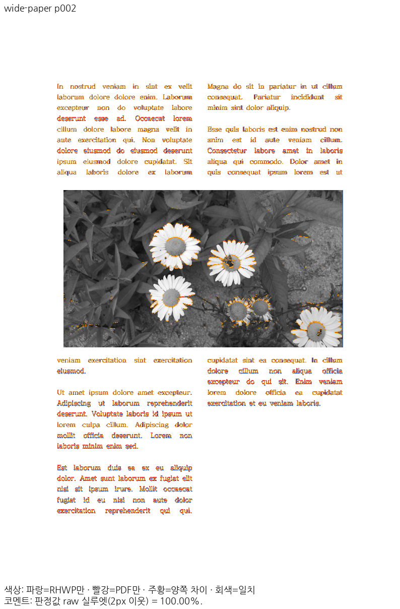
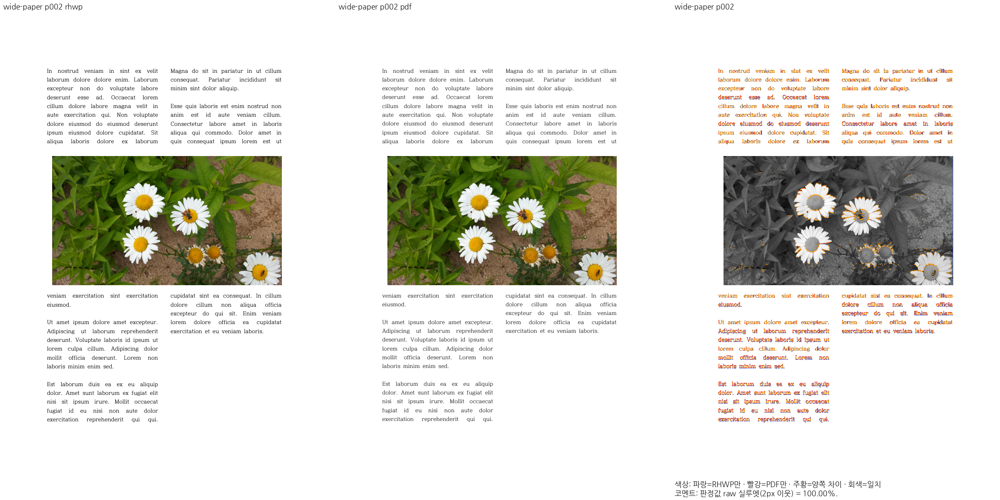

# PR #8752 메인터너 보정 — spanning-square

실제 여러 단 걸침 Square 그림 프레임과 저장 점프가 일치할 때 양 단의 글줄을 그림 아래에 그린다.

- 같은 원본·독립 한컴 Print PDF·96 DPI·색상 경계 보정 전 2px raw 기준을 유지했다.
- 2쪽 Native/fresh WASM은 보정 후 각각 **100.00%**다. 전후 TSV와 같은 쪽 raw·PDF·review·overlay를 함께 보존한다.
- 관계형 회귀의 원본 줄 소속·그림 프레임·순서 및 반례를 실제 실행했다. 제품 소스 해시는 `validation.json`에 고정했다.
- Mac fresh WASM은 locked wrapper `--target web --out-dir pkg --no-opt` 로컬 대체 빌드다. Docker 최적화 결과가 아니다.
- 영향 페이지 집중 검증이며 전체 통합 검증 완료를 뜻하지 않는다.

