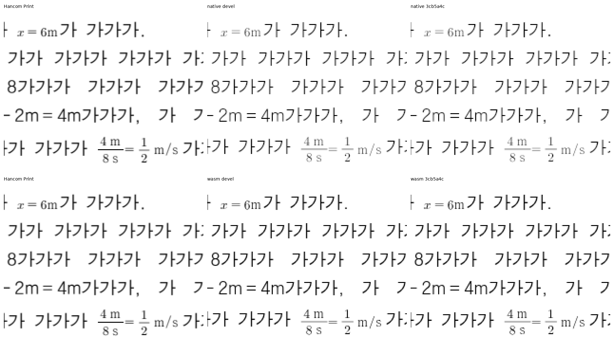
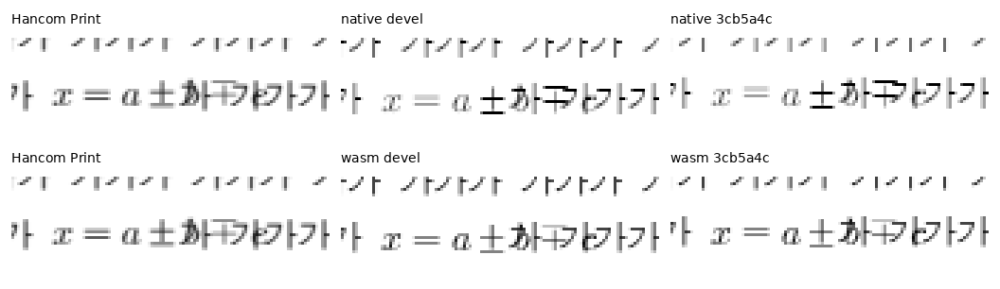
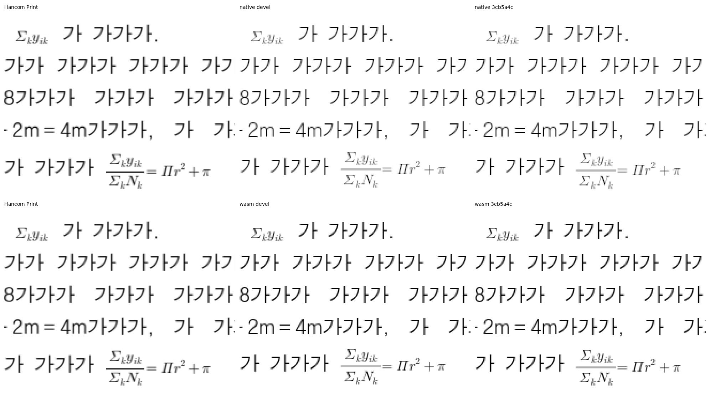
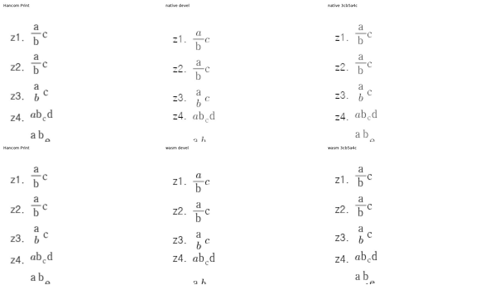
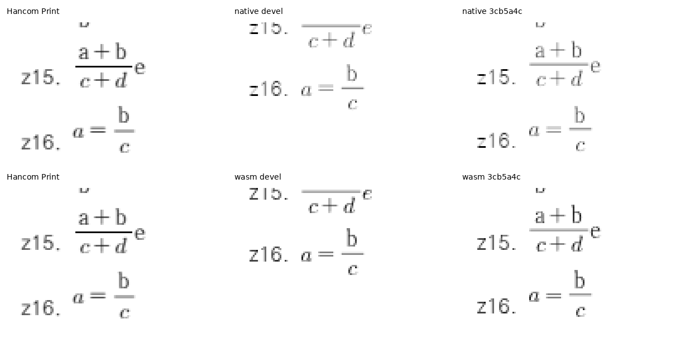
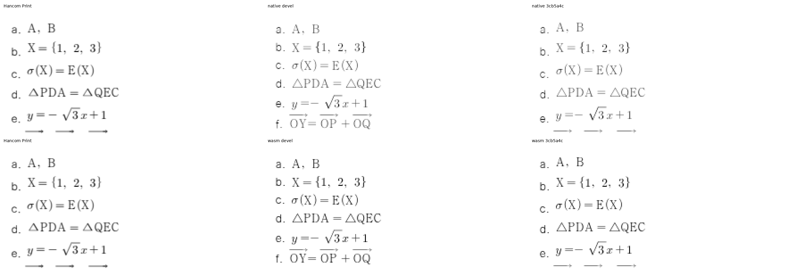
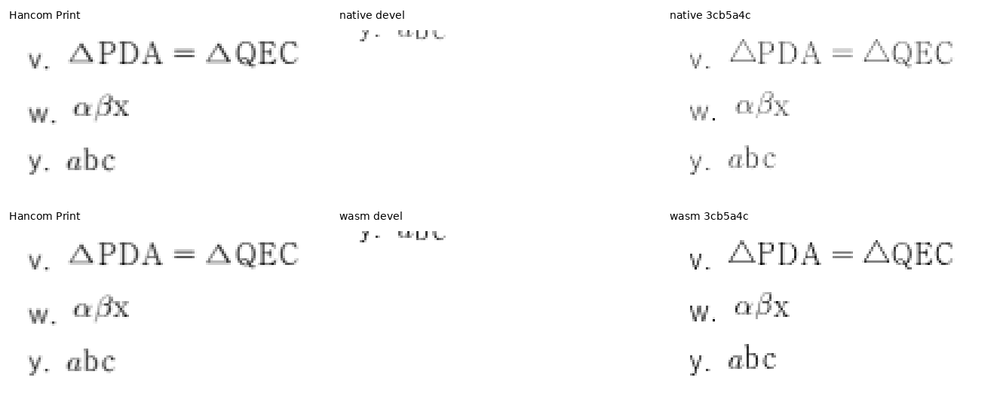

# 완료된 수식 페이지의 문서별 핵심 회귀

- 실제 runtime: `3cb5a4c290663343123074be1e2fc0dda18d3db4`. 같은 원본·한컴 2020 Print, compat 2022, 96dpi의 Native Skia/fresh WASM Canvas2D 전 1쪽을 대조했습니다.
- [전쪽 TSV·입력/PDF·producer](../planet6897_20261018/README.md)와 [이미지 바이트 원장](image_integrity.tsv)을 연결합니다. 실행 로그·진단 JSON·폰트 바이너리는 제출하지 않습니다.
- 실제 원본 파일에서 문단·컨트롤 소유와 원문 순서·수식 수·쪽/본문 포함을 검사합니다. 좌표는 독립 PDF의 글리프 origin을 72pt에서 96px로 환산해 ±2px로 보호하며 엔진 출력에서 기대값을 복사하지 않았습니다.
- 이후 source·글꼴·backend가 바뀌면 두 경로의 해당 쪽 raw가 각각 98% 이상인지 다시 확인합니다. px 검사 통과로 raw 미달을 상쇄하지 않습니다.
- 이 다섯 문서는 모두 전 1쪽이므로 후보 페이지 선택의 대안이 없습니다. 100% 세 문서를 우선 보호하고 두 99%대 문서는 정체 상태·분수와 후속 줄 예약을 보호합니다. 새 입력을 만들거나 모든 페이지에 핀을 추가하지 않았습니다.

| 입력 | Native raw | WASM raw | 보호한 핵심 | 입력·Print |
| --- | ---: | ---: | --- | --- |
| eq-rm-space | 100.00000% | 100.00000% | 정체 단위 m/s, 분수 분자·분모와 후속 단위, 가시 역따옴표 없음 | [입력](<../../../../samples/issue7873/eq-rm-quarterspace.hwpx>) · [Print](<../../../../pdf/issue7873/eq-rm-quarterspace-2020.pdf>) |
| eq-plusminus | 100.00000% | 100.00000% | 서로 다른 ±/∓ 한 기호와 최종 paint 원점 | [입력](<../../../../samples/issue7865/eq-plusminus.hwpx>) · [Print](<../../../../pdf/issue7865/eq-plusminus-2020.pdf>) |
| eq-uppercase-greek | 100.00000% | 100.00000% | Σ의 k 및 y의 ik 소유·대문자 Π와 소문자 π·후속 항 | [입력](<../../../../samples/issue7390/eq-uppercase-greek.hwpx>) · [Print](<../../../../pdf/issue7390/eq-uppercase-greek-2020.pdf>) |
| eq7873-eq-font-fraction | 99.56633% | 99.48605% | 16개 수식의 소유·분수/후속 항, 첫·마지막 기준선과 누적 줄 예약 | [입력](<../../../report/eq-rm-space-7873/eq-font-fraction.hwpx>) · [Print](<../../../report/eq-rm-space-7873/eq-font-fraction-2020.pdf>) |
| eq7873-eq-font-state | 99.68240% | 99.59905% | 24개 수식의 소유·정체 A/B 쉼표 공백, 마지막 줄의 정체 b/c와 누적 예약 | [입력](<../../../report/eq-rm-space-7873/eq-font-state.hwpx>) · [Print](<../../../report/eq-rm-space-7873/eq-font-state-2020.pdf>) |

## 독립 Print 원점과 관계

| 문서 | PDF의 96dpi 원점·기준선 | 관계 검사 |
| --- | --- | --- |
| rm | 첫 m `(135.68,199.20)`; 분자 m `(201.76,314.24)`, 분모 s `(204.16,331.52)`, 후속 m/s `(247.84,322.88)`/`(266.88,322.88)` | 모두 정체, 명시 간격을 가시 문자로 그리지 않음 |
| ±/∓ | `(205.76,144.32)` / `(226.40,144.32)` | 각각 한 글리프·원래 소유와 순서 |
| Greek | Σ `(104,199.84)`, k `(115.04,203.04)`, y `(120,199.84)`, i/k `(127.04,203.04)`/`(130.08,203.04)`; Π/π `(240.48,326.24)`/`(279.04,326.24)` | 서로 다른 첨자 소유, 대소문자와 항 순서 |
| fraction | 첫 a/b/c `(84.48,124.16)`/`(84,141.44)`/`(95.20,132.64)`; 마지막 a/b/c `(87.52,703.68)`/`(114.56,694.08)`/`(115.52,712.16)` | 분자·분모·후속 항의 기준선 관계·마지막 줄 예약 |
| state | 첫 A/B `(74.88,124.48)`/`(97.44,124.48)`; 마지막 b/c `(80.64,692.32)`/`(88.64,692.32)` | 정체 상태·그룹 후 내용·누적 줄 예약 |

## 실제 검사 실행과 확대 판독

- 후보 frozen Native 라이브러리에서 같은 다섯 검사를 실행해 5 PASS·0 FAIL을 확인했습니다. 정식 등록 `e25dbd0f5d47bc32686016c08054d2bf718be6a7`의 별도 검증 checkout에서도 자동 수집된 5건이 통과했고 fmt·Clippy 3종·workspace build·manifest 검사가 통과했습니다. [실제 명령·결과](../planet6897_20261018/documents/validation_commands.md)를 연결하며 최신 GitHub CI는 제출 head에서 별도로 확인합니다.
- 같은 입력과 같은 검사로 고정 devel Native 라이브러리를 실행한 실제 결과: `test result: FAILED. 3 passed; 2 failed; 0 ignored; 0 measured; 0 filtered out; finished in 0.17s`. 통과한 기존 동작의 예방 검사와 실패를 검출한 검사를 구분하며 다섯 검사가 모두 devel 결함을 검출했다고 주장하지 않습니다.
- 아래 패널은 같은 좌표를 nearest 3배 확대했습니다. Print/기준/후보를 독립 정렬하거나 이동하지 않았습니다. 정체/기울임·기호·첨자·분수·명시 간격과 다음 글줄의 배치를 직접 대조했습니다.
- `eq-plusminus`는 스크립트를 수동 변경한 합성 표본입니다. 이웃 본문과 일부 겹침은 독립 Print에도 있습니다. 이 검사는 원래 한컴 출력의 ±/∓ 구별과 글리프 원점을 보호하며 이 합성을 겹침 없는 실물 문서로 표현하지 않습니다.
- 수식 획과 괘선의 래스터 명암 차이는 남습니다. 2px raw 100%를 엄격 RGB 동일성으로 표현하지 않습니다.

### eq-rm-space · 1쪽

### eq-plusminus · 1쪽

### eq-uppercase-greek · 1쪽

### eq7873-eq-font-fraction · 1쪽

### eq7873-eq-font-state · 1쪽

## 같은 검사로 확인한 기준/후보 결과

| 정식 함수 | 고정 devel | 후보 | 해석 |
| --- | --- | --- | --- |
| `roman_unit_document_preserves_the_printed_unit_origin` | PASS | PASS | 완료 페이지의 기존 동작 보호 |
| `plus_minus_document_paints_one_of_each_sign_at_print_origins` | PASS | PASS | 완료 페이지의 기존 동작 보호 |
| `uppercase_greek_document_keeps_the_sigma_and_attached_subscripts` | PASS | PASS | 완료 페이지의 기존 동작 보호 |
| `roman_fraction_document_keeps_numerator_denominator_and_following_term` | FAIL | PASS | 기준 결함 검출 |
| `font_state_document_preserves_roman_comma_spaces_and_following_letter` | FAIL | PASS | 기준 결함 검출 |

위 결과는 같은 다섯 검사 전체를 각 frozen Native 라이브러리에서 실제 실행한 결과이며, parser 단위 검사나 source 검토만으로 수정 전 FAIL을 추정하지 않았습니다.
