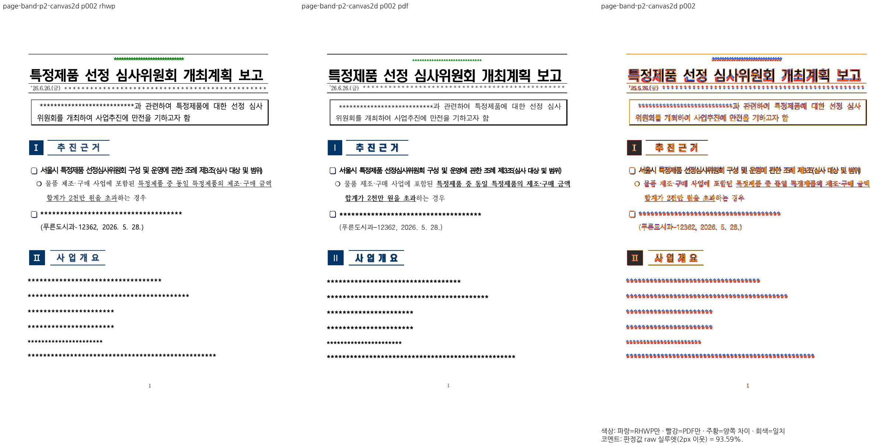
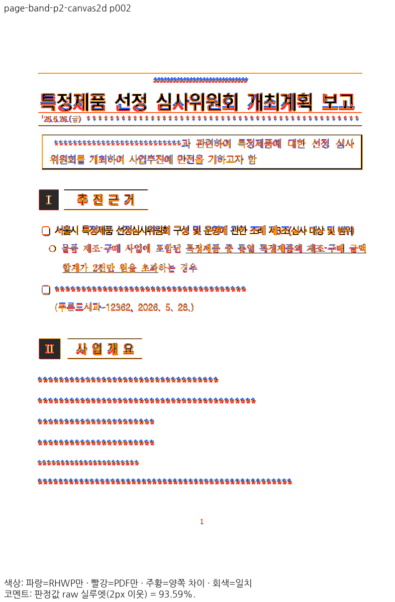
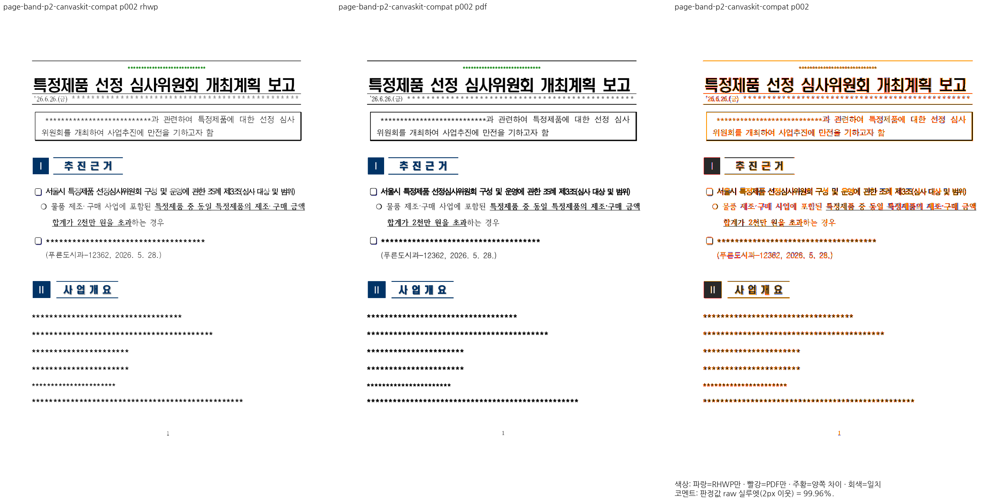
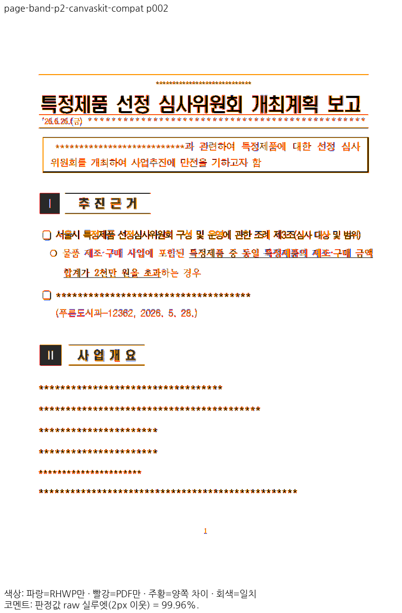

# planet6897 PR 5개 통합 검증

현재 구현 검증 source는 `5fa2645186fc8bec4e53074aa6ff0af7ef67f0ca`, base는 `88170fd75f9d0ce156fe49d79aeabea9bb3a4bcc`다. 빌드 당시 parent·patch와 같은 소스 바이트를 커밋한 SHA는 producer에서 구분한다. 이후 증적·리뷰 문서 커밋이 구현을 바꾸지 않았는지 해시로 확인한다.

원 PR #8976·#9064·#9065·#9067·#9068의 원15개 커밋과 필요한 공통 메트릭 보정3개와 사용자가 요청한 CanvasKit 작업 상한 조정1개를 포함한다. 원 PR의 10k 코퍼스 기록은 작성자의 선행 기록이며 이번 통합에서 새로 수행한 전수 검사로 표시하지 않는다.

## 최종 전쪽 출력

| PR | 문서 | 쪽수/백엔드 | Native 최저 raw | fresh WASM 최저 raw |
| --- | --- | ---: | ---: | ---: |
| #8976 | owned-tac | 11 | 95.63889% | 95.64295% |
| #9064 | ws-host | 2 | 100.00000% | 100.00000% |
| #9065 | page-band | 4 | 95.97412% | 96.01502% |
| #9067 | title-mark | 10 | 94.38083% | 94.48671% |
| #9068 | repeated | 5 | 99.79582% | 99.79577% |
| #9068 | orphan | 8 | 95.42298% | 95.42139% |

전체6문서·40쪽/백엔드이며 canonical96DPI·compat2022·2px raw 기준이다. 원본/PDF·문턱을 바꾸지 않았다. 정상 설치 글꼴 환경에서 Visual Sweep을 실행했고, 회귀만 최소 글꼴 sandbox에서 실행했다. Mac fresh WASM은 locked wrapper `--target web --out-dir pkg --no-opt`의 로컬 대체 빌드이며 Docker 최적화 결과가 아니다.

## 정본 증적

- [입력·PDF 해시, 전쪽 정밀값, TSV 바이트·해시](claim-validation.json), [고정 producer·Native/JS/WASM 해시](final-claim-producer.json).
- [Native/fresh WASM 보호 문서](protected-validation.json): 각각18종·1,771쪽, 총3,542쪽, 공식 두 자리 표시값 하락0쪽. [페이지별 비교](protected/comparison.tsv). 편람 HWPX Native383쪽 `--handbook-gate`도 통과했다.
- [전체 회귀](full-nextest-result.json): 13,541통과·0실패·45skip. [최소 글꼴 감사](minimum-font/inventory-audit.json).
- [원 PR/적용 SHA와 보정 출처](integration-provenance.json), [최신 devel·원 PR 간·누적21건 병합 시뮬레이션](merge-simulation.json).
- [현재 base 비교에서 과거 고정 base 증거를 재사용한 경로 감사](rebase-base-read-path-audit.json), [페이지별 base/후보 비교](base-candidate-comparison.json). 실제 쪽수가 다른 base의 공통 쪽 번호 비교는 진단값이고, 후보 전체 내용 소유·쪽수 검사와 구분한다.
- [직접 판독 및 동일 raw 재사용](direct-reading-final.json). 대표 review와 standalone overlay는 항상 같은 입력·페이지다.
- [#8973 중첩 표 줄 보정](row8973/cause.md), [표 뒤 앞 간격 보정](closing-line/cause.md), [1쪽 종료 글자 높이 보정](leading-line/cause.md).
- [원문 #9062 마지막 두 쪽 소유·쪽수](original9062-ownership.json): 원문 전체 시각 수용과 구분한다.

## 상승 결과의 정본 보호 반영

사용자 지시에 따라 이번 최종 전쪽 결과 전체를 [정본 TSV](../visual-protected-baseline/final.tsv)와 [manifest](../visual-protected-baseline/manifest.json)에 반영했다. Native58쪽·WASM56쪽이 상승했고 이전 정본 대비 하락은0쪽이다. [갱신 영수증](protected-baseline-update.json)은 원 수용 TSV가 커밋 `64a951fd7a`의 바이트와 같고 기존 하한114개가 새 기준에서 거절됨을 확인한다. 편람383쪽의 실제 출력 manifest도 새 정본에서 다시 판정해 통과했다.

## 실제 기준 PDF

owned-tac·ws-host·page-band는 데스크톱 한컴2020 Print, title-mark·repeated·orphan는 실제 PDF Creator 기준 한컴2022 `12.0.0.4547` Print다. 파일명의 연도나 서비스 engine 표기와 실제 제품을 혼동하지 않는다. 웹한글기안기/Cairo PDF로 판정하지 않았다. 유효한 기존 독립 Print를 재사용했다.

## 최종 필수 검증

[현재 Rust 게이트](rust-validation.json) 20단계 모두 통과했다. 최소 글꼴 전체 회귀13,541통과·0실패·45skip, Native Skia의 주 라이브러리3,852통과·12ignore와 나머지 라이브러리182통과, PNG2건·PDF36건 및 Native/WASM/all-target Clippy·workspace build·관련 프런트엔드 검사를 확인했다. 회귀·보호·실제 소비·재사용은 각각의 producer와 범위를 구분한다.

[현재 실제 소비](actual-current-validation.json)는 Studio 54건(새 30건·변경 없는 24건 재사용), SVG 18건(새 10건·재사용 8건)을 구분한다. owned-tac 4·10쪽, page-band 2쪽, title-mark 9쪽은 [현재 코드로 다시 캡처한 24건](actual-consumer-completion/validation.json)과 같은 페이지의 review·overlay를 새로 보존했다. [초기 응답 감사](budget100k/initialization-audit.json)는 root pkg/Studio public/frozen pkg 동일성과 실제 초기 JS 및 WASM6응답을 확인한다. 초기 JS의 Vite URL 한 곳 변환은 역변환 후 원문 해시가 일치한다. 이전5만 상한의 fallback·실패 strict report를 새 CanvasKit 통과로 표시하지 않는다.

## 개별 원 PR 리뷰

- [#8976](../../archives/pr_8976_review.md): 다중 TAC 저장 줄과 별도 음수 오프셋 중첩 표의 공통 보정.
- [#9064](../../archives/pr_9064_review.md): 빈 host·양수 오프셋 표·이어받기 간격·종료 글자 높이.
- [#9065](../../archives/pr_9065_review.md): 쪽 기준 표 띠 아래 host와 저장 줄이 증명한 뒤 간격.
- [#9067](../../archives/pr_9067_review.md): 글자 없는 문단의 제목 차례 슬롯·다중 TAC 소유.
- [#9068](../../archives/pr_9068_review.md): 반복·짝 없는 숨김 끝·저장 문단 사슬·마지막 조각 점유.

원 PR의 기능과 통합 후 보정, 실제 한컴 Print의 제품·버전과 전쪽 TSV/대표 PNG를 번호별로 연결했다. 원 PR head CI는 [현재 조회](source-ci-final.json)에서 모두 성공이다. [통합 PR #9074의 코드 head CI](code-ci.json)는 `f3446e4bbaae57b70c3da0288a27f019aa897c4f`에서 CI·CodeQL·Render Diff·Adapter·Proptest 모두 성공했다. 증적 trailing head CI·병합·후속 조치는 별도 확인한다.

## page-band 2쪽 출력 경로별 구분

원 PR #9065의 제출 TSV는 Native 97.96%·fresh WASM 93.57%다. 현재 실제 Studio Canvas2D는 93.59%, CanvasKit compat/default는 각각 99.96%다. 원 PR의 단독 WASM과 현재 Studio의 글꼴 공급·실행 경로가 달라 0.02%p 개선으로 단정하지 않는다. 현재 Canvas2D PNG는 같은 소비 경로의 이전 PNG와 해시가 일치한다.

| 현재 출력 | review | overlay |
| --- | --- | --- |
| Studio canvas2d |  |  |
| Studio canvaskit-compat |  |  |
