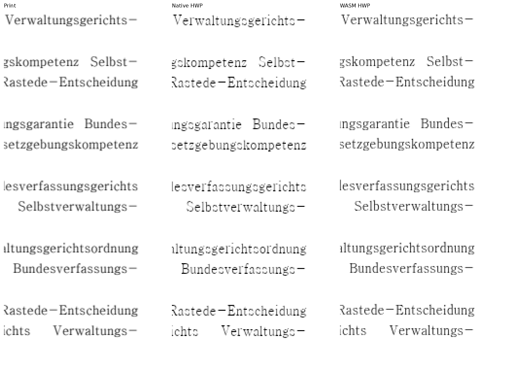
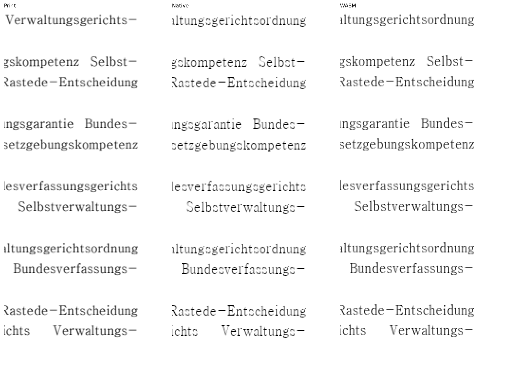

# 원 PR별 현재 출력의 대표 판독

- 실제 runtime은 `3cb5a4c290663343123074be1e2fc0dda18d3db4`입니다. 이미 전쪽 실행한 Native Skia/fresh WASM Canvas2D의 새 PNG에서 대표 자료를 만들었습니다. 새 문서·이관 원본·별도 렌더 실행을 추가하지 않았습니다.
- 같은 원본·독립 한컴 Print, 96dpi·입력별 compat를 사용했습니다. [전체 입력·PDF·기준/후보 TSV](../planet6897_20261018/README.md), [바이트 원장](image_integrity.tsv)을 연결합니다.
- 아래 12개 원 PR의 15쪽에서 Print/Native/WASM을 동일 좌표로 직접 읽었습니다. 따로 정렬하거나 글자·좌표를 수정하지 않았습니다. 각 행의 수치는 대표 쪽 raw이며 전쪽 최저값은 전체 원장에 있습니다.
- 내용·줄/표 소유·선후 순서·누락/중복·포함과 후속 본문을 확인했습니다. 가는 괘선과 글리프의 래스터 명암·굵기 차이가 남아 raw 100%를 엄격 RGB 동일성으로 표현하지 않습니다.

| 원 PR | 입력·쪽 | Native raw | WASM raw | Native | WASM |
| --- | --- | ---: | ---: | --- | --- |
| #7973 | original-nested-tac-row-drop · 1쪽 | 99.56579% | 99.51155% | [review](images/original-nested-tac-row-drop/p001-native-review.png) · [overlay](images/original-nested-tac-row-drop/p001-native-overlay.png) | [review](images/original-nested-tac-row-drop/p001-wasm-review.png) · [overlay](images/original-nested-tac-row-drop/p001-wasm-overlay.png) |
| #7979 | edit7866-d_red_longer_after · 1쪽 | 100.00000% | 100.00000% | [review](images/edit7866-d_red_longer_after/p001-native-review.png) · [overlay](images/edit7866-d_red_longer_after/p001-native-overlay.png) | [review](images/edit7866-d_red_longer_after/p001-wasm-review.png) · [overlay](images/edit7866-d_red_longer_after/p001-wasm-overlay.png) |
| #8005 | added-issue7687-empty-host-hwpx · 1쪽 | 100.00000% | 100.00000% | [review](images/added-issue7687-empty-host-hwpx/p001-native-review.png) · [overlay](images/added-issue7687-empty-host-hwpx/p001-native-overlay.png) | [review](images/added-issue7687-empty-host-hwpx/p001-wasm-review.png) · [overlay](images/added-issue7687-empty-host-hwpx/p001-wasm-overlay.png) |
| #8006 | added-issue7092-substitute-font-ttf-hwpx · 1쪽 | 100.00000% | 100.00000% | [review](images/added-issue7092-substitute-font-ttf-hwpx/p001-native-review.png) · [overlay](images/added-issue7092-substitute-font-ttf-hwpx/p001-native-overlay.png) | [review](images/added-issue7092-substitute-font-ttf-hwpx/p001-wasm-review.png) · [overlay](images/added-issue7092-substitute-font-ttf-hwpx/p001-wasm-overlay.png) |
| #8011 | added-issue7679-tac-after-text-2024-hwp · 1쪽 | 100.00000% | 100.00000% | [review](images/added-issue7679-tac-after-text-2024-hwp/p001-native-review.png) · [overlay](images/added-issue7679-tac-after-text-2024-hwp/p001-native-overlay.png) | [review](images/added-issue7679-tac-after-text-2024-hwp/p001-wasm-review.png) · [overlay](images/added-issue7679-tac-after-text-2024-hwp/p001-wasm-overlay.png) |
| #8012 | added-issue7696-page-anchored-band-2024-hwp · 1쪽 | 100.00000% | 100.00000% | [review](images/added-issue7696-page-anchored-band-2024-hwp/p001-native-review.png) · [overlay](images/added-issue7696-page-anchored-band-2024-hwp/p001-native-overlay.png) | [review](images/added-issue7696-page-anchored-band-2024-hwp/p001-wasm-review.png) · [overlay](images/added-issue7696-page-anchored-band-2024-hwp/p001-wasm-overlay.png) |
| #8013 | added-issue7695-footnote-page-tail-2024-hwp · 1쪽 | 99.92823% | 99.95062% | [review](images/added-issue7695-footnote-page-tail-2024-hwp/p001-native-review.png) · [overlay](images/added-issue7695-footnote-page-tail-2024-hwp/p001-native-overlay.png) | [review](images/added-issue7695-footnote-page-tail-2024-hwp/p001-wasm-review.png) · [overlay](images/added-issue7695-footnote-page-tail-2024-hwp/p001-wasm-overlay.png) |
| #8013 | added-issue7695-footnote-page-tail-2024-hwp · 2쪽 | 100.00000% | 100.00000% | [review](images/added-issue7695-footnote-page-tail-2024-hwp/p002-native-review.png) · [overlay](images/added-issue7695-footnote-page-tail-2024-hwp/p002-native-overlay.png) | [review](images/added-issue7695-footnote-page-tail-2024-hwp/p002-wasm-review.png) · [overlay](images/added-issue7695-footnote-page-tail-2024-hwp/p002-wasm-overlay.png) |
| #8034 | added-issue7972-inactive-cell-margin-hwpx · 1쪽 | 100.00000% | 100.00000% | [review](images/added-issue7972-inactive-cell-margin-hwpx/p001-native-review.png) · [overlay](images/added-issue7972-inactive-cell-margin-hwpx/p001-native-overlay.png) | [review](images/added-issue7972-inactive-cell-margin-hwpx/p001-wasm-review.png) · [overlay](images/added-issue7972-inactive-cell-margin-hwpx/p001-wasm-overlay.png) |
| #8059 | added-issue7870-tac_37-hwpx · 1쪽 | 100.00000% | 100.00000% | [review](images/added-issue7870-tac_37-hwpx/p001-native-review.png) · [overlay](images/added-issue7870-tac_37-hwpx/p001-native-overlay.png) | [review](images/added-issue7870-tac_37-hwpx/p001-wasm-review.png) · [overlay](images/added-issue7870-tac_37-hwpx/p001-wasm-overlay.png) |
| #8059 | added-issue7870-tac_37-hwpx · 2쪽 | 100.00000% | 100.00000% | [review](images/added-issue7870-tac_37-hwpx/p002-native-review.png) · [overlay](images/added-issue7870-tac_37-hwpx/p002-native-overlay.png) | [review](images/added-issue7870-tac_37-hwpx/p002-wasm-review.png) · [overlay](images/added-issue7870-tac_37-hwpx/p002-wasm-overlay.png) |
| #8068 | added-issue8067-flow_L3-hwpx · 1쪽 | 100.00000% | 100.00000% | [review](images/added-issue8067-flow_L3-hwpx/p001-native-review.png) · [overlay](images/added-issue8067-flow_L3-hwpx/p001-native-overlay.png) | [review](images/added-issue8067-flow_L3-hwpx/p001-wasm-review.png) · [overlay](images/added-issue8067-flow_L3-hwpx/p001-wasm-overlay.png) |
| #8082 | footnote8081-span38 · 1쪽 | 100.00000% | 100.00000% | [review](images/footnote8081-span38/p001-native-review.png) · [overlay](images/footnote8081-span38/p001-native-overlay.png) | [review](images/footnote8081-span38/p001-wasm-review.png) · [overlay](images/footnote8081-span38/p001-wasm-overlay.png) |
| #8082 | footnote8081-span38 · 2쪽 | 99.87128% | 99.89504% | [review](images/footnote8081-span38/p002-native-review.png) · [overlay](images/footnote8081-span38/p002-native-overlay.png) | [review](images/footnote8081-span38/p002-wasm-review.png) · [overlay](images/footnote8081-span38/p002-wasm-overlay.png) |
| #8026 | added-issue7993-soft-hyphen-2024-hwp · 1쪽 | 99.97226% | 99.97821% | [review](images/added-issue7993-soft-hyphen-2024-hwp/p001-native-review.png) · [overlay](images/added-issue7993-soft-hyphen-2024-hwp/p001-native-overlay.png) | [review](images/added-issue7993-soft-hyphen-2024-hwp/p001-wasm-review.png) · [overlay](images/added-issue7993-soft-hyphen-2024-hwp/p001-wasm-overlay.png) |

## 직접 판독한 핵심

- #7973: 보기 상자의 세 줄과 아래 선택지 5개를 보존했습니다.
- #7979: 길어진 대체 문자열 전체의 빨간색, 앞·뒤 검은 글자와 순서·간격을 확인했습니다.
- #8005: 두 표 사이 H1 글 1~3과 둘째 표 아래 글 4~8을 확인했습니다. 빈 host의 줄 상자와 제외 띠가 후속 글을 잃지 않습니다.
- #8006: 대체 TTF 사례의 한글·라틴·숫자와 가운뎃점이 있는 구절을 같은 줄에서 확인했습니다.
- #8011: 앞 host 글줄·3×4 표·회신내용·뒤 문단 순서와 표 앞 간격을 확인했습니다.
- #8012: 본문 24줄과 종이 기준 회색 사각형·그 안의 문구를 확인했습니다.
- #8013: 1쪽의 채움 37줄·문단 앞 두 줄·각주와 2쪽의 남은 세 줄을 대조했습니다. 각/주가 두 쪽에 걸치는 원래 경계가 같습니다.
- #8026: 저장 HWP에서 줄 끝 하이픈과 줄 안의 숨긴 제어, 리터럴 대조군을 확인했습니다. 아래 별도 재조판 제한과 구분합니다.
- #8034: 비활성 cellMargin 표의 첫 행·끝 행·네 열과 두 표의 높이·후속 문단을 보존했습니다.
- #8059: 1쪽 BEFORE와 2쪽의 4×4 중첩 TAC 전체·AFTER·TAIL을 확인했습니다.
- #8068: L0/L1/L2와 칸 위아래 여백·표 바깥 BEFORE/AFTER를 확인했습니다. 선언 높이에 맞춰 여백을 줄이지 않습니다.
- #8082: 1쪽은 R00~R04와 각주 본문 없음, 2쪽은 R05~R23·TAIL과 각주 앵커/본문 1~6을 보존했습니다.

## #8026의 저장 줄과 기존 재조판 비적용 범위

원 PR은 “저장 줄 없는 재조판의 줄 나눔(소프트 하이픈에서 끊지 않는 기존 동작 — 범위 밖)”을 명시했습니다. 이번 통합의 해당 보정은 `hp:hypen` 파서·저장 계약과 저장 줄의 표시 문자열 투영입니다. [#7993](https://github.com/edwardkim/rhwp/issues/7993)은 참조 상태로 유지하며 전체 종료를 주장하지 않습니다.

저장 HWP의 Native/WASM raw는 99.97226%/99.97821%이며 다음 줄 끝을 직접 확대했습니다.

저장 줄 없는 수동 HWPX도 TSV에서 생략하지 않았습니다(99.33618%/99.33179%). 다만 `Verwaltungsgerichts-`의 끊김 등이 달라 이를 줄 나눔 일치로 판정하지 않습니다. 이 경로의 기존 비적용 범위를 이번에 해결했다고 표시하거나 새 자동 하이픈 분할을 구현하지 않았습니다. 검사 제거·기준값 완화·글꼴 예외도 없습니다.

이 자료는 실제 판독한 변경·정상 대조의 범위를 기록합니다. 다른 원본이나 이관한 이슈의 해결을 이 대표 쪽으로 대신하지 않습니다.
