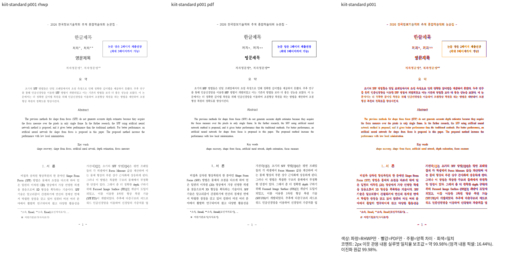
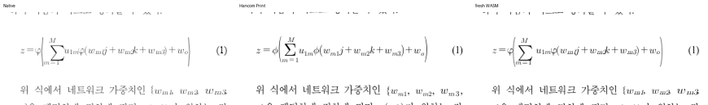
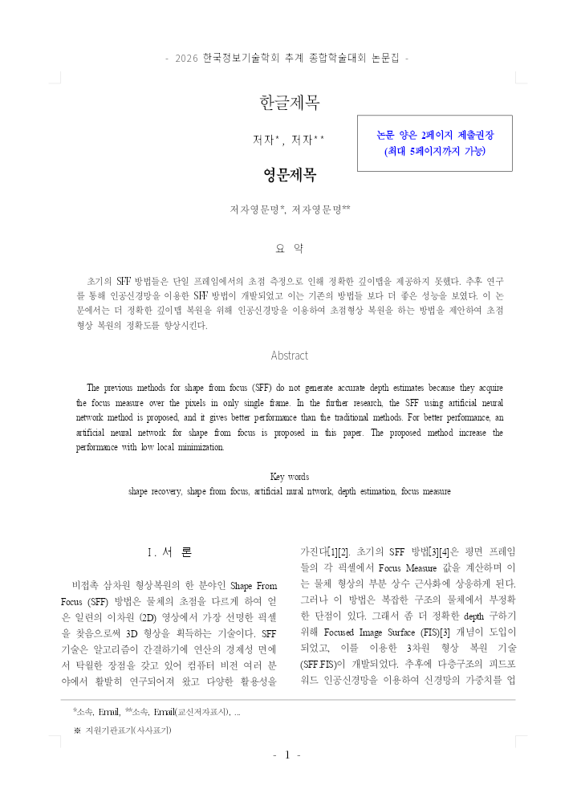
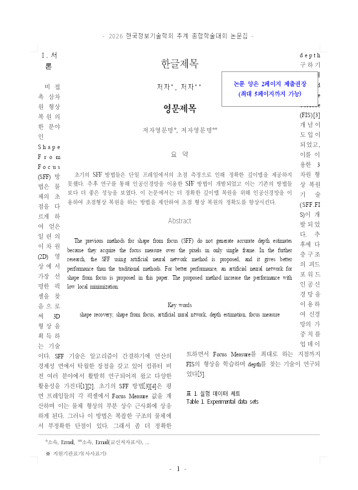

# #7699 시각 증적과 페이지별 px 기준

## 검증 신원

- 기준 devel: `4662c069e557e928ed7968d061121fde90b1f027`. 원 PR source: `11f3e5838af0c5b5bf97da8a672ad934e1510b04`, 체리픽 `b6a865ca6`.
- 메인터너 production source: `9e2cca42a015c965106698a1689040fa56e871e3`. 이후 기록·증적만 추가하며 생산 소스의 SHA-256 동일성을 확인한다.
- Ubuntu, release-test/native-skia CLI와 fresh web WASM. Cargo jobs8, 공유 `/home/tsjang/rhwp/target/pr-review`, WASM codegen-units16. Docker 실행 파일이 없어 canonical host `scripts/wasm-pack-locked.sh --target web --out-dir pkg --no-opt` 대체 경로를 사용했다.
- 동일 입력·독립 한컴2020 PrintMethod0·compat2022·96dpi·2px 내용 실루엣. Native는 실제 Skia PNG, WASM은 실제 browser Print Canvas2D PNG이며 SVG를 산출하지 않았다.
- 시스템 원본 글꼴 디렉터리 `/usr/local/share/fonts/hancom-office-2020/{All,Install,Hwp}` 및 `/usr/local/share/fonts/hwp-convert-mcp-survey`를 직접 공급했다. `휴먼명조·휴먼고딕`은 Hwp/HMKMM.TTF·HMKMG.TTF다. 글꼴 파일이나 family 변조를 PR에 추가하지 않았다. Hwp 누락 상태의 초기 진단 수치는 최종 근거에서 제외했다.
- 새 입력·기준 PDF의 바이트·SHA와 독립 생성 출처는 [fixture README](../../../../tests/fixtures/issue_7699/README.md)에 있다. 저장 LineSeg를 수동 작성하지 않았다.

## 전쪽 결과

4개 보정 대상 각3쪽과 기존 정상 대조군5개 각1쪽: **9문서·17쪽씩 Native/fresh WASM**, 페이지/backend 비교34건. 기준 대비0.01%p 이상 하락·90% 미만·누락·중복·전체 쪽수 불일치0. Decimal 원수치로 비교했다.

| 입력 | Native p1 / p2 / p3 | fresh WASM p1 / p2 / p3 |
| --- | --- | --- |
| kiit-standard | 99.98326 / 99.91808 / 99.99692 | 99.90991 / 99.71153 / 99.97540 |
| kiit-hancom | 99.98326 / 99.91808 / 99.99692 | 99.90991 / 99.71153 / 99.97540 |
| kiit-overlap | 99.98326 / 99.91808 / 99.99692 | 99.90991 / 99.71153 / 99.97540 |
| kiit-narrow85 | 99.98678 / 99.90805 / 99.99692 | 99.93899 / 99.69093 / 99.97540 |

원본/정상 HWPX/allowOverlap의 기준 p1은 Native54.09142%, WASM53.68568%였다. 좁은 표의 기준 p1은 Native91.87685%, WASM91.79435%였다. 표 폭80%만으로 예약하던 원 PR의 좁은 표 Native61.24616%는 초기 진단이며 최종 근거는 위 같은 조건의 base/head 대조다.

| 정상 대조군 | Native | fresh WASM | 기준 대비 |
| --- | ---: | ---: | --- |
| stored-offset | 99.86301 | 99.87148 | 동일 |
| reflow-wide | 99.87061 | 99.87779 | 동일 |
| reflow-narrow | 99.73828 | 99.76357 | 동일 |
| reflow-overlap | 99.87061 | 99.87779 | 동일 |
| reflow-para | 100.00000 | 100.00000 | 동일 |

TSV 원본·실행 로그·입력/PDF/글꼴/producer hash는 ignored `output/pr-review/pr7699-20261016/`에 보존한다. `base-head-page-comparison.json`은 원수치34건 및 각 TSV 경로를 기록한다. `latest-base/corrected-{native,wasm}[-controls]/<key>/silhouette.tsv`가 전쪽 원본이다. Git에는 TSV·로그·중간 JSON을 넣지 않는다. 실루엣 전용 원본 manifest의 `not_evaluated`는 그대로 보존하며, 그 상태를 승인으로 해석하지 않는다. 아래 직접 판독·독립 기대값의 관계/px 검사·필수 검증을 결합해 최종 개별 review에서 판단한다.

## 직접 판독과 범위

- 원본 p1의 표 아래 첫 본문, 두 단 시작, 타이틀과 안내 글상자, 표 바깥 여백을 Print와 직접 비교했다. 안내 글상자는 Print에도 표와 겹치므로 본문과 구분해 유지한다.
- 좁은 표 p1은 양옆 차선과 제목 뒤 빈 글줄을 확인했다. 본문을 표 아래로 강제하지 않고 빈 줄의 높이를 보존한다.
- p2 수식은 Σ·φ·괄호·이탤릭/첨자·식 번호와 양쪽 본문 간격을 같은 배율로 확대 판독했다. 표/그림·캡션·참고문헌도 확인했다. 좁은 표로 한컴이 재조판한 p2는 별도 Print와 읽었다.
- p3 전체 서식 안내 표와 쪽번호를 확인했다. 원본/정상 HWPX/allowOverlap은 backend별 전3쪽 실제 RGB 동일, 좁은 표 p3도 동일하다. 동일 raster의 판독을 중복 실행한 것으로 세지 않는다.
- 실루엣 점수는 전체 픽셀 정확도100%를 뜻하지 않는다. p1 `영문제목`의 기존 HFT 요청 글꼴 차이는 남는다. 실제 Native font decision trace에서 `한양견명조`→bundled `Noto Sans KR`를 관측했다. 독립 Print보다 얇은 글자를 단순 AA 차이로 해석하지 않으며 본문 흐름 보정과 구분한다. 최신 base/head의96dpi crop `[305,196,420,238]`가 RGB 동일함을 확인했고, 새 px 검사는 실제 Print와 맞는 본문 기준선에 한정한다. 서체 완전 일치나 #7548 전체 해결을 주장하지 않는다. 본문/표 위치·줄 소속·내용 순서·수식 기호와 간격의 변경 범위를 별도로 판독했다.
- #7548의 모든 형상·모든 편집 경로·중첩 표 이어받기 일반성을 해결했다고 확대하지 않는다. 기존 정상 관계 검사는 유지한다.

## px 회귀의 독립 기준

완료 p1의 양쪽 최솟값은 원본3종99.90991%, 좁은 표99.93899%다. 변경의 핵심이 p1에 있으므로 무관한 높은 p3를 선택하지 않았다. 같은 핵심 동작을 검증할 수 있는99%대 완료 페이지를 사용했다. 아래72pt 문자 origin을96dpi로 환산하고 **±2px**로 검사한다. 문서 전3쪽의 내용 순서·누락·중복·쪽수 및 포함/비겹침 관계를 함께 유지한다.

| 입력 | Print 페이지/문자 | 독립 y 기준선(px) |
| --- | --- | ---: |
| 원본 HWP·정상 HWPX·allowOverlap | p1 `서  론` | 692.9195963541666 |
| 동일3종 | p1 첫 단 `비접촉…` | 733.877197265625 |
| 동일3종 | p1 둘째 단 `가진다…` | 691.7996419270834 |
| 좁은 표 | p1 첫 단 `비접` | 179.34954833984375 |

정식 검사: `tests/cases/issue_7699_stored_square_top_band.rs`, 총5함수. 원 PR 라이브러리로 같은 정식 소스를 빌드·실행하여2 PASS/3 FAIL을 확인했다. allowOverlap의 본문 겹침, 좁은 표의 과도한 밀어내기, 빈 줄 누락이 각각 독립적으로 실패한다. 최종 Native와 기본 정식 suite의 대응5건은 모두 PASS이며 기본 전체 nextest도10,440 PASS/45 skipped/실패0이다.

## 대표 PNG






## 실제 Studio backend

동일9e2cca42a WASM의 실제 성공 초기화 바이트 SHA를18캡처에서 확인했다. Canvas2D·CanvasKit compat/default × screen/print × 원본/좁은 표/정상 reflow3입력에서 요청 backend/profile과 일치, fallback·replay hard 위반0이다. 실제 CanvasKit default/software Print p1은 원본99.94575%, 좁은 표99.93156%, 정상 reflow99.84876%다.

픽셀 비교(report-only, 채널 차이8 이하 무시·diff ratio0.5% 기준)12건은 미달이며 전체 readiness/performance gate의 통과로 표시하지 않는다. 실제 Print의2px 실루엣과 배치를 별도로 대조했다. Studio의 연한 용지 안내선은 UI 캡처에 남는다. host provider는 설치된 실제6face를 원래 메타데이터로 읽고 기존 fallback chain의HYmjrE TTF 대체를 명시했다. HFT와 동일 프로그램이라는 주장은 하지 않는다.




## 재현 명령

아래는 커밋된 원본을 사용하는 p1–p3 전쪽 재현 예다. 실제 실행은 같은 SHA를 확인한 ignored 입력 사본과 동결 producer를 사용했다. 나머지3입력도 위 표의 대응 독립 Print로 같은 명령을 실행했다. 정상 대조군5개도 각각 전1쪽이다.

```bash
font_args=(
  --font-path /usr/local/share/fonts/hancom-office-2020/All
  --font-path /usr/local/share/fonts/hancom-office-2020/Install
  --font-path /usr/local/share/fonts/hancom-office-2020/Hwp
  --font-path /usr/local/share/fonts/hwp-convert-mcp-survey
)
venv/bin/python scripts/visual_sweep.py --silhouette-only \
  --hwp tests/fixtures/issue_7699/kiit-standard-original.hwp \
  --pdf pdf/pr7699-kiit-standard-2020.pdf --key kiit-standard \
  --rhwp-bin output/pr-review/pr7699-20261016/corrected-rhwp \
  --compat 2022 --dpi 96 --page-workers 1 --embed-fonts full \
  "${font_args[@]}" --out output/pr-review/pr7699-20261016/corrected-native
```

fresh WASM은 같은 인자에 `--wasm-pkg output/pr-review/pr7699-20261016/corrected-wasm`을 추가하고 `--out output/pr-review/pr7699-20261016/corrected-wasm`으로 실행했다. 기준은 최신 devel의 별도 동결 `latest-base-rhwp`와 `latest-base-wasm`을 사용했다. `--silhouette-only`의 원시 not_evaluated를 최종 승인으로 표시하지 않는다. 영향 p1/p2의 review·standalone overlay와 확대 PNG는 별도로 생성해 직접 판독했다.
