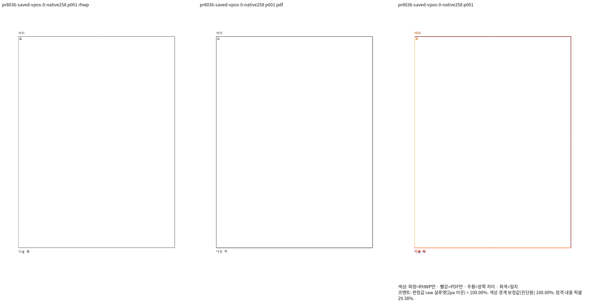
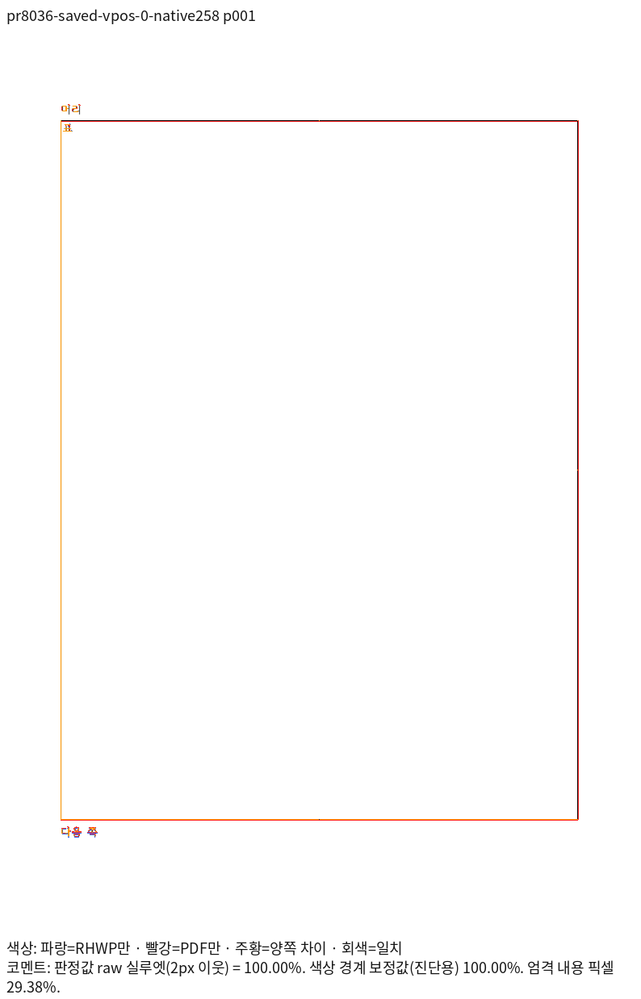
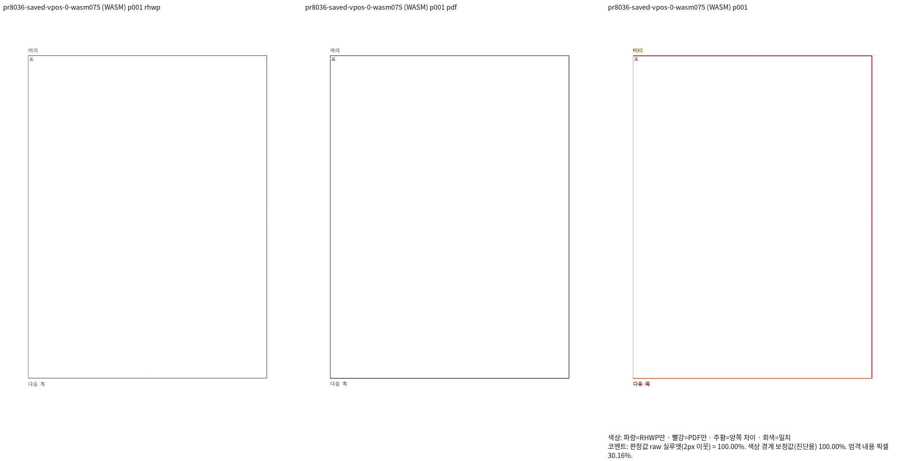
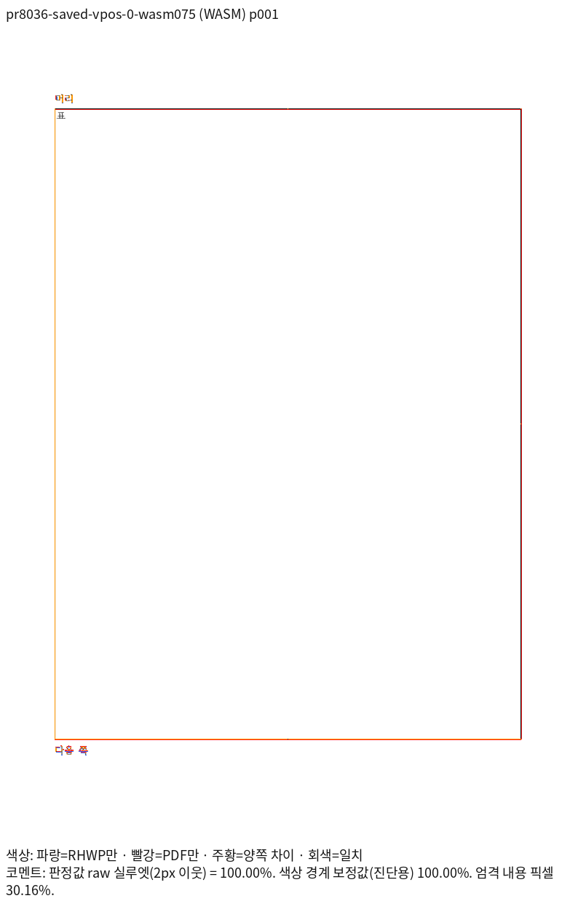

# #8036의 1쪽 Print와 회귀 검사 정정 근거

검증 코드 `55f06decaf`, 측정 base `4e690c930105fa09fef484787ed0a2e5e182d444`에서
동일한 두 원본의 전체 1쪽을 대조했다. 최신 원격 devel `2546c8b2ab`은 아직 이
결과에 포함하지 않았다. 리베이스 뒤의 기능 보존 결과와 구분한다.

| 입력 | 후보 Native | 후보 fresh WASM | base Native | base fresh WASM | 전체 쪽수 |
| --- | ---: | ---: | ---: | ---: | ---: |
| [zero.hwpx](../../../../tests/fixtures/pr8036_stored_tall_line/zero.hwpx) | 100% | 100% | 100% | 100% | 모두 1쪽 |
| [continuing.hwpx](../../../../tests/fixtures/pr8036_stored_tall_line/continuing.hwpx) | 100% | 100% | 100% | 100% | 모두 1쪽 |

[출처·입력/PDF/TSV 해시·실행 명령·페이지별 PNG 동등성](provenance.json)에 실제
한컴 버전과 MCP Print job을 기록했다. 독립 PDF는 [zero](../../../../pdf/pr8036_stored_tall_line/zero-2020.pdf),
[continuing](../../../../pdf/pr8036_stored_tall_line/continuing-2020.pdf)다. 서버 인증 정보나
실행 로그는 포함하지 않는다.

Native와 fresh WASM의 대표 review·standalone overlay를 직접 판독했다. 머리 문단,
큰 표, 셀의 글자, 표 아래 후속 문단이 같은 1쪽에서 보존된다. 이어지는 vpos 대조군은
각 backend 및 독립 PDF raster가 같은 페이지 RGBA임을 확인한 뒤 이 판독을 재사용했다.

| 전쪽 TSV 원문 | Native | fresh WASM |
| --- | --- | --- |
| zero 후보 | [TSV](zero-candidate-native.tsv) | [TSV](zero-candidate-wasm.tsv) |
| zero base | [TSV](zero-base-native.tsv) | [TSV](zero-base-wasm.tsv) |
| continuing 후보 | [TSV](continuing-candidate-native.tsv) | [TSV](continuing-candidate-wasm.tsv) |
| continuing base | [TSV](continuing-base-native.tsv) | [TSV](continuing-base-wasm.tsv) |

원래 2쪽 검사와 그 근거가 틀렸으므로 새 이름의 관계 검사로 교체한다. 보정 전
Native257에서는 되감김 입력 검사가 FAIL, 보정 후 Native258에서는 두 검사 모두
PASS인 실행을 확인했다. 독립 PDF 괘선 좌표의 ±2px 검사도 관계 검사와 함께 유지한다.
