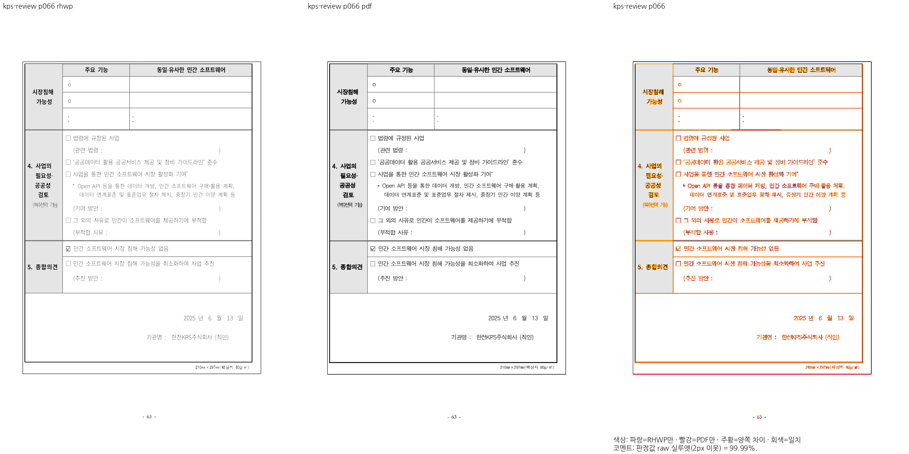
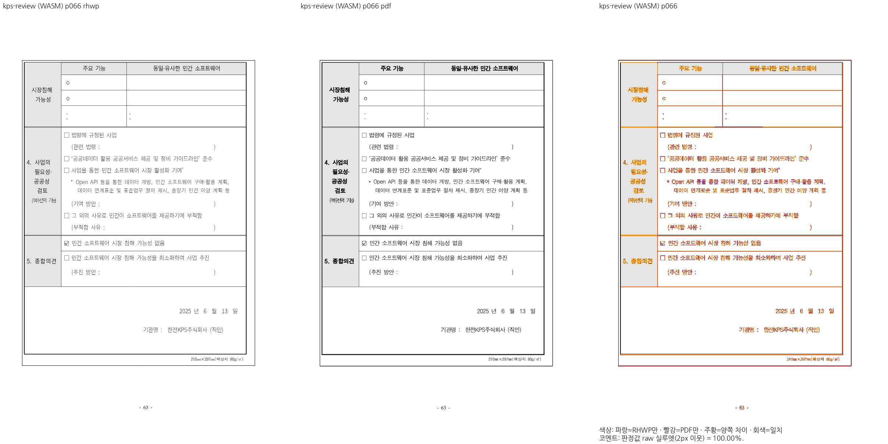

# 원 PR 감사 댓글 본문

기여해 주셔서 감사합니다. 논리 좌표의 삭제·서식 글 붙여넣기, 범위 재조판과 다단 경계 보존 기능을 원 기여 13커밋과 함께 수용했습니다. 최신 devel의 공통 편집·자원 예산·기준선 보정을 유지하도록 메인터너 쪽에서 통합했고, 독립 Print 비교에서 확인한 KPS 65·66쪽 표의 물리 프레임과 테두리도 보완했습니다.

독립 한컴 Print 대비 Native·fresh WASM 각각 14문서·516쪽이 전쪽 raw 90% 이상이며 기준 devel 대비 하락한 쪽은 없었습니다. KPS 66쪽은 각각 99.99427%와 99.99510%입니다. raw는 2px 내용 실루엣의 자동 일치율 보조값으로, 사람의 판정 정확도나 픽셀 완전 동일을 뜻하지 않습니다. 같은 영역의 프레임·본문 간격·날짜·서명은 직접 확대 판독했습니다.

집중 회귀 72건·로컬 전체 12,415건·Native 4,064건을 검증했고, 최종 head `8c97771760`의 GitHub CI·CodeQL·Render Diff·Adapter·Proptest·정책 집계와 self-review를 확인해 통합했습니다. CI에서 드러난 이미지 개수 검사의 환경 의존성도 제품 변경 없이 공개 글꼴을 명시해 바로잡았으며 정확히 21개 이미지 보존 검사는 유지했습니다. [#7444](https://github.com/edwardkim/rhwp/issues/7444)의 나머지 Studio 연결 범위는 열린 상태로 유지합니다.

- merge: [`3724ab9dc4`](https://github.com/edwardkim/rhwp/commit/3724ab9dc43bd60796a20e48c00c5f5ad1f053b9)
- CI: [최종 head 검사](https://github.com/edwardkim/rhwp/actions/runs/41580317496) · [self-review](https://github.com/edwardkim/rhwp/pull/8187#pullrequestreview-5747574077)
- 기록·전쪽 TSV·대표 PNG: [최종 검토](https://github.com/edwardkim/rhwp/blob/devel/mydocs/pr/archives/pr_8187_review.md)
- 검증 방법: [Visual Sweep](https://github.com/edwardkim/rhwp/blob/devel/mydocs/manual/verification/visual_sweep_guide.md#github-merge-comment)

