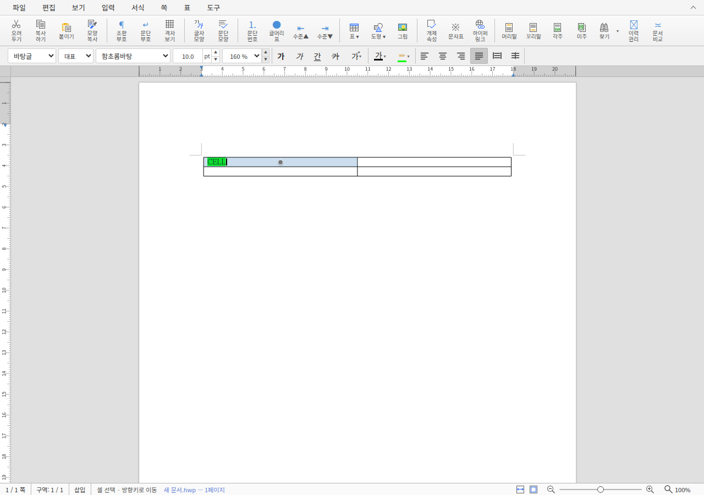

# PR #8379 연속 형광펜 검토 증적

검증일은 2026-11-02 KST다. 전체 판정과 source/base·제출 후보는
[검토 기록](../../archives/pr_8379_review.md)에 있다. 원 기여는 `34b51b7009`, 실제 최신 base는
`de2295d430`, 로컬 보정은 `8eb7b8aab9`, 원 source 위의 제출용 보정은 `e6439bd3ca`다.
실제 검증 tree와 제출 후보의 최신-base 병합 tree가 `c93a15af1757a7568f839a57c6c92ac183d83c53`로 같다.

## 재현 명령과 검사

검토 repository의 루트에서 공용 target으로 `scripts/wasm-pack-locked.sh --target web --out-dir pkg`를
실행했다. 최적화를 포함하며 기존 기본 workspace의 배포 bundle은 변경하지 않았다.
Studio의 lockfile로 `npm ci --ignore-scripts --no-audit --no-fund`를 수행했다.

```sh
cd rhwp-studio
./node_modules/.bin/tsc --noEmit
npm test
npm run build
# Chrome for Testing 155.0.8059.79, Linux headless, 신규 격리 browser
npm run e2e:continuous-highlighter
npm run e2e:issue-6635
```

브라우저 검증에는 `CHROME_PATH`와 `RHWP_WASM_BUILD_MANIFEST`를 실제 빌드 manifest 경로로
지정했다. 최종 제품 E2E는 현재 파일의 실제 F5·팔레트·Shift 선택과 WASM 속성·undo/redo를
검사한다. 검증 중 추가한 두 경계는 제품 보정 전 같은 최적화 package에서 실패했고, 보정 뒤
통과했다. 별도 HWP/HWPX/PDF 입력이나 한컴 Print·실루엣 측정은 사용하지 않았다.

## 파일

- [provenance.json](provenance.json): 원 head·base·실제 로컬 후보·최소 source 후보·tree 대조.
- [wasm-build-manifest.json](wasm-build-manifest.json): 최적화 빌드, JS/WASM 해시와 바이트 수.
- [wasm-consumption.json](wasm-consumption.json): 최종 초기 로딩 5세션의 실제 응답 대조. 제외한
  base 하네스의 잘못된 package 선택도 별도로 표시했다.
- [negative-control.json](negative-control.json): 보정 전 4개 assertion 실패와 원 검사 통과.
- [validation-summary.json](validation-summary.json): 최종 Studio 2,716 PASS·2 skip, E2E 34·64 PASS.
- [local-validation.json](local-validation.json), [browser-validation.json](browser-validation.json):
  명령·시각·실제 exit code.
- [base-boundaries.json](base-boundaries.json), [boundaries.json](boundaries.json): 같은 WASM으로
  기존 F5 계약 보존과 새 경계·양식 보호·문서 전환 상태를 실제 브라우저에서 조회했다.
- [ci-snapshot.json](ci-snapshot.json): 원 source head의 관찰 시점 CI. 보정 source의 CI가 아니다.
- [remote-action-plan.md](remote-action-plan.md): 승인 대기 중인 원격 순서와 게시 초안.

## 화면 직접 확인



선택 셀의 `CELL` 글자에 초록 배경이 적용되고 셀 블록 선택은 남는다. 형광펜 버튼은 연속 모드의
눌림 상태가 아니다. 실제 PNG를 열어 글자·초록 배경·셀 외곽과 UI를 확인했다.
이는 브라우저 서식·상태 증거이며 Native/fresh WASM의 독립 Print 피델리티 점수로 해석하지 않는다.

[원격 수행 증적](remote-integration.json)과 [GitHub Frontend 실행 확인](ci-frontend-confirmation.json)에 새 head의 실제 CI·정상 merge 결과를 보존했다.

[시간 메타데이터 결과](duration-result.json)는 workflow success·실측 자료 부족에 따른 정상 갱신 보류다.
