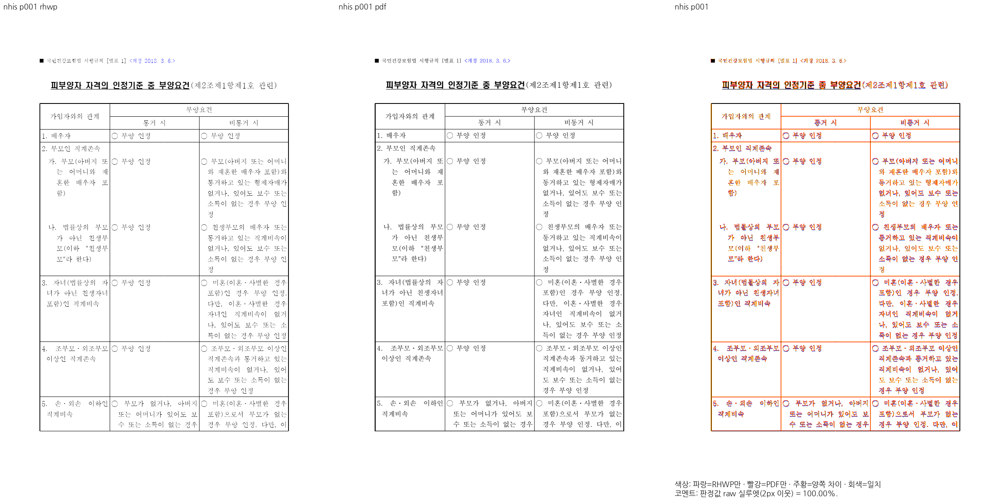
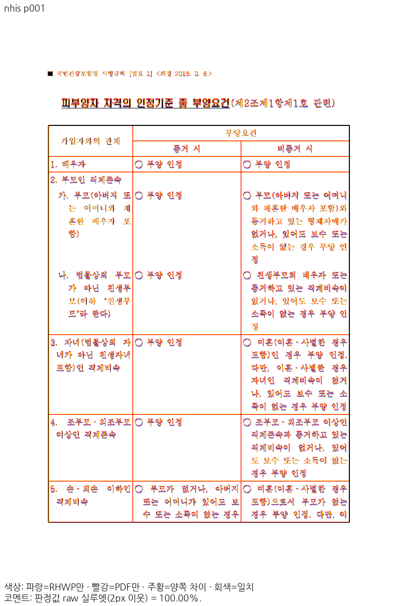
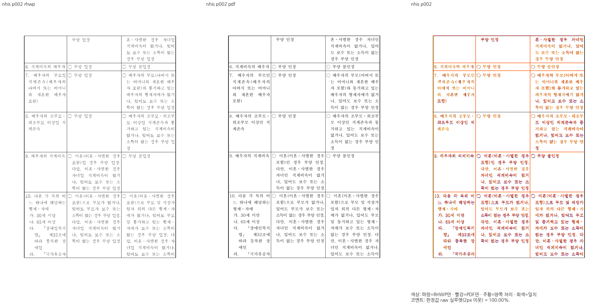
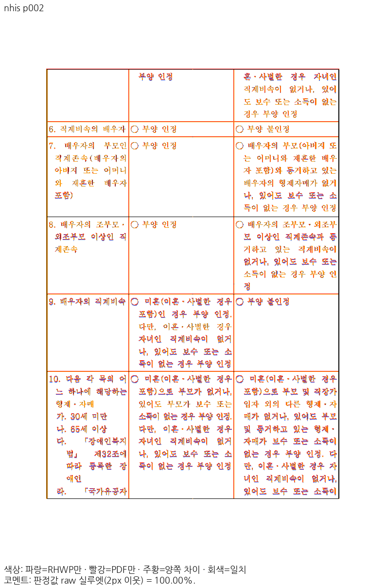
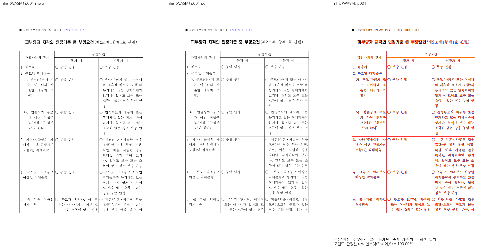
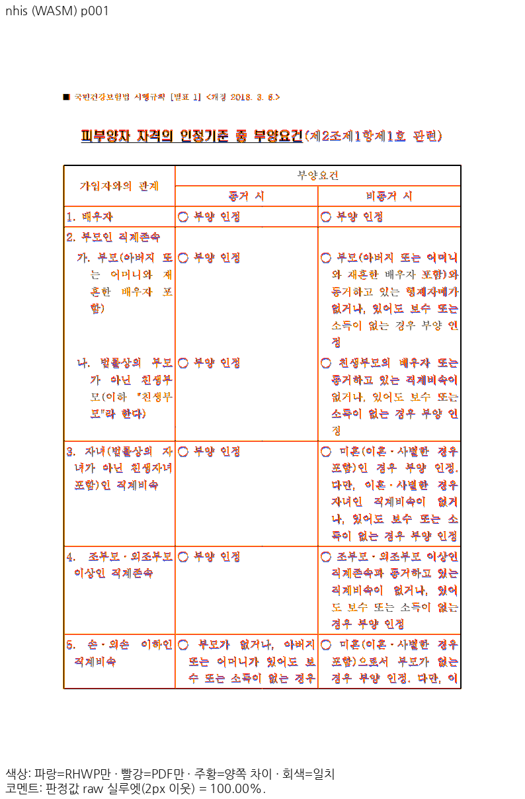
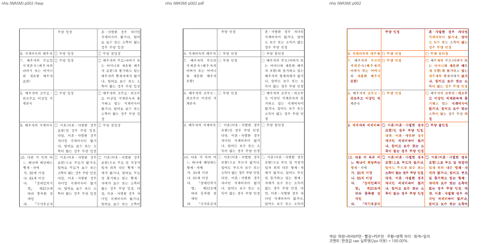
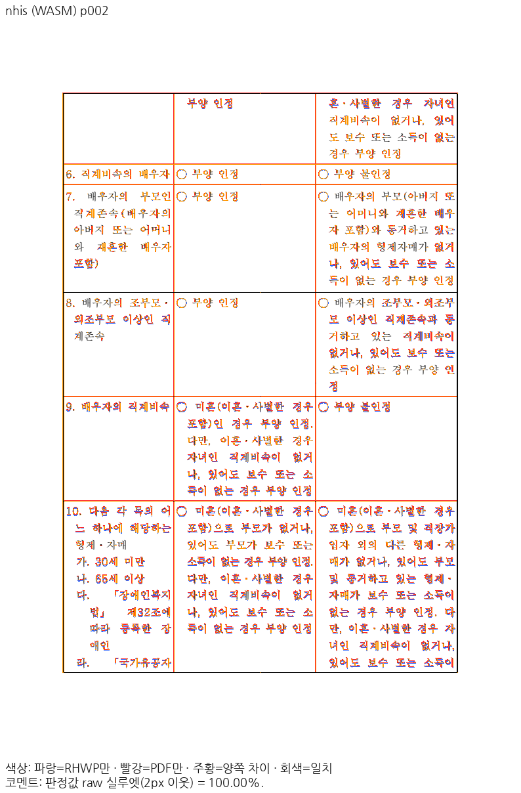

# PR #8542 독립 시각 검증
2026-11-05 KST. 사용자 자료를 수정하지 않은 공개 HWP와 대응 한컴 PDF를 비교했다.
## 실행과 출처

- 기준 devel: `ece9c3383bb2c73e0f055459ede727a9d3101ac6`.
- 원 PR head: `dc7553366f6c85035d510eaeb50eff2f25d83242`.
- 실제 병합 실행 source: `5df48e77e7fc249feb6eacda74263ed96375cd36`, src tree `ceaa7c40545ca8036c71c880b8d4a8c447435a4e`.
- 이후 회귀 주석·쪽수 원장·검토 문서 보강은 제품 source와 빌드 옵션을 바꾸지 않는다.
- Native Skia PNG / 최적화 fresh WASM Canvas2D, print, compat 2022, PDFium 96dpi, raw 2px 실루엣 `threshold_boundary_color_support_v1`.
- Rust 1.93.1, wasm-pack 0.15.0, Node 24.15.0, Chrome for Testing 155.0.8059.79, Linux x86_64.
- 공용 target `/home/edward/mygithub/rhwp/target/pr-review`, Cargo jobs 6, WASM release codegen-units 16.
- Docker Desktop의 마운트·hard-link는 확인했으나 준비된 검토 image의 Rust 1.93.0이 MSRV 1.93.1보다 낮아 호스트의 검증된 1.93.1 locked wrapper를 사용했다.
- 원본과 독립 PDF는 [fixture 출처](../../../../samples/issue8539/README.md)에 보존돼 있다. 기존 commit의 파일과 실제 입력이 동일하다.

- `samples/issue8539/nhis-dependent-requirements.hwp`: 17920 bytes, SHA-256 `53d7763a0e5c9860e62c8dc3b20cfb515aac6f6eceeeef01ff0fb1abbdfe8fef`.
- `samples/issue8539/nhis-dependent-requirements-2020.pdf`: 52093 bytes, SHA-256 `a54a96205d1916b44d98a71caf6114d47ddb34ebfa9f34263228f875e90e5da6`.

Native/WASM에 같은 H2MJSM·H2HDRM TTF를 명시적으로 공급했다. 로컬 Windows 설치본을 사용했으며 글꼴 바이너리는 배포하지 않는다.

- `/mnt/c/Windows/Fonts/H2HDRM.TTF`: SHA-256 `e50c7200521c3ea59840e5dd42e79708905a74a607f2300ed862fe2491caf831`.
- `/mnt/c/Windows/Fonts/H2MJSM.TTF`: SHA-256 `f78f538885b29f956cf84286e430898462d11430604625857ad587c0ea73925b`.
- 기준 Native `base-rhwp`: 87599584 bytes, SHA-256 `c562a94e669b0c17b87f007de57a4e23c365eac587ddf6fbf1d855757b15dd61`.
- 후보 Native `candidate-rhwp`: 87608384 bytes, SHA-256 `5cd4e2b7ae50d3c5bcb11c7668062ef9ac6f8cbcc0629b5a73cbf0e9d8597e89`.
- 기준 WASM `rhwp.js`: 535713 bytes, SHA-256 `8ad202184fcb970d908e338761e36863a1f7508806bd426be491bd3cc069a769`.
- 기준 WASM `rhwp_bg.wasm`: 28183812 bytes, SHA-256 `848fc0c8cdaebbcda9c490e6799ad983af6c17c61eb9209ce9efc39e7d54217c`.
- 후보 WASM `rhwp.js`: 535713 bytes, SHA-256 `8ad202184fcb970d908e338761e36863a1f7508806bd426be491bd3cc069a769`.
- 후보 WASM `rhwp_bg.wasm`: 28184385 bytes, SHA-256 `5e04063c3ef7cb0c8625e441afef34f5cdbbd10094ee161bd5675e3e2fb82093`.

## 원 사례의 전쪽 TSV 원문

TSV는 소수 둘째 자리로 표시한다. 후보 Native 원값은 전 3쪽 100.00000%, Canvas 원값은 100.00000 / 100.00000 / 99.99607%다. Canvas 3쪽은 raw 미대응 1px이며 경계 보정은 사용하지 않았다. 두 경로 모두 독립 PDF와 3=3쪽, 미달·누락·2%p 초과 하락 0건이다.

### 기준 Native

원본 TSV SHA-256 `16b0f2843e34ad1d9a1e69b8dfb84907af1013e327780a9f5d64ff2cbac747ad`, 166 bytes.

```tsv
page	tolerant_content_match_percent	below_90	silhouette_raw_match_percent	silhouette_boundary_reconciled_pixels
1	97.70	0	97.70	0
2	57.29	1	57.29	0
3	64.02	1	64.02	0
```

### 기준 WASM Canvas

원본 TSV SHA-256 `4c54ccfb1d61b8592dbb0a18b7258cb6f61a8db8ea45142a75d4c133e5836b3e`, 166 bytes.

```tsv
page	tolerant_content_match_percent	below_90	silhouette_raw_match_percent	silhouette_boundary_reconciled_pixels
1	97.74	0	97.74	0
2	57.34	1	57.34	0
3	64.10	1	64.10	0
```

### 후보 Native

원본 TSV SHA-256 `371cf5ea8358d027c470b21e0b8714a382cc0234194d53e1de889f530e9f09af`, 172 bytes.

```tsv
page	tolerant_content_match_percent	below_90	silhouette_raw_match_percent	silhouette_boundary_reconciled_pixels
1	100.00	0	100.00	0
2	100.00	0	100.00	0
3	100.00	0	100.00	0
```

### 후보 WASM Canvas

원본 TSV SHA-256 `371cf5ea8358d027c470b21e0b8714a382cc0234194d53e1de889f530e9f09af`, 172 bytes.

```tsv
page	tolerant_content_match_percent	below_90	silhouette_raw_match_percent	silhouette_boundary_reconciled_pixels
1	100.00	0	100.00	0
2	100.00	0	100.00	0
3	100.00	0	100.00	0
```

## 직접 판독과 대표 PNG

1·2·3쪽 Native와 Canvas의 review 패널을 독립 PDF와 직접 대조했다. 1쪽은 9행의 셋째 줄, 2쪽은 이어받은 첫 줄·6번 행·16행의 마지막 줄, 3쪽은 첫 줄과 마지막 「받은 사람」 및 표 하단을 확인했다. 각각 같은 쪽·칸에 있고 누락·중복·다음 행 겹침이 없다. 수식은 없는 원문이다. 표의 세로선·본문 기준선·글자 간격·문장 부호도 대조했다.

raw 실루엣은 글꼴 획·안티앨리어싱의 픽셀 완전 일치를 뜻하지 않는다. Native 평균 pixel match 95.65791%, 평균 ink/visual proxy 27.62819%; Canvas는 각각 95.55692%, 27.50601%다. 이번 수용 근거는 쪽 경계·본문 소유·내용 보존과 직접 판독이며, 이 proxy를 전체 fidelity 통과로 부르지 않는다.

















## 저장 경계 반례와 코퍼스

| 대조군 | 쪽수 | 페이지 컷·트리 | Native PNG | Canvas PNG |
| --- | ---: | --- | --- | --- |
| `samples/issue6549/16418295_square_rowbreak_table.hwp` | 2 | devel과 동일 | 전쪽 동일 | 전쪽 동일 |
| `samples/issue6929/148776468_search_ad_terms_press_release.hwp` | 17 | devel과 동일 | 전쪽 동일 | 전쪽 동일 |
| `samples/issue1853_caption_precedes_body_split.hwpx` | 52 | devel과 동일 | 전쪽 동일 | 전쪽 동일 |
| `samples/issue1937_rowbreak_footnote_overpagination.hwp` | 50 | devel과 동일 | 전쪽 동일 | 전쪽 동일 |
| `samples/issue5699/37787_regulatory_impact.hwp` | 47 | devel과 동일 | 전쪽 동일 | 전쪽 동일 |
| `samples/byeolpyo4.hwp` | 25 | devel과 동일 | 전쪽 동일 | 전쪽 동일 |

총 193쪽씩을 같은 조건에서 직접 export해 PNG SHA-256을 비교했다. 코퍼스 구조 비교는 공개 `samples/` HWP/HWPX 1,494개에 Native CLI `dump-pages --compat 2022 --json`을 기준/후보 각각 실행했다. 정상 열기 1,490개 중 1,489개는 전체 JSON이 같고 원 사례만 두 컷이 바뀌었다. 암호 입력이 필요한 3개와 대형 CellBreak 입력 1개(각 90초 timeout)는 양쪽에서 같은 실패였다. 이 4개를 정상 렌더 통과로 합산하지 않는다. 구조 무변화가 모든 문서의 독립 Print fidelity를 증명한다는 주장도 하지 않는다.

## 필수 편람 Native 383쪽

`visual_sweep.py --handbook-gate`를 같은 실행 후보의 Native 바이너리로 완료했다. 전체 383=383쪽, 최저 raw 99.96465%, 90% 미만·누락·#8389 페이지별 기준 하락 모두 0건이며 gate는 `passed`다. 첫 실행의 종료 코드 143은 통과로 세지 않고 동일 조건 `--resume`의 성공 결과를 사용했다. 이 경로는 Native 전쪽 품질 하한 검사이며 편람의 fresh WASM 전쪽 검사로 기재하지 않는다.

원본 TSV SHA-256 `d5006cd9110c1247282aa5627f1728d9c751c3212925204582b9b40f39900308`, 8428 bytes.

```tsv
page	tolerant_content_match_percent	below_90	silhouette_raw_match_percent	silhouette_boundary_reconciled_pixels
1	100.00	0	100.00	0
2	100.00	0	100.00	0
3	100.00	0	100.00	0
4	100.00	0	100.00	0
5	100.00	0	100.00	0
6	100.00	0	100.00	0
7	100.00	0	100.00	0
8	100.00	0	100.00	0
9	100.00	0	100.00	0
10	100.00	0	100.00	0
11	100.00	0	100.00	0
12	100.00	0	100.00	0
13	100.00	0	100.00	0
14	100.00	0	100.00	0
15	100.00	0	100.00	0
16	100.00	0	100.00	0
17	100.00	0	100.00	0
18	100.00	0	100.00	0
19	100.00	0	100.00	0
20	100.00	0	100.00	0
21	100.00	0	100.00	0
22	100.00	0	100.00	0
23	100.00	0	100.00	0
24	100.00	0	100.00	0
25	100.00	0	100.00	0
26	100.00	0	100.00	0
27	100.00	0	100.00	0
28	100.00	0	100.00	0
29	100.00	0	100.00	0
30	100.00	0	100.00	0
31	100.00	0	100.00	0
32	100.00	0	100.00	0
33	100.00	0	100.00	0
34	100.00	0	100.00	0
35	100.00	0	100.00	0
36	100.00	0	100.00	0
37	100.00	0	100.00	0
38	100.00	0	100.00	0
39	100.00	0	100.00	0
40	100.00	0	100.00	0
41	100.00	0	100.00	0
42	100.00	0	100.00	0
43	100.00	0	100.00	0
44	100.00	0	100.00	0
45	100.00	0	100.00	0
46	100.00	0	100.00	0
47	100.00	0	100.00	0
48	100.00	0	100.00	0
49	100.00	0	100.00	0
50	100.00	0	100.00	0
51	100.00	0	100.00	0
52	100.00	0	100.00	0
53	100.00	0	100.00	0
54	100.00	0	100.00	0
55	100.00	0	100.00	0
56	100.00	0	100.00	0
57	100.00	0	100.00	0
58	100.00	0	100.00	0
59	100.00	0	100.00	0
60	100.00	0	100.00	0
61	100.00	0	100.00	0
62	100.00	0	100.00	0
63	100.00	0	100.00	0
64	100.00	0	100.00	0
65	100.00	0	100.00	0
66	100.00	0	100.00	0
67	100.00	0	100.00	0
68	100.00	0	100.00	0
69	100.00	0	100.00	0
70	100.00	0	100.00	0
71	100.00	0	100.00	0
72	100.00	0	100.00	0
73	100.00	0	100.00	0
74	100.00	0	100.00	0
75	100.00	0	100.00	0
76	100.00	0	100.00	0
77	100.00	0	100.00	0
78	100.00	0	100.00	0
79	100.00	0	100.00	0
80	100.00	0	100.00	0
81	100.00	0	100.00	0
82	100.00	0	100.00	0
83	100.00	0	100.00	0
84	100.00	0	100.00	0
85	100.00	0	100.00	0
86	100.00	0	100.00	0
87	100.00	0	100.00	0
88	100.00	0	100.00	0
89	100.00	0	100.00	0
90	100.00	0	100.00	0
91	100.00	0	100.00	0
92	100.00	0	100.00	0
93	100.00	0	100.00	0
94	100.00	0	100.00	0
95	100.00	0	100.00	0
96	100.00	0	100.00	0
97	100.00	0	100.00	0
98	100.00	0	100.00	0
99	100.00	0	100.00	0
100	100.00	0	100.00	0
101	100.00	0	100.00	0
102	100.00	0	100.00	0
103	100.00	0	100.00	0
104	100.00	0	100.00	0
105	100.00	0	100.00	0
106	100.00	0	100.00	0
107	100.00	0	100.00	0
108	100.00	0	100.00	0
109	100.00	0	100.00	0
110	100.00	0	100.00	0
111	100.00	0	100.00	0
112	100.00	0	100.00	0
113	100.00	0	100.00	0
114	100.00	0	100.00	0
115	100.00	0	100.00	0
116	100.00	0	100.00	0
117	100.00	0	100.00	0
118	100.00	0	100.00	0
119	100.00	0	100.00	0
120	100.00	0	100.00	0
121	100.00	0	100.00	0
122	100.00	0	100.00	0
123	100.00	0	100.00	0
124	100.00	0	100.00	0
125	100.00	0	100.00	0
126	100.00	0	100.00	0
127	100.00	0	100.00	0
128	100.00	0	100.00	0
129	100.00	0	100.00	0
130	99.97	0	99.96	5
131	100.00	0	100.00	0
132	100.00	0	100.00	0
133	100.00	0	100.00	0
134	100.00	0	100.00	0
135	100.00	0	100.00	0
136	100.00	0	100.00	0
137	100.00	0	100.00	0
138	100.00	0	100.00	0
139	100.00	0	100.00	0
140	100.00	0	100.00	0
141	100.00	0	100.00	1
142	100.00	0	100.00	0
143	100.00	0	100.00	0
144	100.00	0	100.00	0
145	100.00	0	100.00	0
146	100.00	0	100.00	0
147	100.00	0	100.00	0
148	100.00	0	100.00	0
149	100.00	0	100.00	0
150	100.00	0	100.00	0
151	100.00	0	100.00	0
152	100.00	0	100.00	0
153	100.00	0	100.00	0
154	100.00	0	100.00	0
155	100.00	0	100.00	0
156	100.00	0	100.00	0
157	100.00	0	100.00	0
158	100.00	0	100.00	0
159	100.00	0	100.00	0
160	100.00	0	100.00	0
161	100.00	0	100.00	0
162	100.00	0	100.00	0
163	100.00	0	100.00	0
164	100.00	0	100.00	0
165	100.00	0	100.00	0
166	100.00	0	100.00	0
167	100.00	0	100.00	0
168	100.00	0	100.00	0
169	100.00	0	100.00	0
170	100.00	0	100.00	0
171	100.00	0	100.00	0
172	100.00	0	100.00	0
173	100.00	0	100.00	0
174	100.00	0	100.00	0
175	100.00	0	100.00	0
176	100.00	0	100.00	0
177	100.00	0	100.00	0
178	100.00	0	100.00	0
179	100.00	0	100.00	0
180	100.00	0	100.00	0
181	100.00	0	100.00	0
182	100.00	0	100.00	0
183	100.00	0	100.00	0
184	100.00	0	100.00	0
185	100.00	0	100.00	0
186	100.00	0	100.00	0
187	100.00	0	100.00	0
188	100.00	0	100.00	0
189	100.00	0	100.00	0
190	100.00	0	100.00	0
191	100.00	0	100.00	0
192	100.00	0	100.00	0
193	100.00	0	100.00	0
194	100.00	0	100.00	0
195	100.00	0	100.00	0
196	100.00	0	100.00	0
197	100.00	0	100.00	0
198	100.00	0	100.00	0
199	100.00	0	100.00	0
200	100.00	0	100.00	0
201	100.00	0	100.00	0
202	100.00	0	100.00	0
203	100.00	0	100.00	0
204	100.00	0	100.00	0
205	100.00	0	100.00	0
206	100.00	0	100.00	0
207	100.00	0	100.00	0
208	100.00	0	100.00	0
209	100.00	0	100.00	0
210	100.00	0	100.00	0
211	100.00	0	100.00	0
212	100.00	0	100.00	0
213	100.00	0	100.00	0
214	100.00	0	100.00	0
215	100.00	0	100.00	0
216	100.00	0	100.00	0
217	100.00	0	100.00	0
218	100.00	0	100.00	0
219	100.00	0	100.00	0
220	100.00	0	100.00	0
221	100.00	0	100.00	0
222	100.00	0	100.00	0
223	100.00	0	100.00	0
224	100.00	0	100.00	0
225	100.00	0	100.00	0
226	100.00	0	100.00	0
227	100.00	0	100.00	0
228	100.00	0	100.00	0
229	100.00	0	100.00	0
230	100.00	0	100.00	0
231	100.00	0	100.00	0
232	100.00	0	100.00	0
233	100.00	0	100.00	0
234	100.00	0	100.00	0
235	100.00	0	100.00	0
236	100.00	0	100.00	0
237	100.00	0	100.00	0
238	100.00	0	100.00	0
239	100.00	0	100.00	0
240	100.00	0	100.00	0
241	100.00	0	100.00	0
242	100.00	0	100.00	0
243	100.00	0	100.00	0
244	100.00	0	100.00	0
245	100.00	0	100.00	0
246	100.00	0	100.00	0
247	100.00	0	100.00	0
248	100.00	0	100.00	0
249	100.00	0	100.00	0
250	100.00	0	100.00	0
251	100.00	0	100.00	0
252	100.00	0	100.00	0
253	100.00	0	100.00	0
254	100.00	0	100.00	0
255	100.00	0	100.00	0
256	100.00	0	100.00	0
257	100.00	0	100.00	0
258	100.00	0	100.00	0
259	100.00	0	100.00	0
260	100.00	0	100.00	0
261	100.00	0	100.00	0
262	100.00	0	100.00	0
263	100.00	0	100.00	0
264	100.00	0	100.00	0
265	100.00	0	100.00	0
266	100.00	0	100.00	0
267	100.00	0	100.00	0
268	100.00	0	100.00	0
269	100.00	0	100.00	0
270	100.00	0	100.00	0
271	100.00	0	100.00	0
272	100.00	0	100.00	0
273	100.00	0	100.00	0
274	100.00	0	100.00	0
275	100.00	0	100.00	0
276	100.00	0	100.00	0
277	100.00	0	100.00	0
278	100.00	0	100.00	0
279	100.00	0	100.00	0
280	100.00	0	100.00	0
281	100.00	0	100.00	0
282	100.00	0	100.00	0
283	100.00	0	100.00	0
284	100.00	0	100.00	0
285	100.00	0	100.00	0
286	100.00	0	100.00	0
287	100.00	0	100.00	0
288	100.00	0	100.00	0
289	100.00	0	100.00	0
290	100.00	0	100.00	0
291	100.00	0	100.00	0
292	100.00	0	100.00	0
293	100.00	0	100.00	0
294	100.00	0	100.00	0
295	100.00	0	100.00	0
296	100.00	0	100.00	0
297	100.00	0	100.00	0
298	100.00	0	100.00	0
299	100.00	0	100.00	0
300	100.00	0	100.00	0
301	100.00	0	100.00	0
302	100.00	0	100.00	0
303	100.00	0	100.00	0
304	100.00	0	100.00	0
305	100.00	0	100.00	0
306	100.00	0	100.00	0
307	100.00	0	100.00	0
308	100.00	0	100.00	0
309	100.00	0	100.00	0
310	100.00	0	100.00	0
311	100.00	0	100.00	0
312	100.00	0	100.00	0
313	100.00	0	100.00	0
314	100.00	0	100.00	0
315	100.00	0	100.00	0
316	100.00	0	100.00	0
317	100.00	0	100.00	0
318	100.00	0	100.00	0
319	100.00	0	100.00	0
320	100.00	0	100.00	0
321	100.00	0	100.00	0
322	100.00	0	100.00	0
323	100.00	0	100.00	0
324	100.00	0	100.00	0
325	100.00	0	100.00	0
326	100.00	0	100.00	0
327	100.00	0	100.00	0
328	100.00	0	100.00	0
329	100.00	0	100.00	0
330	100.00	0	100.00	0
331	100.00	0	100.00	0
332	100.00	0	100.00	0
333	100.00	0	100.00	0
334	100.00	0	100.00	0
335	100.00	0	100.00	0
336	100.00	0	100.00	0
337	100.00	0	100.00	0
338	100.00	0	100.00	0
339	100.00	0	100.00	0
340	100.00	0	100.00	0
341	100.00	0	100.00	0
342	100.00	0	100.00	0
343	100.00	0	100.00	0
344	100.00	0	100.00	0
345	100.00	0	100.00	0
346	100.00	0	100.00	0
347	100.00	0	100.00	0
348	100.00	0	100.00	0
349	100.00	0	100.00	0
350	100.00	0	100.00	0
351	100.00	0	100.00	0
352	100.00	0	100.00	0
353	100.00	0	100.00	0
354	100.00	0	100.00	0
355	100.00	0	100.00	0
356	100.00	0	100.00	0
357	100.00	0	100.00	0
358	100.00	0	100.00	0
359	100.00	0	100.00	0
360	100.00	0	100.00	0
361	100.00	0	100.00	0
362	100.00	0	100.00	0
363	100.00	0	100.00	0
364	100.00	0	100.00	0
365	100.00	0	100.00	0
366	100.00	0	100.00	0
367	100.00	0	100.00	0
368	100.00	0	100.00	0
369	100.00	0	100.00	0
370	100.00	0	100.00	0
371	100.00	0	100.00	0
372	100.00	0	100.00	0
373	100.00	0	100.00	0
374	100.00	0	100.00	0
375	100.00	0	100.00	0
376	100.00	0	100.00	0
377	100.00	0	100.00	0
378	100.00	0	100.00	0
379	100.00	0	100.00	0
380	100.00	0	100.00	0
381	100.00	0	100.00	0
382	100.00	0	100.00	0
383	100.00	0	100.00	0
```

## 실제 명령과 중단 처리

```sh
# 기준은 기본 작업공간, 후보는 review/pr-8542-rowbreak-stored-restart worktree에서 실행
CARGO_TARGET_DIR=/home/edward/mygithub/rhwp/target/pr-review CARGO_BUILD_JOBS=6 cargo build --locked --profile release-test --features native-skia --bin rhwp
CARGO_TARGET_DIR=/home/edward/mygithub/rhwp/target/pr-review CARGO_BUILD_JOBS=6 CARGO_PROFILE_RELEASE_CODEGEN_UNITS=16 cargo build --locked --release --lib --target wasm32-unknown-unknown
CARGO_TARGET_DIR=/home/edward/mygithub/rhwp/target/pr-review CARGO_BUILD_JOBS=6 CARGO_PROFILE_RELEASE_CODEGEN_UNITS=16 scripts/wasm-pack-locked.sh --target web --out-dir <기준 또는 후보 pkg 경로>
visual_sweep.py --silhouette-only --hwp samples/issue8539/nhis-dependent-requirements.hwp --pdf samples/issue8539/nhis-dependent-requirements-2020.pdf --key nhis --rhwp-bin <해당 Native> --font-path <H2MJSM·H2HDRM 공급 디렉터리> --compat 2022 --dpi 96 --out <Native 출력>
# Canvas에는 같은 명령에 --wasm-pkg <해당 최적화 pkg> 추가; 직접 판독은 --silhouette-only 없이 실행
visual_sweep.py --handbook-gate --rhwp-bin <후보 Native> --out <handbook 출력> --resume
```

기준 WASM 첫 최적화 실행도 종료 코드 143으로 중단됐다. 미완료 package를 검증에 사용하지 않았고 locked wrapper를 다시 실행해 최적화 포함 성공을 확인했다. 후보는 compile과 locked packaging을 순차로 완료했다. 모든 Cargo 작업은 같은 target에서 순차 실행했다. 중간 로그·JSON·일반 raster는 ignored output에만 두며 종료 정리 대상이다. 후속 회귀·lint 결과와 제출 후보는 [검토 문서](../../archives/pr_8542_review.md)에 기록한다.

## SVG 소비 경로 보충

원 이슈의 SVG API 경로도 같은 소스·입력·독립 PDF·TTF·96dpi·print·compat 2022로 확인했다. `--rasterizer svg --embed-fonts=full`을 추가했으며 Native/최적화 WASM의 전 3쪽 raw는 각각 100.00000 / 100.00000 / 99.99639%다(3쪽 raw 미대응 1px, TSV 표시는 100.00%). SVG 결과를 앞의 직접 Native PNG·Canvas 검증으로 대신하지 않았다.

### Native SVG

TSV SHA-256 `371cf5ea8358d027c470b21e0b8714a382cc0234194d53e1de889f530e9f09af`.

```tsv
page	tolerant_content_match_percent	below_90	silhouette_raw_match_percent	silhouette_boundary_reconciled_pixels
1	100.00	0	100.00	0
2	100.00	0	100.00	0
3	100.00	0	100.00	0
```

### fresh WASM SVG

TSV SHA-256 `371cf5ea8358d027c470b21e0b8714a382cc0234194d53e1de889f530e9f09af`.

```tsv
page	tolerant_content_match_percent	below_90	silhouette_raw_match_percent	silhouette_boundary_reconciled_pixels
1	100.00	0	100.00	0
2	100.00	0	100.00	0
3	100.00	0	100.00	0
```


## 최종 code/data 검증과 source 동일성

`790ef21567d041fe272253673fa63fb1ce7809df`에서 14개 필수 gate가 모두 성공했다. 전체 nextest 12,640 PASS/45 skipped, Native lib 4,040 PASS/12 ignored·placeholder 2 PASS·직접 PDF 22 PASS다. 신규 원본 1개를 명시한 보안 계약 6개와 기존 SVG snapshot 4개는 전체 회귀에서 실제 PASS다. 새 회귀 3개는 최소 글꼴 환경에서도 별도로 통과했다.

`git show`로 원본/PDF의 Git blob과 실제 사용 파일이 같음을 확인했다. 원 기여의 회귀 파일에서 `//!` 모듈 주석을 제외한 source는 보강 뒤에도 바이트가 같아 assertion을 바꾸지 않았음을 확인했다. 제품 src tree는 빌드/시각 측정 때와 같은 `ceaa7c40545ca8036c71c880b8d4a8c447435a4e`다. Cargo.lock과 build.rs 및 crate/vendor 제품 source도 바꾸지 않았다. 실제 단계·소요·노출 글꼴·필터와 기존 ignored의 구분은 검토 문서에 기록했다.
