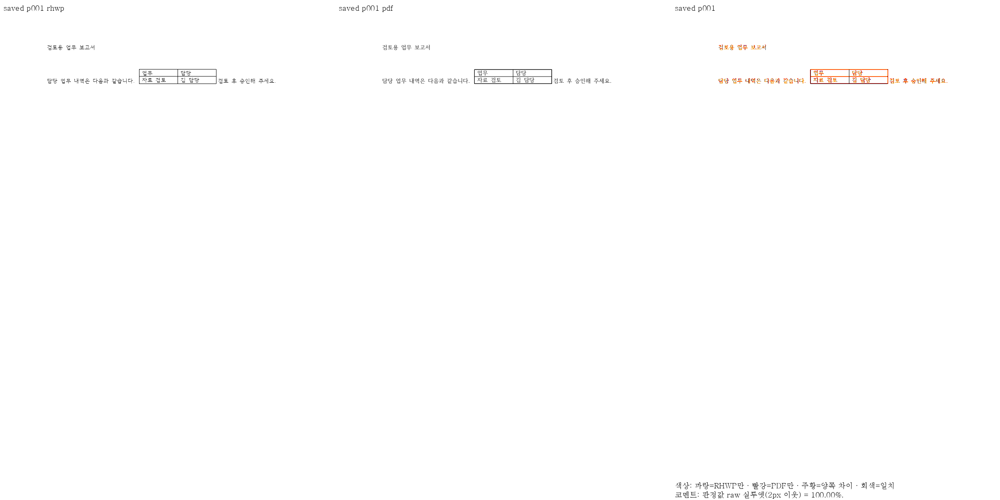
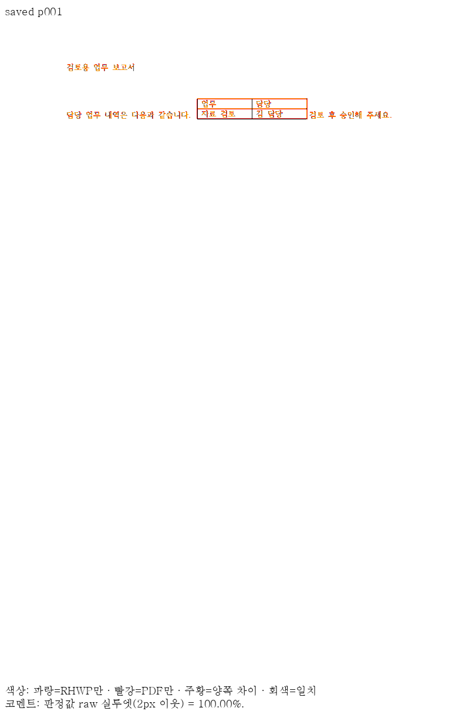
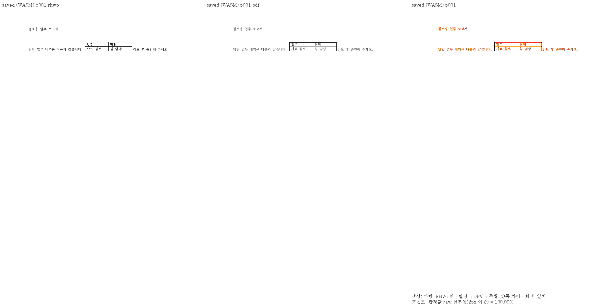
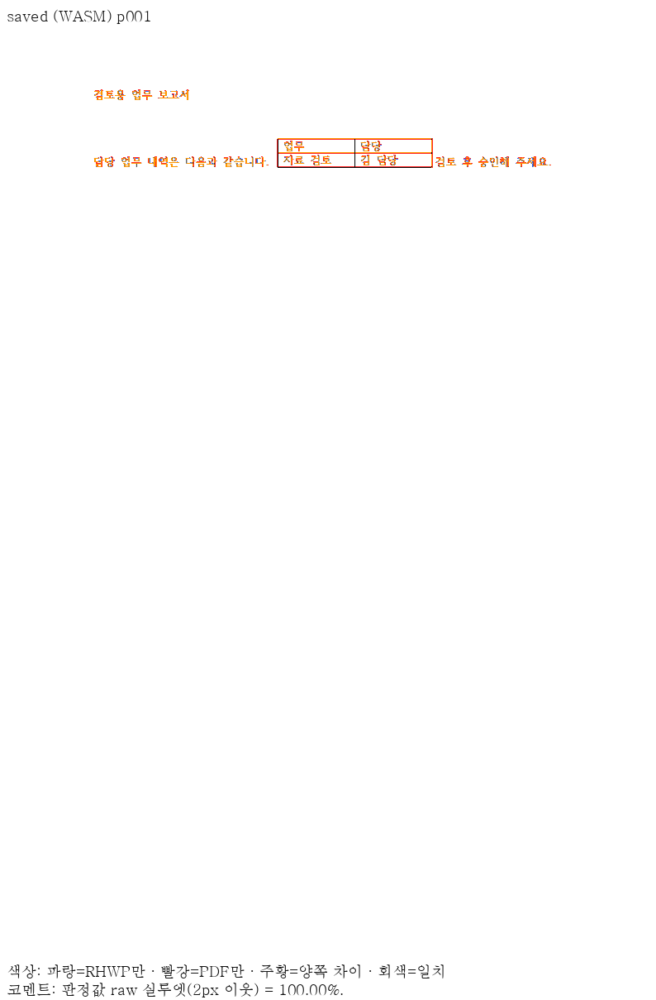

메인테이너 self-review 결과, 수용합니다.

검토 head는 `cbe5a6f4dfbc2775913af10ee42098137b27e088`입니다. 선행 정의를 삽입하는 adapter와 writer가 공통 `insert_leading_definition`을 소비하며, 요청 Storage의 reserve를 완료한 뒤 제어 스트림 좌표·field 소유 index·병렬 records를 함께 변경하는 것을 확인했습니다. writer는 복제 문단을 수정하므로 원 IR을 보존합니다. 본문 밖 머리말·꼬리말 정의는 기존 공통 표·글줄 plan을 막지 않게 했고, 컷·이어받기·backend별 배치 규칙은 바꾸지 않았습니다.

원 기여와 협업자의 6개 source commit을 보존했습니다. 메인테이너 추가 수정은 회귀 파일 첫머리의 측정 근거 주석과 검토 증거입니다. 전체 회귀 12,782건·Native 공식 4,064건은 `4e5a8d1565`에서 통과했습니다. 기록 정정 `929f0f5ca5`에서는 제품 코드·테스트 본문·기대값의 동등성을 확인하고 Rust lint·정책·영향 focused 4건을 다시 통과했습니다. 제출 head까지 이후 변경은 mydocs입니다.

최신 devel의 그림 편집 대조군 13쪽은 Native/fresh WASM 각각 최저 98.63%·98.53%이며 base와 후보 PNG 26쌍이 같습니다. 실제 셀 편집·저장 재열기와 편람 383쪽 후퇴 0도 확인했습니다. CLI 엄격 `--verify`의 기존 무효 LineSeg 제거 진단은 양쪽에 같으며 성공으로 세지 않았습니다. 실제 내용·저장·재열기와 `--verify-pages`는 별도로 통과했습니다.

같은 제출 head의 [CI](https://github.com/edwardkim/rhwp/actions/runs/42327643464) Archive A–E 실제 12,588 passed·기존 45 skipped, Lint·Native·Frontend·[CodeQL](https://github.com/edwardkim/rhwp/actions/runs/42327643465)·[Render Diff](https://github.com/edwardkim/rhwp/actions/runs/42327643448)·Adapter·Proptest가 모두 성공했습니다. [최종 정책 감사](https://github.com/edwardkim/rhwp/actions/runs/42330675981)도 success입니다. 현재 base `13775409e57a9550cfb31866d40bdf319ab54bac`와 clean merge-tree `adf85e7bed4899fdb69033b90e8da977ba3ba5e5`를 확인했고 PR은 MERGEABLE/CLEAN입니다. 공개 CodeQL 경고는 0건이며 보안 분류·검사 설정·workflow는 변경하지 않았습니다.

문서 비교는 [Visual Sweep 정본](https://github.com/edwardkim/rhwp/blob/devel/mydocs/manual/verification/visual_sweep_guide.md#github-merge-comment)을 따랐습니다. 직접 판독에서 머리말·표 셀과 표 앞뒤 문장의 순서·내용 및 잘림 해소를 확인했습니다. 후보 문서는 1쪽, flagged 0쪽이며 raw 100.00%는 2px 실루엣 지표로 픽셀 완전 일치나 사람의 판정 정확도를 뜻하지 않습니다. 글리프 농도·래스터 가장자리 차이는 남습니다. Native pixel match는 99.66377%이고 `visual_accuracy_proxy_percent`는 29.04142%, fresh WASM은 각각 99.62015%·21.63350%입니다. 이 낮은 자동 잉크 일치율도 확대 판독했으며 사람의 판정 정확도로 표시하지 않습니다. [검토 증거](https://github.com/edwardkim/rhwp/blob/cbe5a6f4dfbc2775913af10ee42098137b27e088/mydocs/pr/assets/pr8711/README.md)

