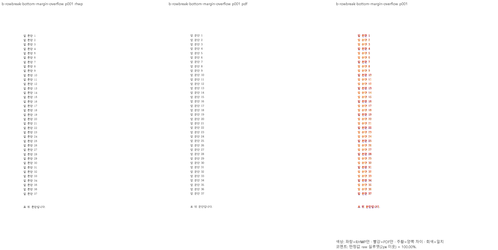
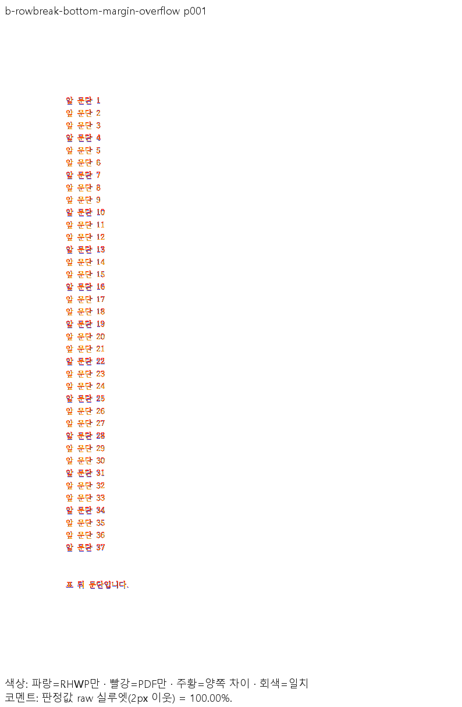
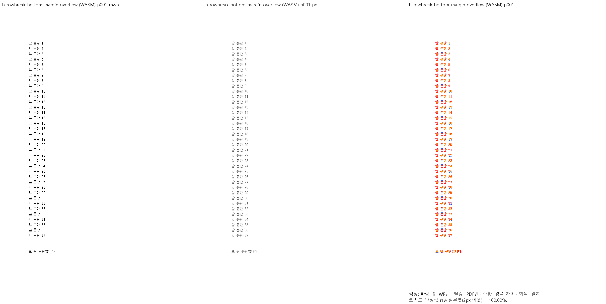
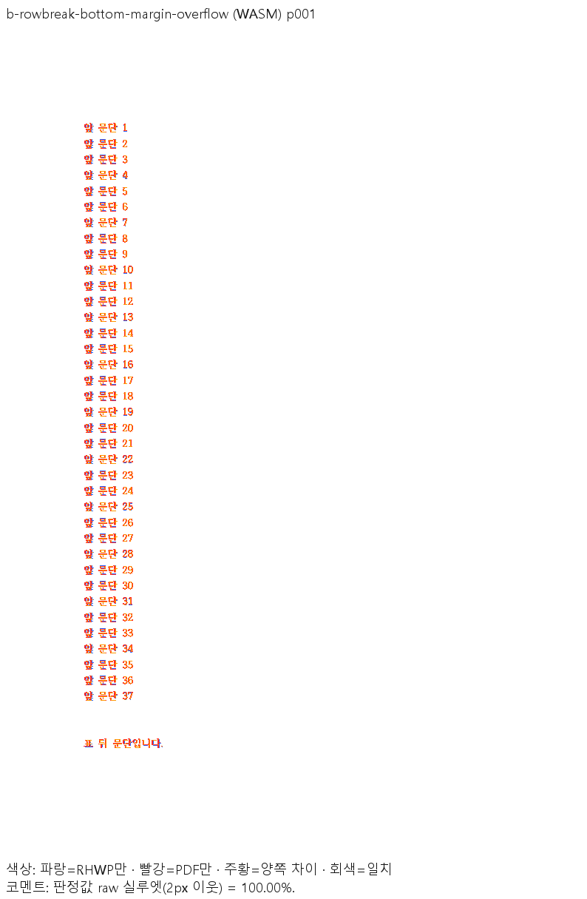
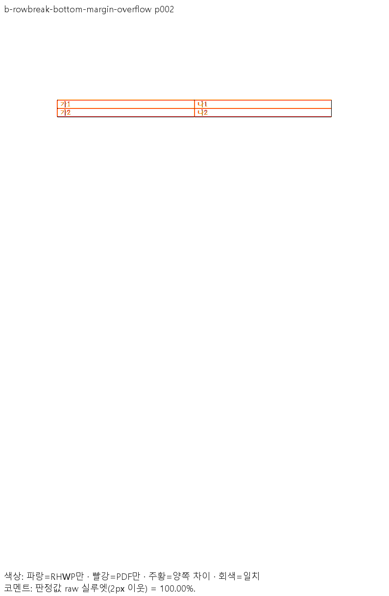
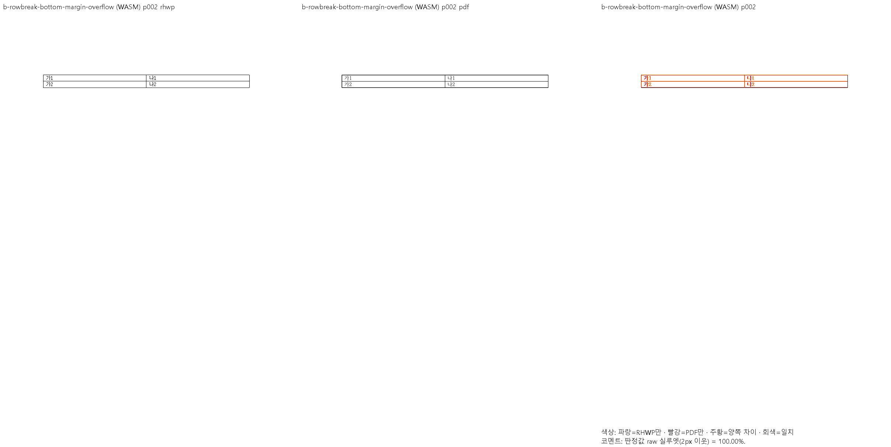
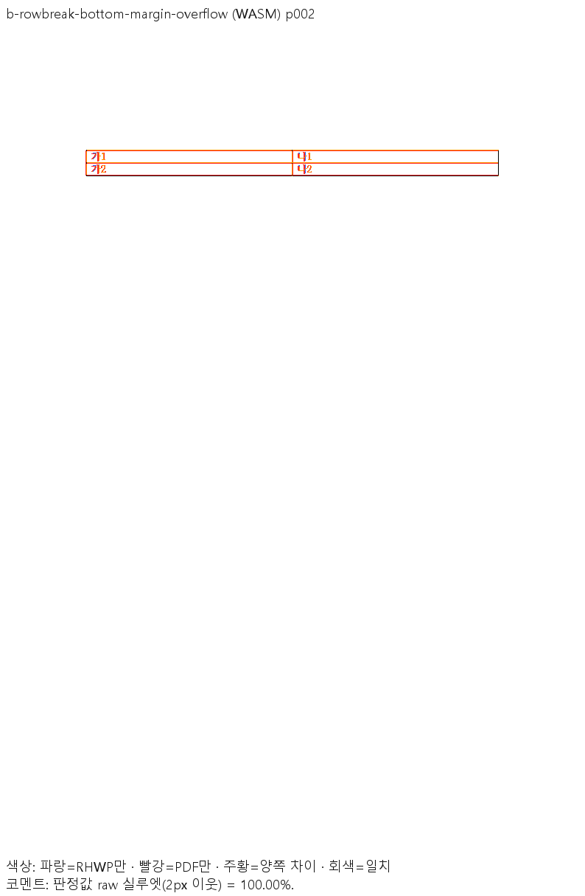

원 head `06f47c8a518f542a80d38e5a398ed73fed7dcc64`의 검토를 완료해 승인합니다.

첫 조각 예약과 실제 이월·점유 소비 경로를 확인했고, 최신 devel에서도 재현되는 b 사례가 개선됐습니다.
독립 메인테이너 검증에서 b 1·2쪽 Native/fresh 최적화 WASM raw는 각각 100.00%입니다.
최소 글꼴 집중 회귀 14건·필수 HWPX Native 편람 383쪽과 원 head의 녹색 CI를 확인했습니다.
보호 문서의 현재 devel/후보 PNG 3,542쌍은 모두 같습니다. 과거 보호값 미재현 911행은
메인테이너의 이번 PR 한정 수용 결정으로 구분하며 보호 기준 자체는 변경하지 않습니다.

문서 비교는 [Visual Sweep 정본](https://github.com/edwardkim/rhwp/blob/devel/mydocs/manual/verification/visual_sweep_guide.md#github-merge-comment)을 따랐습니다.
위 수치는 색상 경계 보정 전 2px 실루엣 자동 보조값이며, RGB 전체 동등성이나 사람의 판정 정확도를 뜻하지 않습니다.
표와 뒤 본문의 쪽 소속·분할 경계를 독립 Print와 직접 대조했습니다.

아래 이미지는 같은 b 원본·독립 PDF에 대응하는 **원 PR 제출 증적**이며 위 원 head에 고정했습니다.
메인테이너가 별도로 실행한 검증·전쪽 TSV와 원 PR 제출 이미지의 출처를 구분합니다.

b 1쪽 — Native·fresh WASM review / overlay

b 2쪽 — Native·fresh WASM review / overlay

[#7620](https://github.com/edwardkim/rhwp/issues/7620)의 바닥 예산에 대한 부분 개선으로 수용합니다. footer·CellBreak 등 남은 범위는 해결했다고 표시하지 않으며 이슈는 OPEN을 유지합니다.
