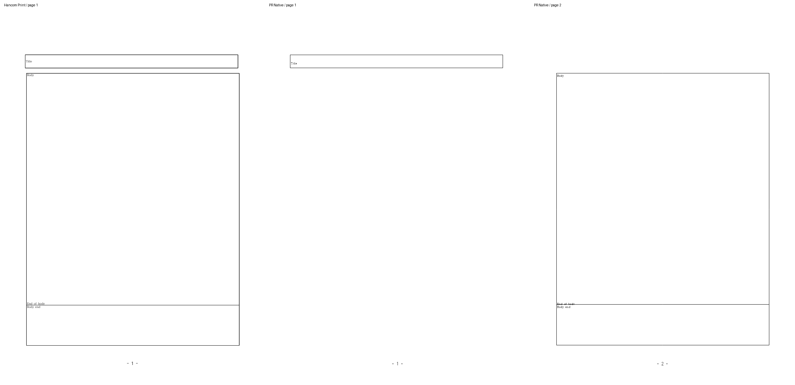

# PR #9042 독립 검토 증거

현재 제품의 전쪽·반복 저장·보호 검증은 [최종 원장](final-validation/README.md)을 따른다.
아래는 접수 시점의 수정 전 증거다. 초기 WASM의 실제 글꼴 공급 설명은
[저장 줄 추적 기록](source-line-cache/README.md#글꼴-공급과-직접-판독)에서 정정했다.

2026-11-13 검토. 제품 source는 원 head `3ae4eeb332c3b0edbb3a8fbe334daf2b0a48115b`를
devel `00d09f773a2f6c21604a4e6394df7152bbb26e8c`에 적용한 `637410dbfa8deb060d1c8739b0bf5e7ae8286c89`다.
[상위 검토](../../archives/pr_9042_review.md)와 [실제 해시·producer·독립 작업](evidence.json)을 따른다.
측정은 Native Skia Print, 96 DPI, compat 2022다. **접수·경계 조사 자료이며 최종 수용 검증 완료 자료가 아니다.**

## 입력·기준 PDF의 출처

| 입력 | 생성 | 독립 기준 |
| --- | --- | --- |
| [원 공개 HWP](../coanchored-table-pagination/float-pagination.hwp) | 기여자가 RHWP 빈 문서에서 생성한 합성 입력. 본문 중첩 표 없음 | [원 Mac Viewer Print](../../../../pdf/coanchored-table-pagination/float-pagination-hancom-mac-viewer-12.31.9-print.pdf), Viewer 12.31.9(6544), macOS 27.0.1, 2쪽 |
| [무변경 직렬화](../../../../samples/pr9042/metadata-unchanged.hwp) | 아래 생성기의 unchanged, export_hwp_native 후 재열기 | [한컴 2020 Print](../../../../pdf/pr9042/metadata-unchanged-hwp-2020.pdf), 2쪽 |
| [빈 머리말](../../../../samples/pr9042/metadata-empty-header.hwp) | 같은 원본에 빈 문단 1개를 가진 Header 추가, char_count·control records 갱신, 저장·재열기 | [한컴 2020 Print](../../../../pdf/pr9042/metadata-empty-header-hwp-2020.pdf), 2쪽 |
| [빈 꼬리말](../../../../samples/pr9042/metadata-empty-footer.hwp) | 같은 방식으로 Footer 추가 | [한컴 2020 Print](../../../../pdf/pr9042/metadata-empty-footer-hwp-2020.pdf), 2쪽 |
| [한컴 재저장 HWP](../../../../samples/pr9042/pr9042-hancom-saved.hwp) | 원 합성 HWP를 실제 한컴 2020 SaveAs | [해당 저장본의 Print](../../../../pdf/pr9042/pr9042-hancom-saved-hwp-2020.pdf), 2쪽 |

Windows 기준은 hwp-convert MCP의 engine 2020, 실제 한컴 `11.0.0.9136`,
`pdf_print_method=0`, `hancom2020_pdf_driver_one_up`이다. 각 작업은 terminal succeeded와 result success를 확인했다.
인증 정보·서버 주소·중간 응답은 커밋하지 않았다. 공개 합성 파일만 사용했고 비공개 업무 문서는 사용하지 않았다.

합성 원본에는 `RhwpLineSegTags`가 있고 실제 한컴 재저장본에는 없다.
입력 metadata의 한컴 제품 문자열을 생성 경로 증거로 승격하지 않는다.
재저장본은 devel과 후보가 이미 같은 2쪽이며 두 Native PNG도 바이트가 같다.

## 측정·직접 판독

- [원 입력 Native 전 2쪽 TSV](original-native.tsv): 94.20%, 96.08%.
- [한컴 재저장본 Native 전 2쪽 TSV](hancom-saved-native.tsv): 100.00%, 100.00%.
- [빈 머리말 1쪽 부분 TSV](empty-header-p001-native-partial.tsv): 26.64%.
  Native 전체 3쪽, 독립 PDF 2쪽 불일치로 sweep이 종료했으므로 **전쪽 TSV가 아니다**.
- 빈 머리말·꼬리말·무변경 직렬화의 독립 Print 3종은 96 DPI RGB가 전 2쪽 모두 같다.
  해시를 evidence.json에 기록했다. 빈 비본문 제어의 본문 배치 불변을 확인한 근거다.
- 실제 글꼴 공급은 함초롬돋움→HCRDotum, 함초롬바탕→HCRBatang이다. font program SHA·source URL과
  미공급·fallback 없음은 evidence.json을 따른다. 글꼴 파일은 추가하지 않았다.



위 이미지는 원본 96 DPI 캡처 세 장을 크기·내용 변경 없이 가로로 놓고 위에 영어 라벨만 더했다.
왼쪽 독립 Print 1쪽과 달리 가운데 후보 1쪽에는 본문이 없다. 본문은 오른쪽 후보 2쪽,
`Next page`는 [후보 3쪽](empty-header-native-p003.png)에 있다. 본문 손실이 아니라 잘못된 이월이다.
각 원본 PNG도 보존했다.

원 입력의 [Mac Print 1쪽](original-mac-print-p001.png)과 [후보 1쪽](original-native-p001.png)은
제목 기준선·본문 끝 괘선 부근에서 차이가 있다. base 본문과 후보 본문의 geometry는 같다.
새 악화로 단정하거나 글꼴 원인·수용 예외로 확정하지 않았다.
[한컴 재저장본의 후보 1쪽](hancom-saved-native-p001.png)은 별도 정상 대조군이다.

## 재현·한계

```bash
CARGO_BUILD_JOBS=8 cargo build --locked --profile release-test \
  --features native-skia --bin rhwp --target-dir "$PWD/target/pr-review"

venv/bin/python scripts/visual_sweep.py \
  --hwp mydocs/pr/assets/coanchored-table-pagination/float-pagination.hwp \
  --pdf pdf/coanchored-table-pagination/float-pagination-hancom-mac-viewer-12.31.9-print.pdf \
  --out output/pr-review/pr9042/candidate-native-sweep \
  --rhwp-bin output/pr-review/pr9042/candidate-rhwp \
  --dpi 96 --compat 2022 --silhouette-only
```

producer binary는 빌드 직후 base/후보별로 고정해 해시를 기록했다.
진단 생성 source는 [metadata-probe.rs.txt](metadata-probe.rs.txt)이며 후보 라이브러리에 연결해 실행했다.
자동 수집 회귀로 등록하지 않았다. ignored output에 생성한 뒤 독립 기준 확보 후 samples와 pdf에 복사했다.
원 회귀는 최소 글꼴 환경에서 1건 통과했으며 최종 fresh WASM·전체 필수 게이트는 미실행이다.
[공통 판정 보정 초안](proposed-header-footer.patch)은 적용 가능성만 확인한 미적용 patch다.
