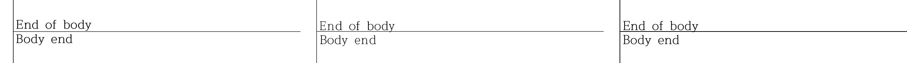

# 원 합성본의 저장 줄 캐시 보완

메인테이너는 2026-11-13 기존 차이 예외 대신 원 합성본의 저장 줄 처리까지 보완하도록 결정했다.
최종 제품 `d66d5f05f9efa4d182228494cd970614d479fb7a`의 원본·정상 한컴 저장본·Header/Footer·중첩 대조군
8종 전 16쪽은 Native/fresh 최적화 WASM 모두 raw 100.00%다.
[현재 전쪽 원장](../final-validation/README.md)과 [실제 편집·반복 저장](../final-validation/live-edit/README.md)을 따른다.
전체 필수 게이트의 종료 판정은 상위 검토 문서에 기록한다.

## 원인과 독립 근거

원 HWP는 RHWP에서 생성한 공개 합성 입력이다. 대상 글자의 `CharShape 0.base_size`는 650 HU지만,
저장 줄은 Title 1900/1615 HU, End of body 1100/935 HU의 글자 높이/기준선을 가진다.
실제 한컴 SaveAs는 두 줄을 650/553 HU로 다시 계산한다.
[파싱·독립 저장본의 값](source-baseline-diagnosis.txt), [수정 전 본문 트리](base-candidate-body-geometry.json).
본문의 고정 간격은 3114 HU 저장값의 절반인 1557 HU인데 옛 줄 사다리는 약 1539~1540 HU씩 전진했다.
줄 높이·기준선·전체 셀의 누적 원점을 함께 고쳐야 마지막 글자와 괘선의 관계가 맞는다.

기존 devel의 둘째 쪽 본문과 원 기여의 첫째 쪽 본문은 같은 geometry였다.
원 기여의 쪽 이월 개선만으로 이 캐시 결함이 생긴 것은 아니다.
수정 전 Native 전쪽 최저 94.20%도 직접 확대하면 글자가 괘선에 걸려 수용하지 않았다.

## 공통 생산과 소비

- `stored_text_metrics`는 현재 글자모양과 문단 전진이 함께 불일치하는 단순 한 줄 셀을 대상으로
  현재 메트릭을 생산한다. 큰 strut이 현재 전진과 맞으면 유지한다. 문단 32개를 삭제하거나 빈 줄을
  공간 0으로 바꾸지 않는다. 제어·장식·다중 줄·되감김 등 증명하지 못한 입력은 기존 경로를 유지한다.
- 실제 BodyText 바이트가 `RhwpLineSegTags`의 해당 구역 digest와 일치하는 관리 구역만 적용한다.
  이름이나 metadata만으로 소유를 판단하지 않으며 이 digest는 내용의 신뢰·정확성 증명이 아니다.
- 읽기 전용 렌더 사본, 저장 사본의 `ManagedCellsForExport`, 최초 유효한 셀 편집의 캐시 인계가 같은
  생산자를 소비한다. 열기·렌더·저장만으로 live IR을 바꾸지 않으며 다른 표시 전용 투영은 직렬화하지 않는다.
- format·fit·예약·paint와 저장 높이 writeback은 같은 닫힌 끝 행 계산을 소비한다.
  본문 셀을 가로로 편집했다는 이유만으로 미변경 제목의 저장 원점을 버리지 않는다.
  실제 줄 재배치·내용 하한이 허용하지 않으면 기존 성장·분할 경로를 사용한다.
- CLI의 검증 기대값도 실제 내보내기 사본을 사용한다. 줄 필드 비교를 생략하지 않으며,
  baseline을 1 HU 손상한 음성 대조는 계속 차이를 검출한다.

## 글꼴 공급과 직접 판독

초기 Native에는 HCR 프로그램을 공급했지만, 초기 WASM의 실제 loaded 목록은 Noto 대체였다.
당시 두 경로가 같은 글꼴 프로그램을 사용했다는 설명은 정정한다. 초기 WASM 94.38% 및 재저장본
99.59%는 현재의 동일 프로그램 비교와 구분한다. Native의 잘못된 저장 기준선과 독립 한컴의
650/553 HU는 이 공급 차이와 별개로 확인한 근거다.

현재는 양쪽에 같은 HCRDotum/HCRBatang 프로그램을 공급하고 WASM의 실제 loaded SHA도 확인했다.
원본·BodyX 편집 직후 전쪽은 양쪽 모두 100.00%다. 384 DPI로 독립 Print와 두 backend를 실제
다시 렌더해 하강부가 괘선을 넘지 않는 것을 확인했다. 100.00%는 PDF와의 RGB 동일을 뜻하지 않는다.

[초기 확대](original-tail-zoom.png)는 수정 전 진단으로 보존한다. 현재 판정 이미지가 아니다.
