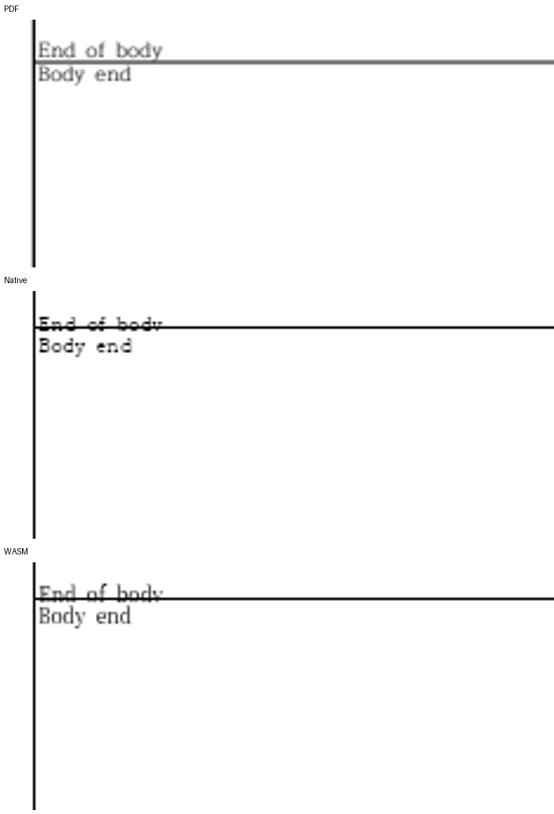

# 원 합성 입력의 기존 저장 줄과 괘선 차이

판정: 2026-11-13 메인테이너가 원 합성본의 저장 줄 처리 보완을 승인했다. 기존 차이 예외는 적용하지 않으며 실제 원본의 최종 검증 전까지 승인을 보류한다. 원인 조사 자료이며, 글꼴 예외로 판정하지 않았다.

원 HWP는 RHWP에서 생성한 합성 입력이다. 모든 대상 글자의 `CharShape 0.base_size`는 650 HU지만, 저장 줄은 Title 1900/1615 HU, End of body 1100/935 HU의 글자 높이/기준선을 가진다. 실제 한컴 SaveAs는 두 줄 모두 650/553 HU로 다시 계산한다. [파싱·최종 run의 실제 값](source-baseline-diagnosis.txt).

기존 devel `00d09f773a`의 둘째 쪽 본문과 보정 전후 후보의 첫째 쪽 본문은 같은 원점·표/셀/글줄 상자를 가진다. [정규화한 전체 본문 트리 대조](base-candidate-body-geometry.json). 페이지 이월은 개선되지만 이 줄/괘선 차이는 원 수정으로 새로 생긴 것이 아니다.

독립 Mac Print와 원 합성 입력의 후보는 Native 전 2쪽 최저 94.20%, fresh WASM 94.38%다. 직접 확대하면 End of body와 가로 괘선이 겹치므로 이 수치로 수용을 면제하지 않는다. 실제 한컴 재저장 대조군은 Native 100.00%, fresh WASM 99.59%이며 같은 겹침이 없다.

동일한 HCRDotum/HCRBatang 계열을 공급했다. 따라서 단순한 미설치 글꼴 문제라고 결론 내리지 않는다. 수동 작성한 저장 메타데이터만을 근거로 모든 정상 한컴 저장 줄의 수용 조건을 완화하지 않는다. 원 합성본의 저장 줄 재사용/생성 계약까지 수정하는 경우 공통 원인·정상 대조군을 추가 검증하고, 기존 차이 한정 수용을 선택하는 경우 이 범위를 명시해야 한다.

## 추가 보완 검증 진행

현재 관리 캐시 보완은 원본 CharShape와 실제 문단 전진으로 줄 높이·기준선·셀 내 누적 원점을 함께 계산한다. 원본을 바꾸지 않은 직접 Native 실행의 두 쪽 raw는 100.00%다. HWP 직접 저장·어댑터 저장·HWPX 저장 후 다시 열어 내용·빈 줄과 같은 기준선을 유지하는 진단 8건도 통과했다. 최종 최적화 WASM과 필수 게이트는 계속 실행한다.

표시용 사본만 보정하면 HWPX로 다시 열 때 낡은 캐시가 복원되는 것을 추가로 확인했다. 같은 생산자의 관리 캐시를 저장 사본에 발행하고, CLI는 그 사본을 검증 기대값으로 사용한다. 원본 HWPX 변환의 `--verify --verify-pages`는 차이 0건·2→2쪽으로 통과했다. 줄 필드의 비교를 일괄 생략하지 않는다.

수치와 확대 이미지는 구분한다. 작은 글자의 안티앨리어싱과 인쇄 장치의 가는 선 coverage는 비트 단위로 같지 않다. 줄·셀의 논리 포함과 실제 한컴 재저장본의 높이·기준선을 함께 확인하며, 원래 글자 중간을 가로지르던 잘못된 저장 기준선을 정상으로 인정하지 않는다.
