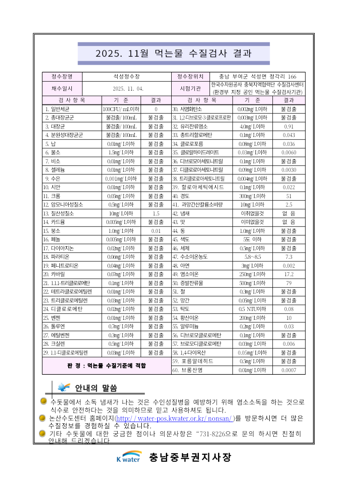
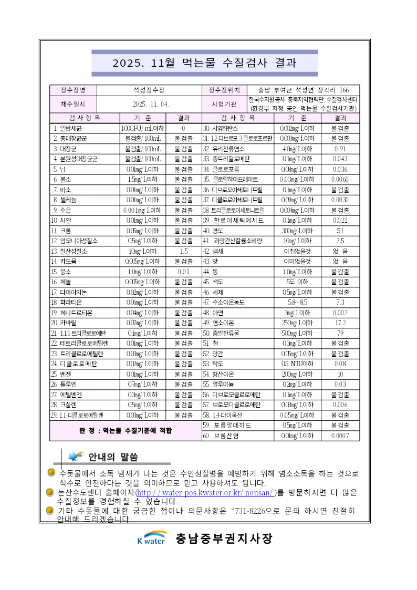

# PR #9155 실제 원격 검증 증거

검증 source `d9868f4ef1e506918bb3eceece5453333b047e64`, devel merge `1ea5d6df80eebcdc16cf451b4e76d4a48d5edc2a`.
`final-ci-and-fuzz-receipt.json`은 성공한 최신 head 실행의 실제 job 로그·단계에서 추출했다.
source 원문·로컬 비교·느린 입력은 [기존 작업 증거](../../../working/assets/issue9154/)에 있다.

## Fuzz 12개 실제 실행

| Ubuntu | 타깃 | sanitizer 빌드 시간 | 빌드 최대 RSS GiB | 실행 입력 수 | 퍼징 최대 RSS MiB |
| --- | --- | --- | --- | --- | --- |
| 24.04 | `parse_hwp3` | 13분 58초 | 7.771 | 9,474 | 438 |
| 24.04 | `parse_hml` | 14분 38초 | 8.092 | 257,746 | 505 |
| 24.04 | `parse_ooxml_chart` | 15분 41초 | 8.015 | 479,798 | 474 |
| 24.04 | `parse_wmf` | 14분 20초 | 7.683 | 64,170 | 681 |
| 24.04 | `parse_hwpx` | 14분 19초 | 7.803 | 39,423 | 509 |
| 24.04 | `parse_hwp` | 13분 57초 | 7.723 | 130,633 | 564 |
| 26.04 | `parse_hwp3` | 15분 26초 | 8.021 | 3,686 | 418 |
| 26.04 | `parse_hml` | 18분 59초 | 8.002 | 156,908 | 490 |
| 26.04 | `parse_wmf` | 18분 27초 | 8.066 | 55,561 | 581 |
| 26.04 | `parse_ooxml_chart` | 17분 31초 | 8.042 | 344,623 | 457 |
| 26.04 | `parse_hwpx` | 18분 32초 | 7.996 | 21,111 | 496 |
| 26.04 | `parse_hwp` | 13분 35초 | 8.045 | 130,114 | 491 |

두 실행은 각각 한 번 접수했고 모두 build/run 성공이다. 기본 60초·입력별 30초·RSS 2 GiB·ASan·coverage를 유지했다.
입력 수는 각 무작위 퍼징의 관측치이며 두 OS나 codegen 구성의 성능비로 해석하지 않는다.
compiler RSS는 `/usr/bin/time -v`의 관측값이며 runtime RSS 한도와 구분한다. 최신 12개 빌드 peak의 최댓값은 8.092 GiB다.
이 결과가 이전 runner shutdown의 커널 OOM 원인을 입증하지는 않는다.

## Native 실제 산출물 소비

producer source는 `de94e7cc23dcbea3fe857a726646a872399f8f9c`이며 run `44072214045`의 Linux/macOS/Windows가 모두 성공했다.
Linux artifact `14324237355` ZIP digest를 검증하고 같은 읽기 전용 패키지를 네트워크 없는 두 Ubuntu Docker에서 실행했다.
실제 `.so` 최대 GLIBC 요구는 2.35이며 capability·IME·Undo/Redo·저장 재열기와 `각`의 비어 있지 않은 재렌더가 통과했다.
`github-native-runtime-results.json`과 `github-reopened-render-results.json`에 실제 해시를 보존했다.
manifest의 source는 caller-declared이며 cryptographic binary provenance를 검증했다고 주장하지 않는다.
이는 GPU·Qt·한컴 조판 정확도 검증이 아니다.

## Full Renderer OS 대조의 범위

실제 producer source는 위 Native와 같은 `de94e7cc23`이다. `codegen-non-fuzz-source-equivalence.json`은
문서·Fuzz 전용 정의/검사를 제외한 task branch source 동일성이다. 최신 devel 병합의 새 source 검증과 구분한다.
각 artifact는 611개 파일이고 browser PNG 378개와 SVG 105개는 OS 간 바이트가 같다.
전체 PNG 462개 중 428개가 바이트 단위로 같고 **Native 34개는 실제 픽셀 차이**다. Native profile PNG는 84개다.
PDF 21개 중 10개만 바이트가 같으며 나머지를 metadata 차이로 단정하지 않는다.
Native/CanvasKit parity report는 두 OS 모두 report-only 72개 중 22개 통과·50개 차이다.

아래는 실제 `table-in-textbox/native-skia-screen` 출력이다. 표 외곽·행 구획은 같지만 글자 폭/모양과 아래 안내문 줄바꿈은 다르다.
이 사실을 Native 완전 일치나 독립 한컴 Print 대비 90% 통과로 바꾸어 기록하지 않는다.
정확한 픽셀 차이율은 silhouette_raw_match_percent와 다른 지표다. 폰트·raster 환경의 개별 원인은 분리 입증하지 않았다.

## 운영 경계

실제 cache budget/read-only 경고를 유지한다. 새 cache 저장·warm hit를 보장하지 않으며 삭제·예산·과금 설정을 바꾸지 않았다.
옛 source의 복구 취소는 승인된 source 전환이다. `codegen-old-fuzz-cleanup-ledger.json`의 상태는 요청 시점의 snapshot이다.
`codegen-fuzz-dispatch-ledger.json`도 접수 당시 상태이며 최종 결과는 receipt를 따른다.
main·태그·배포는 미적용이며 #9154·#536은 OPEN이다. 후속 기록 PR 뒤에는 검증 CI를 다시 실행하지 않는다.
