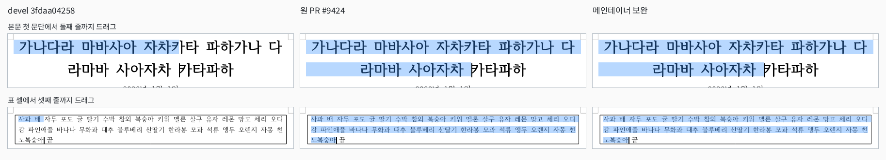
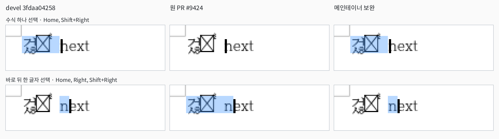

# PR #9424 선택 표시 검증

2026년 11월 26일, 최신 `devel`(`3fdaa04258`), 여기에 원 기여 `1e9194008e`를 병합한 소스(`c765fa2ac9`), 메인테이너 보정 `a37c9cce46`까지 포함한 소스(`45c5648d43`)를 같은 Linux Chrome 156의 Studio에서 비교했다. 각 버전은 고정된 Cargo.lock으로 WASM을 새로 빌드하고 최적화했다. 브라우저가 사용한 바이너리의 SHA-256을 빌드 산출물과 대조했다. [바이너리 크기와 해시](wasm-sha256.tsv)

| 실제 조작 | devel | 원 PR | 메인테이너 보정 |
| --- | ---: | ---: | ---: |
| 본문·표 셀의 정방향·역방향 드래그에서 범위, 줄별 표시, 양 끝, 복사가 모두 맞은 횟수 | 4/16 | 16/16 | 16/16 |
| 문단 맨 앞 인라인 수식 하나를 선택한 표시 폭 | 35.1px | 0px | 35.1px |
| 수식 바로 뒤 한 글자를 선택한 표시 폭 | 9.2px | 44.4px | 9.2px |

## 본문과 표 셀

이슈의 첨부 파일과 PR의 본문 표본은 같은 파일이다. Studio 100% 배율에서 한 줄 안의 선택, 둘째·셋째 줄까지의 선택, 줄 중간에서 시작하는 선택, 다음 문단까지의 선택을 마우스로 실행했다. 각 조작에서 줄별 DOM 사각형을 같은 쪽의 캐럿과 대조하고 시스템 클립보드의 전체 문자열을 원문 범위와 비교했다. 복사 문자열은 세 버전에서 매번 일치했다. [원 이슈](https://github.com/edwardkim/rhwp/issues/9139) · [본문·셀 원본](../issue_9139/) · [16건의 측정값](drag.tsv)



## 본문 앞의 인라인 수식

공개 API로 새 문서에 `next`를 입력하고 앞에 수식 `x+1`을 넣어 HWPX로 저장한 뒤 다시 열었다. 키보드에서 `Home`, `Shift+Right`로 수식 하나를, `Home`, `Right`, `Shift+Right`로 다음 글자 하나를 선택했다. 저장된 줄이 있는 기존 수식 문서와 그 문서에서 해당 문단의 선택적 줄 정보만 생략한 사본도 대조했다. [재현 HWPX](core-export-inline-equation.hwpx) · [문서 세 개의 키 입력별 결과](equations.tsv)



아래 명령은 같은 파일을 공개 WASM API로 열어 수식의 상자와 선택 범위 0–1, 0–2, 1–2를 출력한다. 새 입력을 만들 때에는 마지막에 `--make`를 붙이고 출력 경로를 지정한다.

```sh
node mydocs/pr/assets/pr9424/equation-probe.mjs pkg mydocs/pr/assets/pr9424/core-export-inline-equation.hwpx
```

## 대조군

- 수식을 문단 처음·중간·끝에 둔 경우, 처음에 두 개 둔 경우, 수식만 있는 경우를 각각 HWP와 HWPX로 저장해 다시 열었다. 논리 한 칸씩 선택한 44개 범위 중 원 PR에서 달라진 10개를 보정했고, 44개 모두 기준과 같은 사각형을 반환했다. [형식과 수식 위치별 대조](equation-placement.tsv)
- 선택 표시를 그리기 전 본문 표본과 셀 표본의 전체 페이지 Canvas PNG는 세 버전에서 각각 같은 SHA-256이었다. [페이지 크기와 해시](page-canvas.tsv)
- 인라인 양식이 있는 HWP·HWPX 네 파일에서 본문과 표 셀의 논리 한 칸을 고른 26개 사각형의 쪽·위치·크기가 세 버전에서 모두 같았다. [양식 선택 비교](form-controls.tsv)
- 최신 `devel`에서 먼저 반영한 Word 호환 줄 높이, 그림 양옆 본문, 인라인 표 앞뒤 글자의 공개 문서 여섯 개를 열었다. 여덟 쪽 모두 세 버전에서 선택 전후의 렌더 트리와 SVG가 일치했다. [쪽별 해시](devel-controls.tsv)

별도 대조에서 본문 수식 뒤의 첫 글자를 일반 텍스트로 복사하면 `n` 대신 `e`가 복사되고, 표 셀의 선두 수식만 고르면 표시가 생기지 않았다. 두 동작은 기준 `devel`과 원 PR, 메인테이너 보정에서 동일했다. 위 표의 수식 너비는 본문 선택 표시의 측정값이다.
