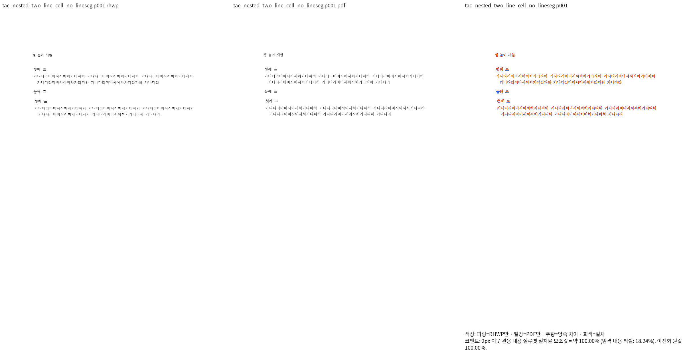
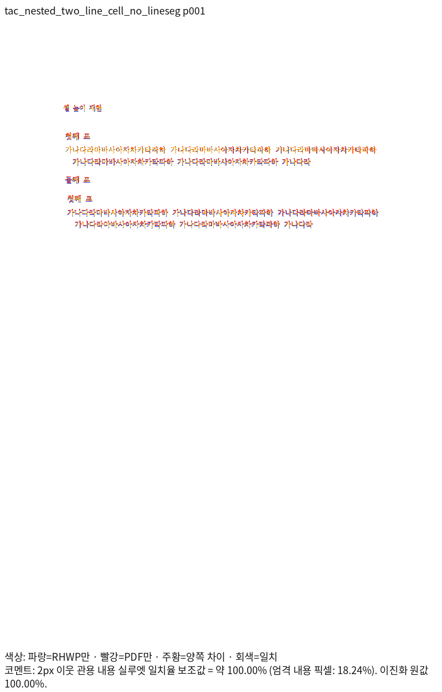
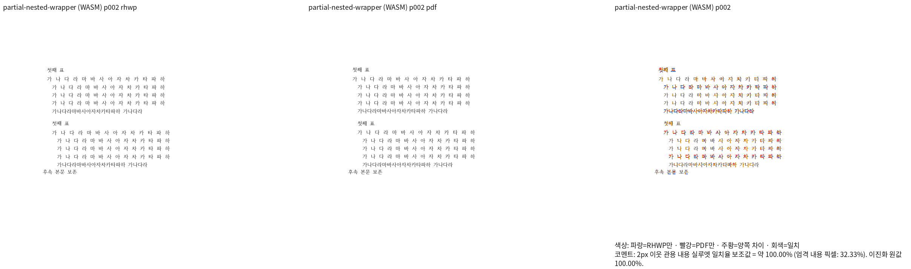
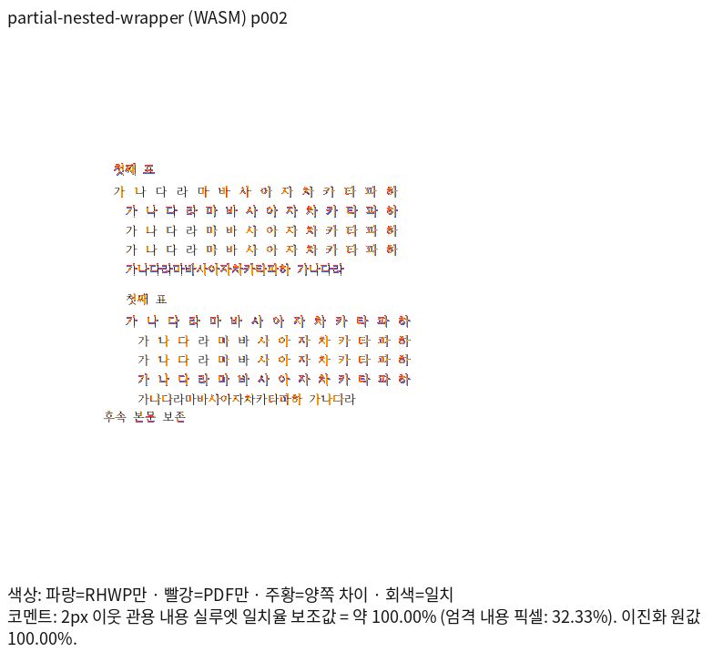
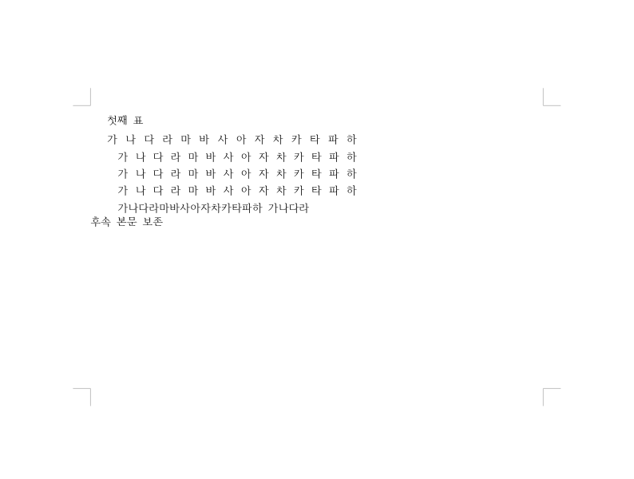

# PR #7433 메인터너 보정 시각 자산

- 렌더링 source: `f5a4774049fa10cc661f7220de0127d61fa081ba`.
- 리베이스 후 위 source에서 실제 Native와 fresh WASM을 다시 빌드해 전쪽 재출력했다.
- 기준 devel: `0953598d8e08af5e9149b3e4cdbbbf2f5f2bae64`.
- 13문서19쪽 Native/fresh WASM의2px 관용 실루엣 최저100%, 독립 Print 쪽수 일치.
  엄격 픽셀100%가 아니다. 여백·분할·wrapper·저장 줄 혼재·뒤 본문을 전쪽 직접 대조했다.
- 사용자는 표준 Docker WASM을 미검증으로 유지하도록 선택했다. 현재 fresh WASM은
  host `--dev --no-opt` 진단이며 Docker 통과로 표시하지 않는다.
- Native/fresh WASM의 PNG는 같은96dpi·Print profile·compat2024와 같은 한컴 글꼴을 쓴다.
- 기존 입력 출처는 [Stage1](../../../working/task_m100_7419_stage1.md),
  분할 경계는 [Stage3](../../../working/task_m100_7419_stage3.md),
  실제 저장 줄 혼재의 생성·수정 전후는 [Stage4](../../../working/task_m100_7419_stage4.md),
  직전 재검증은 [Stage5](../../../working/task_m100_7419_stage5.md),
  현재095 리베이스 후 재검증은 [Stage6](../../../working/task_m100_7419_stage6.md)에 있다.
- 현재 원시 증거는 ignored `output/pr-review/pr7433-current-20261016/rebased-0953598/`다.
  `candidate-{native,wasm}-{sweep,review}/`, `direct-read.json`,
  `producer-builds.json`, `review-assets.json`에서 TSV·생산자·직접 판독·PNG SHA를 확인한다.
- devel과 비교 가능한10문서·backend별12쪽에서0.01%p 이상 하락0이다. 나머지3문서는
  정상 쪽수 복구로 base TSV가 없어 전쪽 일대일 gate가 **re_review_required**다.
  최저100%로 이 보류 조건을 면제하지 않는다.
- `studio-source-direct.png`, `studio-nested-direct.png`는59d source의 과거 캡처다.
  당시 Canvas2D·CanvasKit compat/default software6캡처의 초기 WASM 응답 해시와
  replay hard violation0을 확인했다. 엄격 픽셀4건은 report-only 불일치(최대0.01088193)였다.
  이 두 이미지를 현재f5a source의 Studio 재실행 또는 parity gate 통과로 표시하지 않는다.
- 아래 현재26개 대표 이미지는f5a에서 새로 산출했다.26개 모두 리베이스 전 자산과 바이트도 같다.
  Visual Sweep review와 standalone overlay를 함께 표시해 판독한다.
- [개별 검토](../../archives/pr_7433_review.md). PR/push는 사용자의 별도 승인 전까지 보류한다.

## Native 저장 줄 혼재2쪽

## fresh WASM 저장 줄 혼재2쪽

## Native 원본 중첩1쪽

## fresh WASM wrapper 이월2쪽

## 현재 대표 파일 SHA-256

| 파일 | SHA-256 |
| --- | --- |
| [native-nested-source-review-001.png](native-nested-source-review-001.png) | `30c86453d624e82a96d522a45080e89ee5150a39ffdd8d8562da5575bc579f1e` |
| [native-partial-width-review-002.png](native-partial-width-review-002.png) | `d43a1948a3b7b9dbc39bd3e7e66e44cbdf22524bf3854d7444185b9fba5a9ce2` |
| [native-wrapper-review-002.png](native-wrapper-review-002.png) | `5eb1d2f6e6d2fd4aabc11b6d5433d93a1f0b4a6ccdfb00c0d96e90c5b9c28ac0` |
| [native-margins-review-001.png](native-margins-review-001.png) | `5bf59f5c579386396ef9a8bfddece2b854829d8b40e86e31f0cfd7e6624c6fda` |
| [native-nested-source-overlay-001.png](native-nested-source-overlay-001.png) | `be30045b3126e74fa0b5ce40a2633aecb6758db5f32b1664f176d87ae1f95ef9` |
| [native-partial-width-overlay-002.png](native-partial-width-overlay-002.png) | `618666d860f2da23df953277e2421c00f216507cde6f21f1b7bd9903e731710f` |
| [native-wrapper-overlay-002.png](native-wrapper-overlay-002.png) | `d11737d314d3c12e4c32809c303a5069a867c05ddd9252612f3d0f9af9677deb` |
| [native-margins-overlay-001.png](native-margins-overlay-001.png) | `6c4b91d43a174e6aa42dd5a79ff4b15389035a3be5a13cfb0ab0f8816dfb4353` |
| [native-partial-width-review-001.png](native-partial-width-review-001.png) | `2960b12c8f56a48a12c6366db7d83cf2924f4e8fcaa7fc5d0589b87c6528119c` |
| [wasm-nested-source-review-001.png](wasm-nested-source-review-001.png) | `d406d6f185ad055b96aa458979bbb9d698242bdaafc39c9d3ea73242c373a325` |
| [wasm-partial-width-review-002.png](wasm-partial-width-review-002.png) | `13a1aa5716befe67931a833d23b88ad07e1ae63bf0a6fab2f3a05211e6a1cc7d` |
| [wasm-wrapper-review-002.png](wasm-wrapper-review-002.png) | `ccdc8720feed14956a2670b0cd53a83ac2f05229ca7f4f918948beb1b48ece70` |
| [wasm-margins-review-001.png](wasm-margins-review-001.png) | `2d5fa2dc1880e3c88471a79cd06cda9352387822a9aa754759b2c24c51238240` |
| [wasm-nested-source-overlay-001.png](wasm-nested-source-overlay-001.png) | `76bb47ce4d813b1a529ea5dbdf10fed44d154a3f0295ef34dffefbfed8257cd0` |
| [wasm-partial-width-overlay-002.png](wasm-partial-width-overlay-002.png) | `b2462bc1113e9b0681a06c1bfa328aeec1cc21fb554c55bc066259257206e080` |
| [wasm-wrapper-overlay-002.png](wasm-wrapper-overlay-002.png) | `2292329b45c6502c414714db4eb3c2b5b3637213b98a5ac7d9e85ff78451cb23` |
| [wasm-margins-overlay-001.png](wasm-margins-overlay-001.png) | `a5f64f3e7a31dacba76197d3978193f0d5edb91fb6ea6023b96d01609974e166` |
| [wasm-partial-width-review-001.png](wasm-partial-width-review-001.png) | `37fadb760a9b03bf18b56bc72657cd6e6ab4f8dc4e8fdf5cb96aeb02036898ec` |
| [native-mixed-storage-review-001.png](native-mixed-storage-review-001.png) | `e690840c0ab302a011440dcffdfce75907556e9a0688696520b6826ee14dd3b8` |
| [native-mixed-storage-overlay-001.png](native-mixed-storage-overlay-001.png) | `84a70d49a9368ae6792a5abef9d2b7781830a180ed634cf2f1150d81499aa80b` |
| [native-mixed-storage-review-002.png](native-mixed-storage-review-002.png) | `63885c65ac0e2dd7a55e284c9c0a17e3585badf69f764dceb7601f7c0d6297a1` |
| [native-mixed-storage-overlay-002.png](native-mixed-storage-overlay-002.png) | `de0e17e67821ef3624ceae7b52bbad71c86132d8cb04a1c41590ab8e9c6baf09` |
| [wasm-mixed-storage-review-001.png](wasm-mixed-storage-review-001.png) | `d20d369bb978905fe1ae435c757b25e81028e9c200d4ce64ddb51700e2b3d1f9` |
| [wasm-mixed-storage-overlay-001.png](wasm-mixed-storage-overlay-001.png) | `2cc2a09af0807e1fa83b744e91b5944cae919f499789efdba891c9d2a87be791` |
| [wasm-mixed-storage-review-002.png](wasm-mixed-storage-review-002.png) | `a6a06fc95935ecca66c0fdfc17c0014a08fc203a38f586a462998780e727c810` |
| [wasm-mixed-storage-overlay-002.png](wasm-mixed-storage-overlay-002.png) | `140a39192fadda1200c84b6a67953a4f647c9fdf75c4f518269813a0eb44a7af` |

## 과거 Studio 캡처 SHA-256

| 파일 | SHA-256 |
| --- | --- |
| [studio-source-direct.png](studio-source-direct.png) | `d16b74a25263e4a4c32f6bc5ec3294521da3947cccd84f591c726632bcc3d2a8` |
| [studio-nested-direct.png](studio-nested-direct.png) | `84fac574e671a28296584c77fc52ed632d38cf5d9045a006780e81d7873782b6` |

## 리베이스 후 실제 Studio 혼재2쪽

현재f5a source의 Canvas2D/CanvasKit software 캡처다.15캡처의 초기 WASM 해시 일치와
replay hard violation0 및 실제 내용을 확인했다. 보고용 엄격 픽셀 비교10건 미달은 남는다.
이 두 이미지는 Visual Sweep review/overlay나 독립 Print gate의 대체 증거가 아니다.

| 파일 | SHA-256 |
| --- | --- |
| [studio-mixed-canvas2d.png](studio-mixed-canvas2d.png) | `32900b263749c9356d62a8b597cbcaab6c797c0e05cdf6a0c27c93c1632a0560` |
| [studio-mixed-canvaskit.png](studio-mixed-canvaskit.png) | `2fdda7522692b901a12c98435785081b5bb5aef775d2b76eaaa9bbb3970c85c4` |
