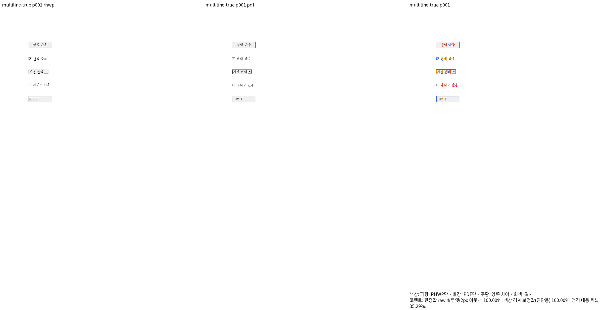
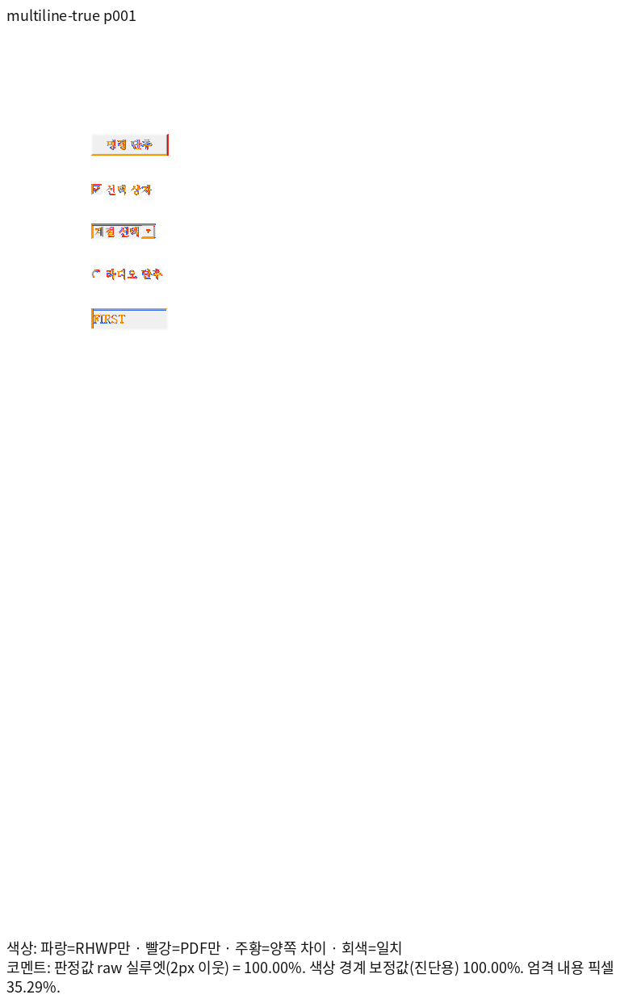
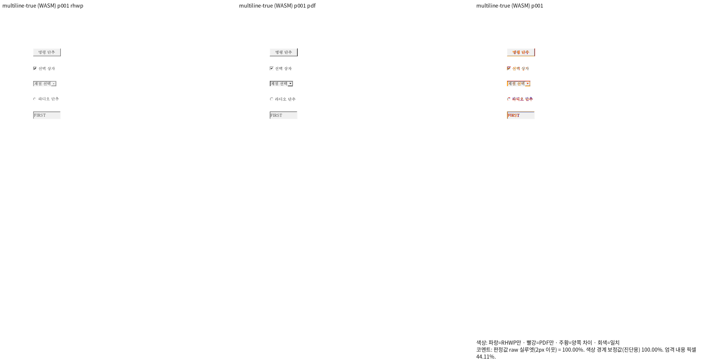
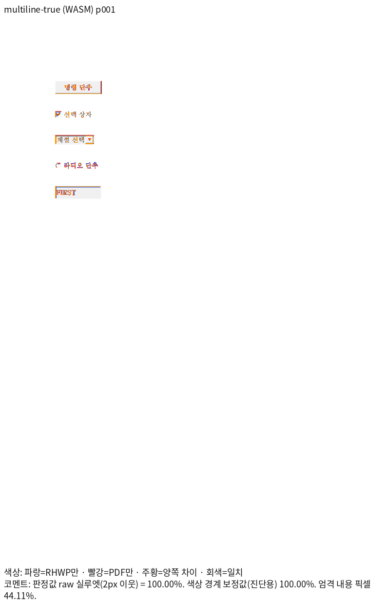

# PR #7589의 입력 상자 인쇄 대조 자료

- 원 PR의 `form_multiline_rendering::fixture`가 `samples/hwpx/form-01.hwpx`에 `FIRST\nSECOND`와 `MultiLine=1/0`을 넣어 저장한 HWPX입니다. 개행과 두 속성값은 다시 열어 확인합니다. 원본 양식의 스크립트는 변경하지 않았으며 실행하지 않습니다.
- 사용자가 두 HWPX를 내용을 바꾸지 않고 한컴의 파일 → 인쇄(Print) → PDF로 출력했습니다. `win10-ted`의 `C:\temp`에서 SCP로 원본 바이트를 가져왔습니다.
- 두 PDF의 실제 Creator는 `Hwp 2022 12.0.0.4605`, Producer는 `Hancom PDF 1.3.0.550`입니다. 파일명의 `2020`과 실제 제품 메타데이터를 구분합니다. 두 파일 모두 A4 1쪽입니다.
- 두 Print의 래스터는 동일하며 Edit에는 `FIRST`만 보입니다. 원문 HWPX의 `SECOND`를 삭제하지 않습니다. 저장값 보존과 표시 문자열을 구분합니다.
- Print에서 확인한 표시 계약의 독립 자료이며, 검증한 source SHA의 전쪽 TSV와 대표 review·overlay는 아래에 보존합니다.

| 파일 | 바이트 | SHA-256 |
| --- | ---: | --- |
| `pr7589-multiline-true.hwpx` | 11274 | `8b3d341410df07fc32f0909b5b84f274ec48e61bb70bf1bcc6050c2e62599457` |
| `pr7589-multiline-true-2020.pdf` | 22106 | `21482ec033b610614f675e32bb983cb3d75f9acbbf7ca7bbe00702f61f8f7868` |
| `pr7589-multiline-false.hwpx` | 11273 | `7bfb9ff9e8a1d047ddc2cb306da35b8e390779e1e56d347e18d67f9a9274e69e` |
| `pr7589-multiline-false-2020.pdf` | 22106 | `1a7972848d4e954d1cd4205f7bf16eb50676edbcc747524d7e1282bfb9b8071d` |

## 표시 계약과 시각 대조

- 렌더 source SHA: `fca7ff627b7d05d6edb8dade112ead8b43c2db6f`. Native Skia와 최적화한 fresh WASM Canvas2D를 각각 사용했습니다. 조판 세대는 2022, 인쇄 프로필, 96dpi, 두 입력 모두 독립 PDF와 1쪽씩 일치합니다.
- `MultiLine=0/1` 두 입력 모두 Native **100.00000%**, fresh WASM **100.00000%**입니다. 판정값은 색상 경계 보정 전 2px 내용 실루엣이며, 완전한 픽셀 동일성을 뜻하지 않습니다. TSV는 산출 원문을 그대로 복사했습니다.
- Native·WASM과 독립 Print에서 같은 영역을 직접 확인했습니다. 입력 상자에는 `FIRST`만 표시되고, `SECOND`가 옆으로 이어지지 않으며, 원문과 `MultiLine` 속성은 보존됩니다. 버튼·체크 상자·콤보 상자·라디오 단추·입력 프레임의 순서와 내용도 유지됩니다.
- 원 PR의 두 SVG가 달라야 한다는 가정은 이 입력의 독립 Print와 다릅니다. 수정한 회귀는 `FIRST` 표시, `SECOND` 미표시, 두 표시 결과의 동일성을 검사합니다. 동일성만 검사해서는 수정 전의 잘못된 연결 표시도 통과하므로 첫 두 조건을 함께 검사합니다. 다른 입력의 모든 MultiLine 동작을 일반화한 판정은 아닙니다.
- WASM에는 시스템에 등록된 `HBATANG.TTF`(Haansoft Batang/한컴바탕)와 `HANBatang.ttf`(HCR Batang/함초롬바탕)를 실제 파일로 공급했습니다. 글꼴 목록이 비어 있던 최초 WASM 실행의 92.37734%는 최종 증거로 사용하지 않습니다. 원본 글꼴 파일은 수정하거나 저장소에 복사하지 않았습니다.

| 입력 | Native 원문 TSV | fresh WASM 원문 TSV |
| --- | --- | --- |
| MultiLine=1 | [TSV](native/multiline-true.tsv) | [TSV](wasm/multiline-true.tsv) |
| MultiLine=0 | [TSV](native/multiline-false.tsv) | [TSV](wasm/multiline-false.tsv) |

대표 페이지는 두 입력에서 동일하게 표시되므로 MultiLine=1의 1쪽을 제시합니다.

| backend | review | overlay |
| --- | --- | --- |
| Native Skia |  |  |
| fresh WASM Canvas2D |  |  |

재현 명령은 같은 입력·PDF에 다음 옵션을 사용합니다. `<생산자>`는 위 source SHA에서 만든 Native 실행 파일이며, WASM 검증에는 같은 SHA의 최적화 web package와 실제 설치 글꼴 디렉터리를 함께 지정합니다. 먼저 `--silhouette-only`로 전쪽 TSV를 만들고, 해당 옵션 없이 대표 PNG를 산출했습니다.

```bash
venv/bin/python scripts/visual_sweep.py --silhouette-only \
  --file-target multiline-true \
  mydocs/pr/assets/pr_7589_form_multiline/pr7589-multiline-true.hwpx \
  mydocs/pr/assets/pr_7589_form_multiline/pr7589-multiline-true-2020.pdf \
  --rhwp-bin <생산자> --compat 2022 --dpi 96 --page-workers 1 \
  --out output/pr-review/<검토 식별자>/native
# fresh WASM: 위 명령에 다음을 함께 지정하고 --out을 wasm으로 구분한다.
# --wasm-pkg <같은 SHA의 web package> --font-path <실제 설치 글꼴 공급 디렉터리>
# MultiLine=0은 key와 두 파일명의 true를 false로 바꾼다.
```

검증 생산자의 SHA-256:

- Native: `fd2f402c3cd89fc228d9482963d1230cc63691db11229fa9b16c1298afc5e513`
- fresh WASM: `03acd69c2e104217796774ea7bfd40a81cee0199d654d1daa378767cc47f8110`
- 공급한 `HBATANG.TTF`: `35f84328500fc2c3ee0b148aa75de0ed384bf9eee8dee9148c01b0a11a27fe05`
