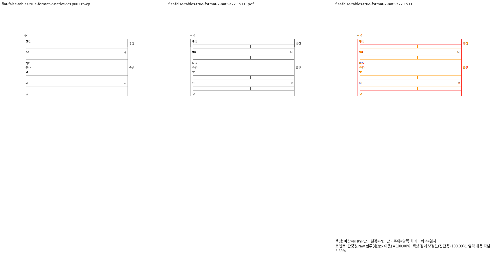
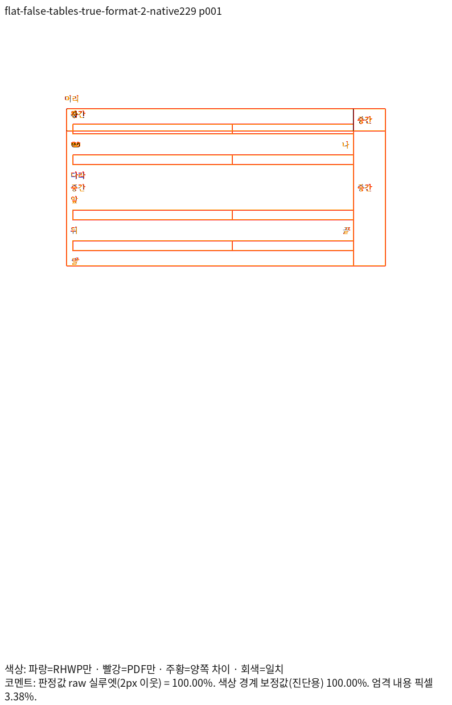
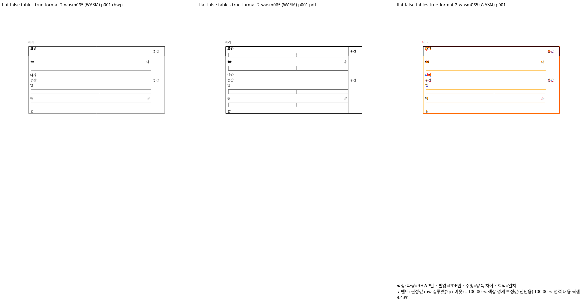
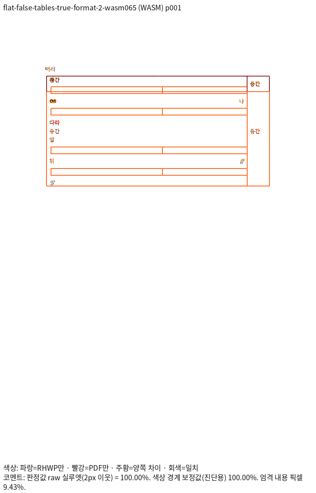

# PR #7833 셀 경계 캐럿 실패 입력의 독립 Print 진단

## 판정과 보존 목적

**최초 진단(runtime `8dc75860ce`)은 Native/fresh WASM 모두 90% 미만이다.** 이 자료는 기존 실패를
재현하기 위한 음성 증거이며, 정상 fixture·golden·신규 회귀 등록이나 PR 제출 승인의
근거가 아니다. 활성 검사·기대값·제품 코드는 이 단계에서 변경하지 않았다.
진단 모델에서 얻은 수치를 실제 제품 출력의 개선으로 보고하지 않는다.

## 원 해결과 정확한 입력

원 [PR #7833](https://github.com/edwardkim/rhwp/pull/7833)의 공개 head는
`255413cdbc74d34f7c1d1be09fb7ad640eac6feb`이다. 원 커밋
`cbb2d3ee9b702027a8101526fbd2b5f9152603c8`과
`efec7825d325beb5f2eff65ac921f148818367a5`는 각각 누적 브랜치의
`be4e63c903735174ea7960389bd9321cf2704a9e`와
`054d8758b1876e3475ead4d604e3432a156207cd`에 대응한다.
helper 통합 보정은 `9c7cf0445ac07a651f3960cbf57f8cb6a22eac32`다.
원 PR 본문의 미공개 로컬 후보 결과를 이 공개 head의 검증으로 사용하지 않는다.

[원 검사 전체](source-before/cell_boundary_object_cut.rs.txt)와
[생성 helper 전체](source-before/cell_boundary_object_fixture.rs.txt)를 보존한다.
`inline_axis_fixture(flat, true)`를 HWPX로 저장하고 다시 연 입력이다. 두 입력 모두
1쪽이며, 보존 입력을 수정하지 않은 채 MCP의 한컴 2020 Print로 출력했다.
실제 제품 버전은 `11.0.0.9136`, engine `2020`, `pdf_print_method=0`,
`input_preprocess=none`이며 다운로드 바이트는 각각 20431/20513바이트다.

| 입력 | 입력 SHA-256 | PDF SHA-256 | Print job ID |
| --- | --- | --- | --- |
| `flat` | `0581033861bb6316ae6bf0e01be0566eafd3191f62fb06cd590686ee07baf26e` | `157895d08e42e72d3ac26f3e4378a91c5927d9cf70daee0b636fc5def8c2b1e6` | `f5b0d12c-f20a-485f-a771-626c62375e70` |
| `nested` | `9959547e50f0614cb2902fb644008ef268d9f255c8252dd7feb47a4ed5820487` | `11e1a3abc260b1dee8e15937fc8a57b28b1404bcbfcc42c2ddcc572ca60479e2` | `a43cc5c8-50d4-4803-907d-67db641ab649` |

- flat: [HWPX](inputs/flat-true-tables-true-format-2.hwpx) /
  [독립 Print PDF](../../../../pdf/pr7833-cell-axis-diagnostic/flat-true-tables-true-format-2-2020.pdf)
- nested: [HWPX](inputs/flat-false-tables-true-format-2.hwpx) /
  [독립 Print PDF](../../../../pdf/pr7833-cell-axis-diagnostic/flat-false-tables-true-format-2-2020.pdf)

## 현재 제품과 고정 base의 전체 페이지 TSV

검사 source head는 `745f3acbdc182cc7249e623f4f07e9e2b3a70230`, 제품 runtime은
`8dc75860cec88ddf7c3f8aeee230b2ca7e2e5537`이다. Native224와 최적화 fresh WASM063,
Print 프로필·96 DPI·렌더러 compat 2022를 사용했다. 이 compat 값은 한컴 engine이나
설치 연도가 아니다. 글꼴 공급은 `/usr/share/fonts`, `/usr/local/share/fonts`,
`/home/tsjang/.local/share/fonts`, 저장소 `assets/fonts`다.

| 입력 | 고정 base Native | 현재 Native | 현재 fresh WASM |
| --- | ---: | ---: | ---: |
| flat | [15.86207%](tsv/base-native/flat.tsv) | [15.85583%](tsv/native/flat.tsv) | [16.01942%](tsv/wasm/flat.tsv) |
| nested | [19.19125%](tsv/base-native/nested.tsv) | [17.24698%](tsv/native/nested.tsv) | [17.30547%](tsv/wasm/nested.tsv) |

각 TSV는 한 페이지 전체 원문이다. 고정 base는
`9418ed0c7cf289c5c4ac2b3bb8cdc18a1b637a9a`이며 최신 fetch 완료를 뜻하지 않는다.
Native194의 source `60972534680a0c5e51e54ec189b92e252e81a867`과 base의
`src`·Cargo 입력이 같고 보존 source 1507개가 Git blob과 일치함을 확인했다.
같은 Native에서 하락은 각각 0.00624/1.94427%p지만 모두 90% 미만이다.
이 최초 기록 뒤 같은 고정 base의 fresh WASM 비교도 완료했다. 아래 후속 확인을 따른다.

### 고정 base의 fresh WASM 후속 확인

최적화 fresh WASM052로 같은 원본·같은 Print PDF의 전체 페이지를 실제 비교했다.
flat은 [16.07167%](tsv/base-wasm/flat.tsv), nested는
[19.17680%](tsv/base-wasm/nested.tsv)다. 각 파일은 생성된 TSV 원문과 바이트가 같다.
Native에서 확인한 기존 미달이 fresh WASM에서도 재현됐다. 이것은 현재 출력의 통과나
검사 제거·이관을 자동 승인하는 근거가 아니며 활성 검사는 유지한다.

빌드 source `60972534680a0c5e51e54ec189b92e252e81a867`과 고정 base의
`src`·`crates`·`vendor`·`build.rs`·Cargo 입력이 같음을 대조했다.
실행 증거는 ignored output의 `cell-axis-base-wasm052-3670-result.json`,
빌드 증거는 `rebase-base-wasm052-build-3060-result.json`이다.
JS/WASM SHA-256은 각각
`f90e8e9655657ea0f23b467ccb89b37b6af24f8f1b387dab9055dae747aea5b9` /
`bf9debaa8e1300924846fa3182d38755457929d29c84935fbbc34f5f6d244789`다.

### 대표 현재 fresh WASM 출력

아래는 진단용 모델이 아니라 변경 없는 실제 제품 출력이다. 작은 표 폭·짧은 부모 셀 때문에
뒤 내용이 잘리며, Print는 큰 셀 그리드를 사용해 줄바꿈하고 부모 표가 더 높다.


[Native flat review](png/native/flat-review.png) / [overlay](png/native/flat-overlay.png),
[Native nested review](png/native/nested-review.png) / [overlay](png/native/nested-overlay.png),
[fresh nested review](png/wasm/nested-review.png) / [overlay](png/wasm/nested-overlay.png)를
같은 입력·독립 PDF로 보존한다. 점수·쪽수만으로 캐럿 소유나 배치 정합을 선언하지 않는다.


Native224 바이너리 SHA-256은
`e333c70587ecf48e24632de8e6f3b843f33eb328051580442af4f46214743ca4`다.
fresh063의 `rhwp.js` / WASM SHA-256은 각각
`75cae6af5d48aa54e2d182681313dc85d824c60ebbea973ab4eb9285807c967d` /
`0995e84e0f2adf6411a517e7f10998a3cbc0929d067d757d8e8ee136637cf4fc`다.

## 진단 관측과 미해결 원인

24개 조회(평면/중첩 × 그림/표 × 메모리/HWP/HWPX × 첫/끝 문단) 중 두 HWPX 표 조건의
끝 문단에서 `cellOverflowed=true`다. 부모 셀 y157.4/h85.5, 캐럿 y216.7/h26.2가
관측됐으며, 이 단계에서 clamp 허용 오차나 논리 offset 기대값을 완화하지 않았다.

합성 helper는 폭 1200HU·높이 1400HU의 Picture 공통 속성을 Table에 통째로 대입하지만,
그 자식 셀 그리드 폭은 41954HU다. 빈 셀의 저장 줄 높이 1000HU와 상하 패딩 합
282HU도 다른 높이 계약이다. 원본의 모순과 렌더러 처리 결함을 구분해야 한다.

같은 PDF의 독립 벡터에서 자식 그리드 폭 약 559.54 CSS px, 높이 약 17.10 CSS px를
관측했다. 부모 clip은 별도 경계이며 표시용 축소 PNG에서 좌표를 역산하지 않았다.
행별 완결 폭 합의가 있는 표만 render-only clone에서 그 폭으로 해석한 실험은
flat 53.10361%, nested 46.44524%다. 이어 선언 높이 하한을 제거하는 진단을 함께
적용했을 때 flat 100.00000%, nested 82.68332%였다. 이는 **제품 미반영 Native 가설**이며
fresh WASM 통과나 원본 출력 보정 완료를 뜻하지 않는다. 높이를 1HU로 바꾼 진단값을
제품 규칙·기대값으로 채택하지 않았다. 깊은 중첩의 앞 문단과 부모 표 하단 차이는 남아 있다.
정상 #5785 대조군은 이 투영에서 변경 0개·PNG 바이트 동일이다.

`Table::flow_width_hu → inline_control_size_hwp / composition / paragraph_layout`의
줄 너비 소비와 `invalid_declared_width_rows → resolve_column_widths`의 그리드 소비를
함께 추적했다. 높이는 `inline_control_occupied_size_hwp → HeightMeasurer`의 측정과
실제 행 높이·부모 표 점유를 함께 대조해야 한다. `layout_embedded_table`은 TextBox에서
호출되므로 현재 입력의 실제 원인 경로라고 단정하지 않는다. render-tree의 wrapper
`CellContext`를 소스 table 주소로 재사용한 중간 진단에도 오인 매핑이 있어 높이 계약의
증거로 채택하지 않았다.

## 재현 기록과 다음 검증

로컬 ignored `output/pr-review/semanticist21-20261019/`의 다음 기록에 실제 명령·producer
SHA와 결과를 보존했다. 실행 로그와 중간 JSON을 이 증적에 추가 커밋하지 않는다.

- `cell-axis-extraction-3643.json`, `cell-axis-observation-3643/observations.json`
- `mcp-cell-axis-3645/results.json`, `cell-axis-models-3647/`
- `cell-axis-current-3649-result.json`, `cell-axis-base-native194-3653-result.json`
- `base-native194-equivalence-3653.json`, `cell-axis-independent-pdf-frames-3654.json`
- `table-projection-score-3651-result.json`, `table-projection-score-3658-result.json`

Native/fresh Sweep은 같은 원본/PDF에 `--file-target <key> <hwpx> <pdf>`,
`--rhwp-bin <동결 Native224> --compat 2022 --dpi 96 --page-workers 1 --out <output>`를
사용했다. fresh는 `--wasm-pkg <최적화 fresh063>`을 추가한 실제 기록을 따른다.
전쪽 TSV는 같은 출력 PNG에 `--silhouette-only --png-pair <rhwp_png> <pdf_png>`로 산출했다.
별도 진단은 같은 PDF 래스터를 재사용했으며 정렬·축척 보정·마스크를 적용하지 않았다.

이 실패 두 입력을 기존 104조건·699쪽 통과 목록에 합치면 106조건·701쪽이지만 전체
범위가 통과한 것이 아니다. 기존 실패 20건 기록은 새 전체 Rust 실행 결과가 아니며,
이번 진단으로 활성 실패가 통과했다고 기록하지 않는다. 공통 조판 계약과 정상 대조군을
확정하고 제품 보정·두 경로 재검증을 마친 뒤에만 정식 회귀와 PR 준비 완료를 판단한다.

- 보존 `tests/cases/cell_boundary_object_cut.rs`: source `745f3acbdc182cc7249e623f4f07e9e2b3a70230`,
  Git blob `1bbfed35fd309e3c7a7a9bb1d6691070d78d1ae7`, SHA-256 `409364a7b7993261f42e3c89eee92de12e5e886188decd8545746bf2e406fde7`.

- 보존 `tests/common/cell_boundary_object_fixture.rs`: source `745f3acbdc182cc7249e623f4f07e9e2b3a70230`,
  Git blob `71b390336b6b0b906b846065f00eaafc66262db4`, SHA-256 `8470987fa153d71419f2fa6277bcddcfe256ee654e3529686d04c4a1d74500f0`.


## 부모 물리 프레임 후속 보정: Native229와 이전 fresh064

Native229는 `8e5f1858d70f05ec32eb6006cc6d048948d0c74e` 위의 추가 소스를 빌드한
후보다. 빌드 중 source 불변·exit0을 확인했으며 실제 patch와 source 해시는 ignored
output의 `rebase-native229-build-3692-result.json`에 있다. 아래 fresh064는 추가 보정
전의 정확한 커밋8e5f1858d7을 표준 release와 wasm-opt -O로 빌드한 결과다.
**두 runtime을 같은 최종 head의 Native/fresh 통과라고 합치지 않는다.**

| 원본 | 부모 프레임 보정 전 Native228 | 보정 후 Native229 | 보정 전 fresh064 |
| --- | ---: | ---: | ---: |
| flat | 100% | [100%](tsv/native229/flat.tsv) | [100%](tsv/wasm064-before-parent-frame/flat.tsv) |
| nested | 82.68332% | [100%](tsv/native229/nested.tsv) | [82.63757%](tsv/wasm064-before-parent-frame/nested.tsv) |

Native229는 원본2개·개체 크기 대조군5개·#5785 정상 대조군을 각각 전체 한 쪽씩
비교해 **8조건 모두 raw100%**다. 같은 여덟 입력의 이전 fresh064는7조건100%, 깊은
중첩만82.63757%였다. 새 보정의 fresh WASM은 아직 검증하지 않았다. 새 정식 회귀나
fixture/golden 등록·PR 제출 가능 판정으로 사용하지 않는다.




[보정 후 flat review](png/native229/flat-review.png) /
[overlay](png/native229/flat-overlay.png),
[이전 fresh nested review](png/wasm064-before-parent-frame/nested-review.png) /
[overlay](png/wasm064-before-parent-frame/nested-overlay.png)를 함께 보존한다.
원본·Print·PNG를 정렬·축척 보정하거나 비교 영역을 줄이지 않았다.

독립 PDF의 두 바깥 래퍼는 각각 약38.357px 높이이며 자식은 약275.38px까지 이어진다.
보정 후 실제 RenderTree는 각각38.4px/38.4px와275.7px다. ‘중간’ 문단의 왼쪽
두 원점과 오른쪽 형제 셀의 정렬도 PDF에 대응함을 review/overlay로 직접 확인했다.
raw100%는 글꼴·괘선의 모든 픽셀이 같다는 뜻이 아니다. 엄격 픽셀 값과 구분한다.

실제 생산·소비는 `reflow_block_cell_flow`의 셀 앞 간격/저장 prefix 기준 →
`reflow_cell_frame_rows`의 부모 행(일반 텍스트 형제 칸 포함) → 공통
`reflow_external_table_flow`의 자손 최대 점유 → whole 배치/중첩 본체 조회/분할 예약이다.
부모 프레임을 줄이면서 자손이나 후속 본문의 예약을 버리지 않는다. 원본 IR·검사 기대값·
한컴 PDF는 변경하지 않았다. 일반 순수 저장 셀과 걸침 칸, 한 칸의 여러 독립 자식은 기존
경로를 유지한다. 기존64검사의 실제 재실행은50 PASS/14 FAIL/0 ignored이며 새 실패는
없다. 이전 실패 기록18개 중4개가 현재 통과했으나 모두 이 코드가 해결했다고 단정하지 않는다.
공식 전체 Rust·최종 fresh WASM·전체 시각 게이트는 별도로 완료해야 한다.

Native229 바이너리 SHA-256: `f862650c422e853988c51eefc919b15e6885e7770ea8e44d0e86859d471ab8b5`.
fresh064 JS/WASM SHA-256: `75cae6af5d48aa54e2d182681313dc85d824c60ebbea973ab4eb9285807c967d` /
`88928e2270e06226846ba051fb5a0ea5d395211b7212f1b53c26e3ef415abb15`.

### 선언 크기·정상 대조군의 독립 입력과 Print

다섯 크기 대조군은 flat 원본의 TAC 개체 선언 크기만 바꾸었으며 다른 XML 속성의
불변을 대조했다. 모두 한컴2020 `11.0.0.9136`·PrintMethod0·preprocess none의
한 쪽 출력이다. 다섯 PDF의96DPI 래스터는 원래 flat PDF와 픽셀 단위로 같았다.
아래 파일은 진단 자료이며 자동 회귀 수집에 등록하지 않는다.

| 입력 / Print PDF | 입력 SHA-256 | PDF SHA-256 | Print job |
| --- | --- | --- | --- |
| [width-1200-height-1282.hwpx](inputs/controls/width-1200-height-1282.hwpx) / [PDF](../../../../pdf/pr7833-cell-axis-diagnostic/width-1200-height-1282-2020.pdf) | `9cfea4b753406ff6af981b4da7afdcd8dfae4f973d28bf30bbc94be2610180a6` | `e9932d18beedbcf22f0699133e4feb70c0d524fafd41e295f3eb13616d269491` | `c86e79d9-fc62-49b7-b0dc-57566e0b8d1a` |
| [width-1200-height-2800.hwpx](inputs/controls/width-1200-height-2800.hwpx) / [PDF](../../../../pdf/pr7833-cell-axis-diagnostic/width-1200-height-2800-2020.pdf) | `ad23feb2b16c503b875b34defd66febb491a22a25f239bad41bd6fa31e73443a` | `732177619d41297539acef208a0915fec20b6948dec394ec643662e18bfed980` | `9404a581-2d53-48c4-8379-57683303c440` |
| [width-41954-height-1400.hwpx](inputs/controls/width-41954-height-1400.hwpx) / [PDF](../../../../pdf/pr7833-cell-axis-diagnostic/width-41954-height-1400-2020.pdf) | `2a65d46014d4fcf7266b5b9d3ef9ca24fc53ba5c0b9cd226eb1d8940a666b8d4` | `b8b9e0e641cebd5e2185fd4dd8b4c5de1d8bb2c8ce908364ea60b72e0544874f` | `d3068ba3-f868-4d73-808b-511d57f25441` |
| [width-41954-height-2800.hwpx](inputs/controls/width-41954-height-2800.hwpx) / [PDF](../../../../pdf/pr7833-cell-axis-diagnostic/width-41954-height-2800-2020.pdf) | `bcea2638c89afffa2aeb40adca80645c391504e5961c9e67c55609f461872fde` | `66dc77e03781175cd3b5da6af102157ac657e18a0ad6e0398d7f44d7d93fccd5` | `c4c241a8-522b-4ec8-9388-ca47850b7151` |
| [width-83908-height-2800.hwpx](inputs/controls/width-83908-height-2800.hwpx) / [PDF](../../../../pdf/pr7833-cell-axis-diagnostic/width-83908-height-2800-2020.pdf) | `d4fba658d72e72cd12f84306f686476c958eb93d38824c46b0bb2f0de3c31319` | `c873564f2677b291ed9643e3aab966027b195caf258a9b82554599499706e69f` | `60db78ce-da6f-4a04-8f95-53e5fd1e16f5` |
| [medal_cells_ws_host_inline.hwpx](../../../../samples/issue5785/medal_cells_ws_host_inline.hwpx) / [PDF](../../../../pdf/pr7833-cell-axis-diagnostic/medal_cells_ws_host_inline-2020.pdf) | `dc2062af95eaf71ff77d769331964f915f21f122abfd7071fdef5d3de8331ee1` | `0c0fff8bcb6c972866cc25447995b1d45d69e44f0d900a4baf563b2e574434ef` | `ce4a1b96-a3a0-4273-bf12-ef3b77ec3d26` |

현재 검증 명령과 결과는 `cell-frame-native229-3694-result.json`,
`cell-frame-wasm064-3688-result.json`, `pr8054-focused-after-3693-result.json`에 있다.
실행 로그·중간 JSON은 ignored output에 유지하고 커밋하지 않는다.


## 같은 runtime의 최종 국소 검증과 새 회귀 검사

제품 코드 `98c2a364e68731e4f4911d765756904a0258dd46`의 fresh065는 표준
release와 `wasm-opt -O`로 빌드했다. Native229는 빌드 당시 작업 트리의 제품 소스가
이 commit과 동일한지 312개 파일의 SHA-256으로 대조했다. 이 절은 위의 보정 전
fresh064와 구분한 후속 결과다.

| 원본 | Native229 전체 쪽 raw | fresh065 전체 쪽 raw | 독립 PDF 쪽수 |
| --- | ---: | ---: | ---: |
| flat | [100%](tsv/native229/flat.tsv) | [100%](tsv/wasm065/flat.tsv) | 1 |
| nested | [100%](tsv/native229/nested.tsv) | [100%](tsv/wasm065/nested.tsv) | 1 |

원본 2개·선언 크기 대조군 5개·#5785 정상 대조군은 양쪽 모두 8조건/8쪽 raw100%다.
전체 쪽수도 각각 한 쪽이다. 아래 fresh review/overlay와 Native 대응 자료를 직접 읽어
부모의 짧은 프레임, 바깥으로 이어지는 자손, 글줄의 순서·형제 셀 원점을 확인했다.
괘선 두께와 글꼴의 엄격 픽셀 차이는 남으며 raw100%와 혼동하지 않는다.




[flat review](png/wasm065/flat-review.png) / [overlay](png/wasm065/flat-overlay.png).

신규 이름의 `tests/cases/verified_inline_grid_parent_frames.rs`는 원본·PDF SHA,
한 쪽 전체의 글자 보존·무중복, 본문 순서, 인라인 표 앞뒤 본문과의 관계, 부모/자손의
물리 프레임을 검사한다. 양쪽 raw100%인 완료 페이지에 한해
[independent-frame-oracle.json](independent-frame-oracle.json)의 독립 PDF 벡터 괘선
중심을 96 DPI CSS px로 환산한 좌표에 ±2px를 적용한다. 기대 좌표를 렌더 helper에서
읽거나 PNG를 이동·축소해 맞추지 않았다.

현재 동결 CLI로 실행한 새 검사 2개는 모두 PASS다. 같은 검사에서 보정 전 Native224는
2개 모두 FAIL이고, 셀 폭은 보정됐지만 부모 프레임은 보정 전인 Native228은 flat PASS /
nested FAIL이다. 후자의 실패는 독립 PDF 부모 높이38.357px 대 실제340.9px이며,
현재38.4px로 개선된 결함을 직접 검출한다. 동결 library/CLI 검사 결과와 공식 Cargo
수집·실행 결과는 구분한다. 이 국소 성공은 통합 브랜치 전체의 PR 제출 가능 판정이 아니다.

실행 명령·exit code·바이너리 hash·로그는 ignored output의
`verified-inline-grid-3710-result.json`, `verified-inline-grid-before224-3712-result.json`,
`verified-inline-grid-before228-3712-result.json`, `cell-frame-wasm065-3700-result.json`에
보존한다. `native229-committed-runtime-equivalence-3698.json`이 제품 소스의 동일성을
입증한다. 전체 Rust와 나머지 최종 검증은 별도 필수 게이트다.


정식 자동 수집 경로에서도 다음 명령을 실행했다.

```bash
CARGO_BUILD_JOBS=8 node scripts/run-rust-test.mjs verified_inline_grid_parent_frames -- \
  --cargo-profile release-test --target-dir target/pr-review \
  --features native-skia,pdf-jbig2,pdf-jpeg2000 --test-threads 12 --no-fail-fast
```

`regression_suite_006`에서 **2 tests run / 2 passed / exit0**다. 이 실행의 290 skipped는
선택식에 포함하지 않은 같은 suite의 다른 검사이며 전체 Rust 성공을 뜻하지 않는다.
빌드 5분39초, 실제 테스트 0.127초이며 로그는
`output/pr-review/semanticist21-20261019/logs/verified-inline-grid-nextest-3714.log`에 있다.
자동 수집은 1810 sources / 7874 static attributes / 48 targets이며 파생 harness·manifest는
커밋하지 않는다. 변경 파일의 rustfmt와 `git diff --check`도 통과했다.
