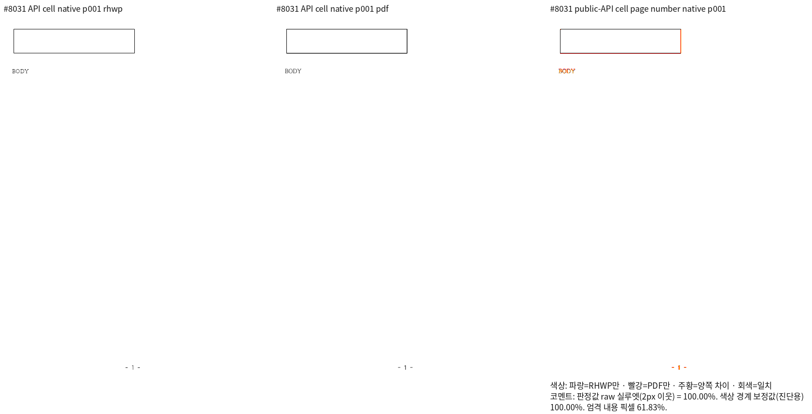
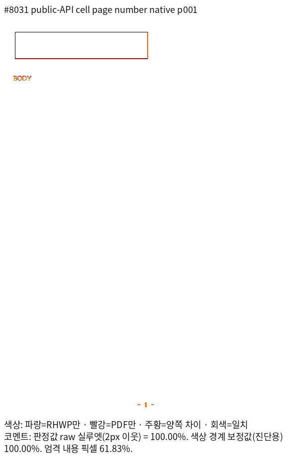
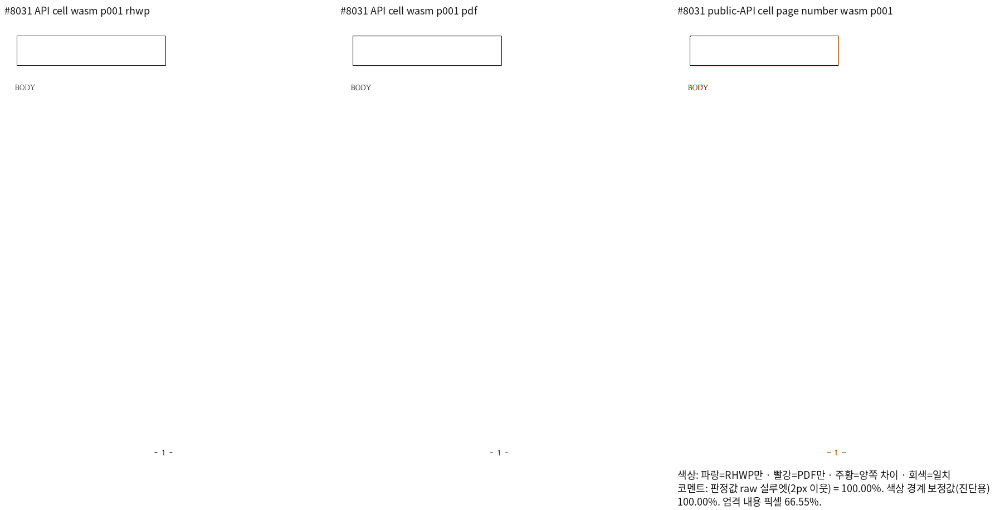
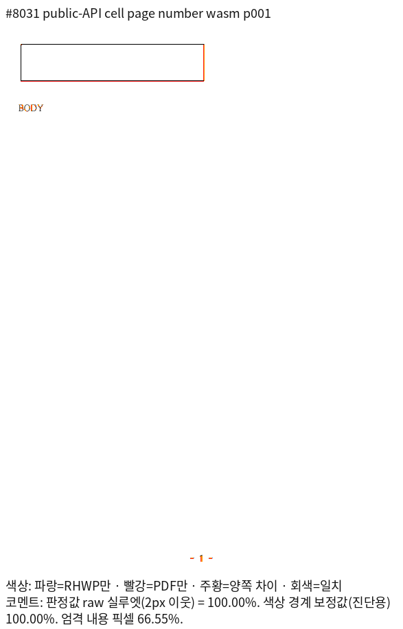

# #8031 셀 쪽 번호의 독립 Print 대조군

## 범위와 판정

원 PR `3b79ee07292b6d386af1ee9e909e0a5549ec52f8`의 셀 내부 쪽 번호 선언·후속
본문 `BODY` 계약을 공개 blank/table API로 구성했다. 1쪽 전체 Native/fresh WASM
raw는 각각 **100.00000%**, 독립 Print와 쪽수는 각각 **1/1**이다. raw는 96 DPI에서
2px 이웃 실루엣 판정이며 RGB 동일성을 의미하지 않는다. 대표 review·overlay를
직접 열어 표 외곽, 뒤 본문과 꼬리말의 위치·유일성을 대조했다.

기존 최소 `Document::default()` IR과 같은 바이트가 아니다. 완전한 DocInfo, 표의
기본 안팎 여백·괘선이 있는 대조군이다. 기존 최소 IR의 Native 14.24802% 미달을
이 결과로 대체하거나 해결 처리하지 않는다. 기존 검사
`tests/cases/page_number_pos_in_table_cell.rs`를 유지하고 새 이름
`tests/cases/page_number_cell_print_contract.rs`에 완료된 대조군의 검사를 추가했다.
통합 전체의 다른 미달과 필수 검증이 남아 있으므로 **통합 PR은 계속 보류**한다.

## 재현 입력과 Print

- [입력 HWPX](../../../../tests/fixtures/pr8031_page_number_cell/pr8031-api-defined-page-number-cell.hwpx)
- [독립 한컴 Print PDF](../../../../pdf/semanticist21-20261019/pr8031-api-defined-page-number-cell-2020.pdf)
- 실제 한컴 2020 MCP job `2618688c-9ce1-4813-8e4a-1754df925180`, 성공 상태·PrintMethod=0,
  `hancom2020_pdf_driver_one_up`. PDF 저장/내보내기 또는 RHWP 재출력본이 아니다.
- `rhwp info`의 마지막 저장 제품은 `hancom-office-2020`이다. 해당 원본에 engine
  `2020`을 명시해 출력했으며 검증의 `--compat 2022`는 2020/2022 조판 세대다.
- 생성 절차: `create_blank_document_native()` → `split_paragraph_native(0,0,0,None)` →
  `insert_text_native(0,1,0,"BODY")` → `create_table_native(0,0,0,1,1)` 순서다.
  원 PR과 같은 용지 44000×60000 HU·여백 2000 HU, 1×1 표 20000×4000 HU,
  TAC/TopAndBottom과 셀 안 `PageNumberPos(position=5, dash_char='-')`를 적용했다.
  공개 API가 생성한 DocInfo·표 기본 여백·괘선을 유지하고 최상위 문단의 layout
  입력을 무효화한 후 `export_hwpx_native()`로 저장했다. HWPX의 제어는
  `pageNum pos="BOTTOM_CENTER" sideChar="-"`다. prefix/suffix 필드를 XML에 별도로
  저장했다고 해석하지 않는다.

## 실행 source와 출력 경로

실행 엔진 source `c2513250ef976cc8189671a5766cd646d75bc4ed`와 기록 시작 head
`a72ce747362f537cc6dba4906dd38a8ea40daece`의 `src/`, `crates/`, Cargo·build 파일,
Studio source·Visual Sweep 파일이 같다. 이번 단계는 fixture·검사·증적만 변경했다.

| 출력 | 고정 산출물 SHA-256 | 전쪽 TSV |
| --- | --- | --- |
| Native261 | `8ac268b00798d80dbf38de0746b43cb51081a521783e027e83a2b50d316432a9` | [Native](native-silhouette.tsv) |
| 표준 최적화 fresh077 WASM | `8132ffc88b9dcb8089cb6e55b84e52d732608a257266b3db516b4d531a8731c7` | [fresh WASM](wasm-silhouette.tsv) |

각 backend의 공통 명령은 아래와 같다. `output/pr-review/semanticist21-20261019` 아래의 고정 producer를 재사용했다.
전체 명령·Print 응답·종료 상태는 ignored `output/pr-review/semanticist21-20261019`의
`page-number-cell-api-validation-4316-result.json`, `page-number-cell-api-print-4315-result.json`에 있다.

```bash
venv/bin/python scripts/visual_sweep.py --silhouette-only \
  --file-target pr8031 <입력 HWPX> <독립 Print PDF> \
  --rhwp-bin <Native261> --compat 2022 --dpi 96 --page-workers 1 \
  --font-path /usr/share/fonts --font-path /usr/local/share/fonts \
  --font-path /home/tsjang/.local/share/fonts --font-path assets/fonts \
  --out output/pr-review/semanticist21-20261019/<실행별 경로>
# fresh WASM은 같은 명령에 --wasm-pkg <fresh-wasm-package-candidate-077>를 추가한다.
```

## 회귀 계약과 직접 판독

새 검사는 셀 내부의 유일한 선언·최상위 선언 부재·한 쪽 소속·`BODY`와 쪽 번호의
각 1회 보존·앞뒤 관계를 확인한다. 독립 PDF에서 꼬리말 기준선은
587.6424560546875pt=783.5232747395834 CSS px다. 해당 쪽의 양쪽 raw 100%와
직접 판독을 확인했으므로 이 기준선은 ±2px로 보호하고 관계 검사도 유지한다.
legacy Paginator도 같은 입력에서 position=5·dash='-'를 확인한다.

실제 자동 수집 `regression_suite_007`에서 새 이름의 2개 검사는 **2 PASS/0 FAIL**이다.
로그 `logs/page-number-cell-auto-nextest-4322.log`에 종료0과 실행 함수가 있다.
처음 자동 실행은 생성 suite가 오래되어 0건으로 종료4였으며 `--prepare` 후 재실행했다.
기존 base070도 쪽 번호를 표시하므로 이를 수정 전 FAIL로 쓰지 않는다. 이미 상속된
기능의 유지 결과이며, 원 수정의 RED 증거로 승격하지 않는다. 원 source의 collector는
새 typeset finalize와 legacy engine 양쪽에서 소비한다.






## 바이트 보존

| 파일 | 바이트 | SHA-256 |
| --- | ---: | --- |
| `pr8031-api-defined-page-number-cell.hwpx` | 7746 | `7e331d2c5a828bf4f915491ee8db3cd0a9eb253d7cc6caad80acebc37044e8b8` |
| `pr8031-api-defined-page-number-cell-2020.pdf` | 12779 | `feb6345ec85aa9166fb3d7a6ce5a2359879cdff66f009c293fd237559986f1a9` |
| `native-overlay.png` | 30233 | `9db4442925083a0d94c3b11165675c5b524c78526a596b913da598bc19f2134b` |
| `native-review.png` | 38027 | `70c8e48befa420680bec11d0f8716ac06bdb2dc28c866787fc706ef262c82dd1` |
| `native-silhouette.tsv` | 138 | `76292db165fc1a04b17dbbd1b6444ba8cf19f40aeff5fc42900007225280ac3b` |
| `wasm-overlay.png` | 30154 | `55a273890075ac9b246396943b9ff0c277f1ca6daeb20700dd6c0eeeaeab10f1` |
| `wasm-review.png` | 37494 | `c8ff31a954826ec5df6c822b95e2182d10df57bcf687e97c782895cf999e5940` |
| `wasm-silhouette.tsv` | 138 | `76292db165fc1a04b17dbbd1b6444ba8cf19f40aeff5fc42900007225280ac3b` |

기존 최소 IR의 두 검사는 `regression_suite_014`에서 별도 실행해 2 PASS/0 FAIL이었다.
새 이름의 suite007 두 검사와 합계4 PASS이며, 단일 target의 필터 결과를 합산값으로
잘못 계산하지 않는다. 기존 원본의 Print 미달은 이 함수 PASS와 별도 판정한다.
