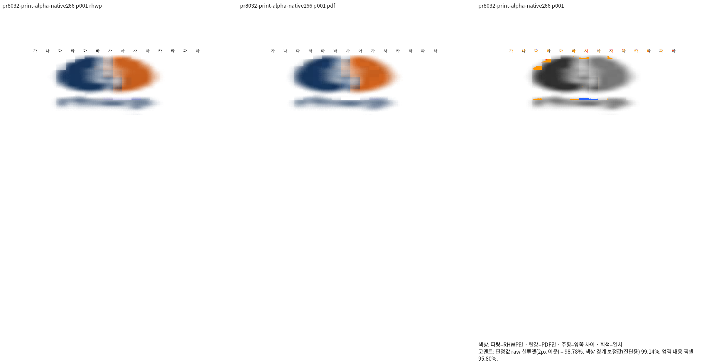
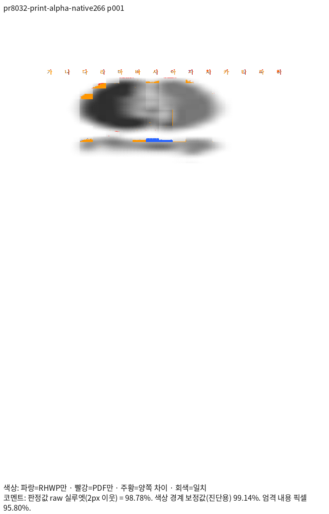
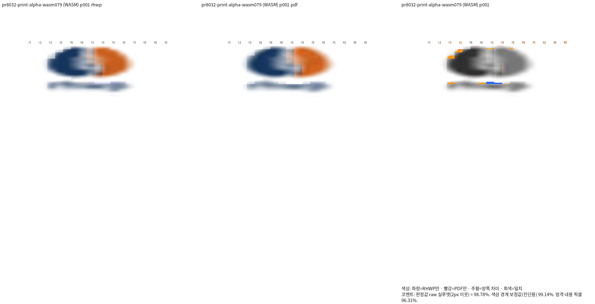
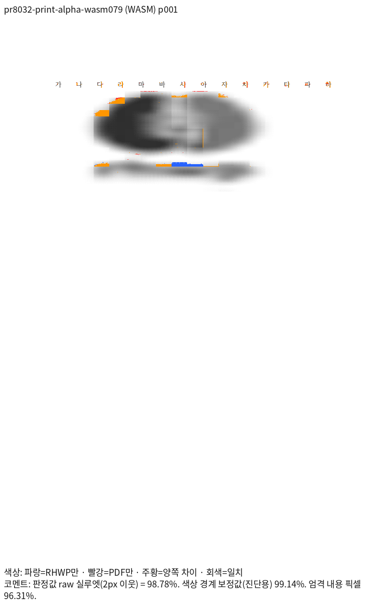

# 연속 알파 그림의 독립 Print 검증

#8032의 공개 API 순서로 만든 넓은/좁은 입력을 내용 변경 없이 한컴 Office 2020
11.0.0.9136의 Print(method 0, `hancom2020_pdf_driver_one_up`)로 출력했다.
두 원본·PDF의 정확한 경로와 SHA-256, PDF 이미지 CTM·명시적 Mask 크기는
[independent-alpha-oracle.json](independent-alpha-oracle.json)에 있다. 기준 PDF를
현재 출력에 맞춰 다시 만들지 않았다. 저장 세대와 대조 옵션은 `--compat 2022`, 96 DPI다.

## 같은 원본의 전쪽 결과

| 입력 | Native265 수정 전 | Native266 수정 후 | fresh078 수정 전 | 최적화 fresh079 수정 후 |
| --- | ---: | ---: | ---: | ---: |
| 넓은 그림 1쪽 | 90.69451 | 98.78322 | 89.93941 | 98.78261 |
| 좁은 그림 1쪽 | 100.00000 | 100.00000 | 99.95997 | 100.00000 |

- [Native 넓은 입력 TSV](tsv/native/wide.tsv), [fresh WASM 넓은 입력 TSV](tsv/wasm/wide.tsv)
- [Native 좁은 입력 TSV](tsv/native/narrow.tsv), [fresh WASM 좁은 입력 TSV](tsv/wasm/narrow.tsv)
- [넓은 입력](../../../../tests/fixtures/pr8032_print_alpha/wide.hwpx), [독립 Print PDF](../../../../pdf/semanticist21-20261019/pr8032-print-alpha-wide-2020.pdf)
- [좁은 입력](../../../../tests/fixtures/pr8032_print_alpha/narrow.hwpx), [독립 Print PDF](../../../../pdf/semanticist21-20261019/pr8032-print-alpha-narrow-2020.pdf)

PNG·TSV의 원본 생성 입력과 제출 fixture는 바이트가 같으며 두 입력은 모두 1쪽이다.
Native/fresh WASM review·standalone overlay를 같은 배율로 직접 대조했다. 넓은 그림의
큰 가로 위치 차이는 해소됐으며 내용·앞 문장의 줄 소속과 순서가 유지된다. 원본 자체가
16×16 픽셀이다. 확대 시 픽셀 칸과 흐린 가장자리가 생기는 것은 독립 PDF에도 같다.
일부 가장자리 알파·RGB 복원 및 글자 raster의 미세 차이는 남으므로 완전 픽셀 일치로
보고하지 않는다. 해당 PNG의 raw 실루엣과 엄격 색상 일치는 서로 다른 지표다.






## 원인과 실제 소비 경로

독립 PDF의 RGB XObject는 FlateDecode이며 별도의 1비트 `/Mask`를 참조한다.
연속 알파 그림은 600 DPI 원본 픽셀의 정수 확대 격자에 RGB 운반체의 시작을 올림하고,
원래 장치 프레임에서 계산한 알파 마스크로 잘린다. 정렬·앞 문장 길이·PNG 메타데이터,
동일 RGBA 재인코딩·32/48 픽셀 대조군과 종횡비를 분리해 확인했다. 문서별 이동값은 없다.

`PrintRasterFrame::new → image_resolver/print_alpha.rs → PaintOp::image의 bbox·payload →
bitmap_raster의 premultiplied 면적 축소 → Skia/Canvas`가 실제 소비 경로다. 저장 IR과
문단 줄 배치는 보존한다. 기존 Catmull–Rom 가중치는 공통 함수로 재사용한다.
연속 알파 PNG의 전체 crop·축 정렬 확대·2020 Print만 해당하며, 이진 알파·회전·축소·
2024·효과·부분 crop은 기존 계약을 유지한다. 600 DPI 출력 버퍼는 4,194,304픽셀 이하다.

## 생산자와 정식 검사

기준 head `5a12bf20e2e0aca40d2edf11d0a44a2bdfb6c5c8` 위 보정의 실제 소스 해시는
ignored `output/pr-review/semanticist21-20261019/print-alpha-native-build-4394-result.json`과
`print-alpha-wasm079-build-4400-result.json`에 기록했다. 후자는 표준 release·실제
`wasm-opt -O`, 8 jobs, 공용 `target/pr-review`로 완료했고 빌드 중 소스 불변을 확인했다.
WASM SHA-256은 `24fd7c188e0386a65ed29506db8e4ed56caeb432305575cfad8c5536266e5670`이며
`pkg`·Studio public·고정 fresh079 package가 같다.

[새 회귀 검사](../../../../tests/cases/print_alpha_source_grid.rs)는 기존 contributor 검사와
다른 이름으로 추가했다. 양쪽 98% 이상·직접 판독을 마친 두 입력의 독립 PDF 운반체를
±2 CSSpx로 검사하고, 앞 문장·그림의 개수·내용 순서·줄 관계와 원본 화면 표본 보존을
함께 보호한다. 기대 좌표와 마스크 크기는 구현 helper가 아니라 PDF에서 직접 읽었다.
전체 SVG 해시로 배치를 고정하지 않는다. 정식 실행과 수정 전 실패/수정 후 통과는 아래 실제 종료 결과에 연결한다.
문서의 설명 자체를 테스트 실행 근거로 대신하지 않는다.

#8188의 기존 4개 입력 × 64쪽×Native/fresh WASM 총 512쪽도 같은 소스로 모두 raw 100이며,
512개 PNG 해시가 직전 자격을 갖춘 Native265/fresh078과 동일하다. 기존 정상 입력·회귀
참조를 추가하거나 복원하지 않았다. 상세 대조는 ignored
`print-alpha-inherited-both-preservation-4419.json`에 있다.


정식 자동 수집 검사 `regression_suite_005::print_alpha_source_grid`는 1 PASS·0 FAIL,
275 filter-skipped·exit0이다. 동일 최종 검사 소스의 수정 전 FAIL(exit101)·수정 후
PASS(exit0)를 확인했다. 실행 로그는 ignored
`output/pr-review/semanticist21-20261019/logs/print-alpha-auto-regression-4426.log`이며
동일 디렉터리의 `print-alpha-red-4425.log`·`print-alpha-green-4425.log`와 대조했다.
전체 통합 검증·CI·merge는 별도로 남아 있다.


## 같은 입력의 재현 명령

저장소 루트에서 현재 소스의 Native CLI와 표준 최적화 web package를 준비한 뒤 실행한다.
두 명령은 각각 독립된 output을 사용한다. 좁은 입력은 파일명과 key의 wide를 narrow로 바꾼다.

```bash
python3 scripts/visual_sweep.py --silhouette-only \
  --file-target pr8032-alpha-wide tests/fixtures/pr8032_print_alpha/wide.hwpx \
  pdf/semanticist21-20261019/pr8032-print-alpha-wide-2020.pdf \
  --rhwp-bin target/pr-review/release-test/rhwp --compat 2022 --dpi 96 --page-workers 1 \
  --font-path /usr/share/fonts --font-path /usr/local/share/fonts \
  --font-path /home/tsjang/.local/share/fonts --font-path assets/fonts \
  --out output/pr-review/semanticist21-20261019/alpha-reproduce-native

python3 scripts/visual_sweep.py --silhouette-only \
  --file-target pr8032-alpha-wide tests/fixtures/pr8032_print_alpha/wide.hwpx \
  pdf/semanticist21-20261019/pr8032-print-alpha-wide-2020.pdf \
  --rhwp-bin target/pr-review/release-test/rhwp --wasm-pkg pkg \
  --compat 2022 --dpi 96 --page-workers 1 \
  --font-path /usr/share/fonts --font-path /usr/local/share/fonts \
  --font-path /home/tsjang/.local/share/fonts --font-path assets/fonts \
  --out output/pr-review/semanticist21-20261019/alpha-reproduce-wasm
```
