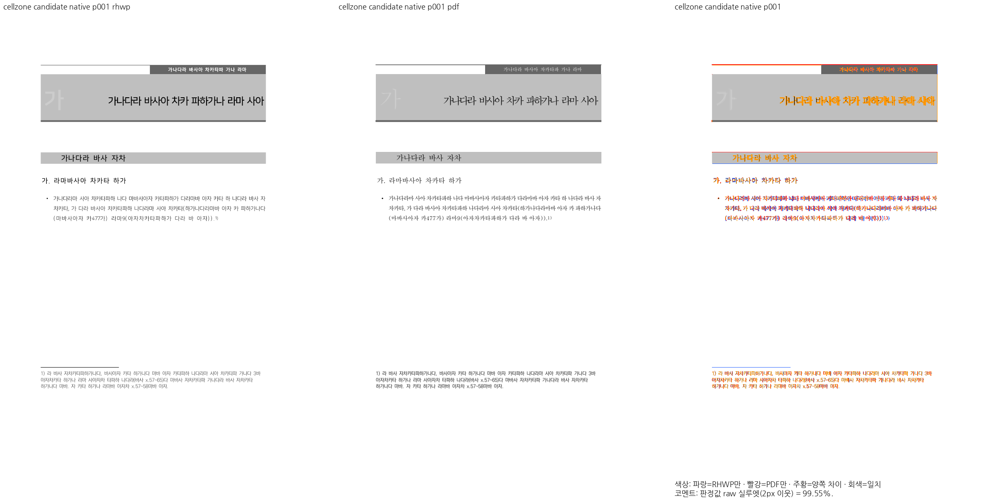
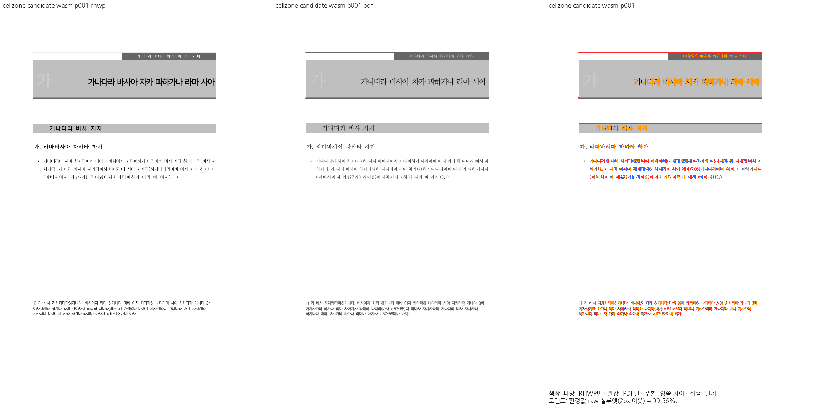

# PR #8145 메인터너 독립 검증 — 2026-10-30

최신 devel `698906bf4aeaa6d0d7101a4fd4d7c4a9229f6bb2`와 원 PR head `a88d758d6f80e7b4b5a788f4dc70df7c865b6516`만 합친 후보 `9e3a672474cc3e424cd068bfa998285dd172e0e0`를 비교했다. 후보 tree는 `6aaeeefc13c5db204aafb319ffd09353b3d7290c`다. 보류 중인 다른 PR의 코드는 포함하지 않았다.

## 전쪽 결과

raw는 색상 경계 보정 전 2px 내용 실루엣 일치율이다. base/candidate × Native/WASM 전체 TSV 24개를 원본 바이트 그대로 보존했다. 각 경로에서 6문서 36쪽, 총 72개 쪽 쌍을 비교했다. 모든 입력에서 독립 PDF와 쪽수가 일치하고 누락·측정 불가 쪽은 없다.

| 문서 | 쪽수 | 후보 Native 전쪽 최저 raw | 후보 fresh WASM 전쪽 최저 raw | base 대비 바뀐 쪽 |
| --- | ---: | ---: | ---: | --- |
| cellzone | 1 | 99.54886% | 99.55637% | p1 |
| issue1880 | 13 | 45.43888% | 95.96391% | p9 |
| issue6542 | 7 | 97.85512% | 97.84222% | p4 |
| issue6298 | 12 | 96.38263% | 96.35623% | p6 |
| header-footer (#8165) | 1 | 91.11882% | 91.03647% | 없음, PNG 동일 |
| master-carry (#8165) | 2 | 100% | 100% | 없음, PNG 동일 |

- 원 사례 p1: Native **76.17115% → 99.54886%**, WASM **76.32898% → 99.55637%**.
- 최대 하락은 issue6298 p6의 Native 0.01665%p / WASM 0.01673%p다. 원인은 병합 칸 아래 선의 배경색 경계 차이며 새 배치·내용 차이는 보이지 않는다. 2%p 초과 하락은 0쪽이다.
- 유일한 90% 미만은 Native issue1880 p1이다. base/candidate 모두 45.43888%, PNG SHA-256도 `ecbe2b6eba6e46c0dfed318545905ef0926f266128efe2bc7eca4cab33bfa076`로 같다. 이번 환경에서 WASM의 같은 쪽은 양쪽 모두 100%, PNG도 같다.
- **자동 gate는 Native issue1880에 `re_review_required`를 유지한다.** 메인터너의 기존 결함 분리·수용 지시에 따라 이 제목 누락에 한정해 머지 차단에서 제외한다. 결함 해결·전체 90% 통과·글꼴 예외로 바꾸어 기록하지 않는다.

[쪽별 전후 값과 PNG 해시](page-comparison.json), [생산자·입력·PDF·명령·자동 gate](verification.json).

## 직접 판독

같은 쪽·영역의 base/후보/독립 Print를 직접 비교했다. 상세 PNG는 이번 전쪽 실행의 PNG로 공식 Visual Sweep compare/overlay/review 함수를 실행해 만들었다. 과거 누적 후보 캡처를 재사용하지 않았다.

- cellzone p1: 회색 면이 병합 끝 칸의 오른쪽 끝까지 확장된다. 글자 위치·표 외곽·후속 본문은 보존된다. 기존 글꼴 모양과 각주 선 차이는 남는다.
- issue1880 p9: 세로 병합 머리 칸 아래쪽도 회색으로 채워진다. 글자·행·표 위치는 같다. p1의 기존 Native 제목 누락은 현재 PNG에서도 확인했다.
- issue6542 p4: 대각선이 위쪽 작은 칸에서 끝나던 상태에서 세로 병합 칸의 끝까지 이어져 Print와 같은 관계가 된다. 글자·표 격자는 보존된다.
- issue6298 p6: 병합 칸 아래 경계의 색 차이 외에 새 위치·내용 차이는 보이지 않는다. 기존 글꼴 굵기 차이는 보존된다.
- 변경 영역에 수식은 없으며 글자 기준선·간격·표 외곽을 함께 확인했다. #8165 대조군은 전쪽 PNG 바이트 동일성을 확인했다.

| 영역 | Native 확대 비교 | WASM 확대 비교 |
| --- | --- | --- |
| cellzone p1 | [PNG](zooms/native-cellzone-1.png) | [PNG](zooms/wasm-cellzone-1.png) |
| issue1880 p9 | [PNG](zooms/native-issue1880-9.png) | [PNG](zooms/wasm-issue1880-9.png) |
| issue6542 p4 | [PNG](zooms/native-issue6542-4.png) | [PNG](zooms/wasm-issue6542-4.png) |
| issue6298 p6 | [PNG](zooms/native-issue6298-6.png) | [PNG](zooms/wasm-issue6298-6.png) |

## 재현과 증거 출처

`verification.json`에 실제 명령·경과 시간·종료 코드와 입력/PDF 해시를 남겼다. 실행 당시 `output/` 경로는 정리 대상이며 최종 TSV·PNG는 이 폴더에 보존했다. Native는 `cargo build --locked --profile release-test --features native-skia --bin rhwp`, `CARGO_BUILD_JOBS=6`, `CARGO_PROFILE_RELEASE_TEST_OPT_LEVEL=1`, `CARGO_PROFILE_RELEASE_TEST_CODEGEN_UNITS=64`로 양쪽을 빌드했다. 공유 `CARGO_TARGET_DIR=target/pr-review`를 순차 사용했다.

fresh WASM은 양쪽 각각 `scripts/wasm-pack-locked.sh --target web --out-dir pkg`로 최적화·wasm-opt까지 완료하고 Chrome 155.0.8059.79에서 실제 print Canvas를 렌더했다. `pkg`와 Studio public JS/WASM 바이트 일치도 확인했다. 첫 base WASM 실행은 Chrome 자동 발견에 실패해 측정값이 없었다. 설치된 Chrome 경로를 명시하고 같은 새 빌드로 WASM 측정만 재실행해 완료했다.

Visual Sweep: `scripts/visual_sweep.py --silhouette-only --dpi 96 --compat <2024|2022> --rhwp-bin <base|candidate>/rhwp --file-target <key> <input> <pdf> --out <out>`에 같은 `--font-path` 4개를 공급했다. WASM에는 `--wasm-pkg <base|candidate>/pkg`를 추가했다. 2020 Print에는 compat 2022를, 2024 Print에는 2024를 적용했다.

글꼴은 KoPub, Nanum, Windows Fonts, 로컬 변환 HFT 디렉터리를 양쪽에 동일하게 공급했다. 실제 파일 해시는 JSON에 있고 폰트 바이너리는 포함하지 않는다. 글꼴별 렌더링 차이의 근본 원인을 이번 변경에서 해결했다고 주장하지 않는다.

cellzone 독립 PDF는 메인터너가 별도로 확보한 한컴 2024 Print(13.0.0.3901)다. 기여자의 13.0.0.711 PDF·수치와 혼합하지 않는다. 로컬 검토 브랜치의 정식 경로 `pdf/pblsketch_review_20261030/cellzone-merged-end-fill-2024.pdf`, 최초 기록 commit `de47e0f23402be9f70f9a27bc479f72772776810`, blob `7c07163d9f6b27c54c84a02d9fd5bc73c3ed9030`에서 그대로 공급했다. PDF SHA-256은 `7b40481db67e9ecb5cde7bb8982147506e91d5b162abe3ef7d13c1be47871b77`이다. 이 PDF와 #8165 PDF는 보존 중인 로컬 검토 브랜치에 있으므로 원격 devel 다운로드 링크로 가장하지 않는다. 각 PNG 패널에 같은 PDF 래스터가 포함되어 있다.

issue1880/issue6542/issue6298은 저장소의 독립 2020 Print를 사용했다. issue1880의 두 공개 별칭 원본은 바이트가 같아 하나의 13쪽 실행으로 대조했다. 입력·PDF 경로와 hash는 JSON에 있다.

## 집중 회귀

기존 자동 수집 경로의 cellzone 병합 끝 칸, #6619 테두리, #1623 대각선, split cellzone, #8165 틀·바탕쪽 6개 case를 선택했다. **26 PASS / 0 FAIL**, 이름 필터로 제외된 검사는 1,393개다. 전체 suite 실행으로 기록하지 않는다. source·test·fixture·기대값은 수정하지 않았다.
