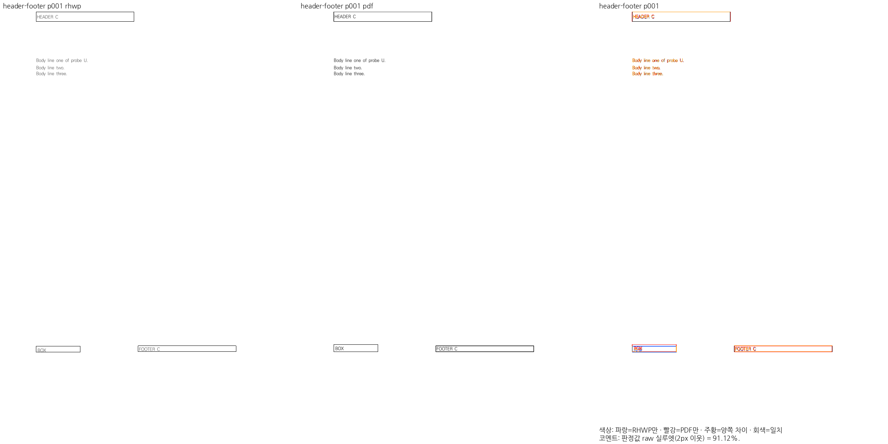
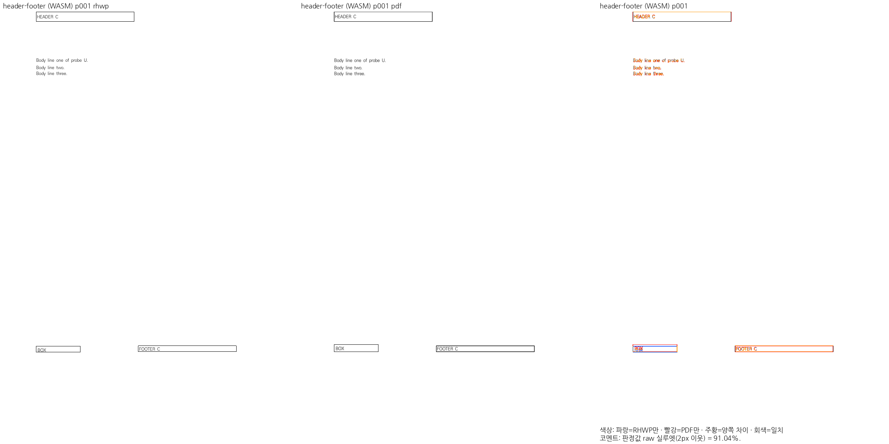

# #8165 메인터너 검증 증거

2026-10-30 누적 후보 `cffa5c8619662945ba82bd1a0798ac3347884425`에서 실행한 자료를 원본 바이트 그대로 보존한다. base는 `ad4bf269ffef5adf2142b33004a9981fad7ce804`, 원 PR head는 `0de61c2578063775dde80b6ccdc41e2a8ed8841f`다. 이번 머지 승인 뒤 독립 후보를 새로 빌드한 자료가 아니다. 전체 입력·PDF SHA와 실제 측정 수치는 [provenance.json](provenance.json)에 있다. PDF는 메인터너가 한컴 2024 13.0.0.3901 Print로 별도 확보했다.

## 실행과 결과

`scripts/visual_sweep.py --silhouette-only --compat 2024 --dpi 96 --rhwp-bin <candidate-rhwp> --out output/pr-review/<phase> --file-target <key> <input> <PDF>`를 실행했다. WASM은 `--wasm-pkg pkg`를 추가하고, 대표 그림은 `--silhouette-only`를 빼고 생성했다. print 프로필과 `/home/edward/mygithub/ttfs/kopub`, `/usr/share/fonts/truetype/nanum`, `/mnt/c/Windows/Fonts`를 각각 `--font-path`로 공급했다. 같은 source의 최적화 fresh WASM을 빌드해 pkg/Studio public 바이트 일치와 Chrome 155.0.8059.79 실행을 확인했다.

- Native 전쪽 producer SHA-256: `e48ca48e4faf0e46a5f10b2ac91bf3f2ae9e54564b771a195b4d93cb9303fe0e`.
- 상세 이미지 producer SHA-256: `d285ec87e6ca00bed384bb66a9eaeb0e95b1086d2f84518783c284abf99653da`.
- fresh WASM SHA-256: `4ccbecaa141be25d4d859caced5456cebd2a4bac2f91304b31a2ff10a4d38563`.
- JS SHA-256: `554f4b47542925de9a812a8029f339c87f6bc71cadd6630fcfab53cddc654b28`.

| 입력 | 쪽수 | Native raw | fresh WASM raw |
| --- | ---: | ---: | ---: |
| header-footer-paper-frame.hwpx | 1/1 | 91.11882% | 91.03647% |
| master-page-section-carry.hwpx | 2/2 | p1/p2 모두 100% | p1/p2 모두 100% |

raw는 색상 경계 보정 전 2px 내용 실루엣 일치율이다. pixel_match나 visual_accuracy_proxy_percent로 바꿔 부르지 않는다. 해당 별도 지표는 이 보존 자료에서 확정하지 않았다. 90% 미달은 0쪽이다.

직접 판독에서 머리말 표와 꼬리말 개체, 둘째 구역 바탕쪽 복원을 확인했다. BOX 윗변·기준선 약 4px 차이는 남는다. 개선 완료로 숨기지 않고, 사용자가 이 잔여 차이를 인지한 후 #8165 머지를 승인한 사실을 [검토 기록](../../archives/pr_8165_review.md)에 남겼다.

