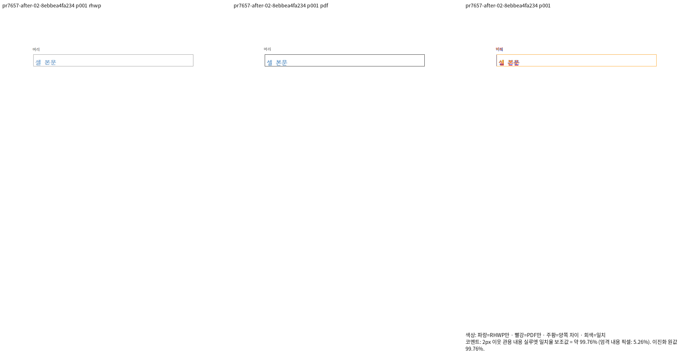
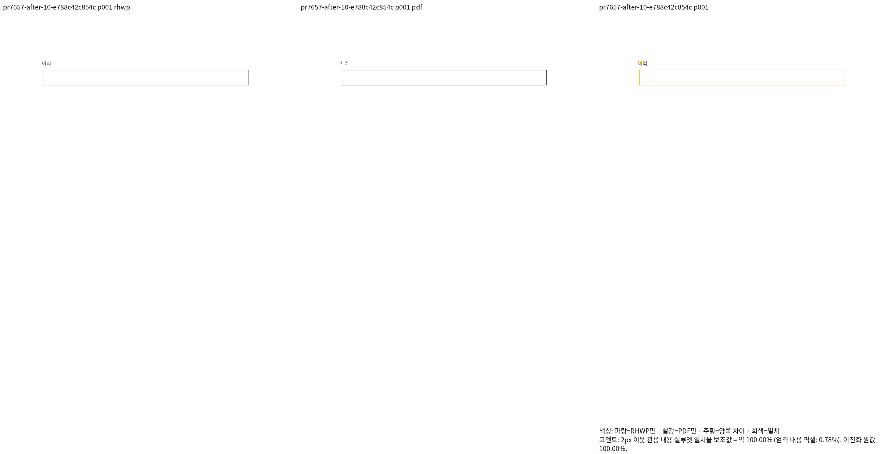

# 셀 서식·저장 첫 줄 앞 띠의 최종 비교(v447)

생산 코드 커밋은 `3cdcb2e20a47dc23dfdd6d1b399ad4d247430b44`, 고정 base는
`bfa28a77a2714482f647ee6a7b9aa7f7876d8404`다. 입력 10개와 독립2020 Print PDF는
이 커밋의 바이트와 일치함을 확인했다. 입력은 기존 `pr7657-batched-correction-v406/after/`를 사용한다.

모두 전체1/1쪽을 새로 비교했다. 최저 Native/fresh WASM은 **99.76088%**(visible-style),
나머지9개는100%이며 원래 셀 서식 삭제 HWP/HWPX도100%다. 미달·누락·쪽수 불일치는 없다.
10개 모두 실제 Native/fresh RGBA가 완전히 같다. 현재 review/overlay의 셀 외곽과
내용·앞뒤 위치를 직접 확인했다. 세부 래스터의 가는 선·글자 획 차이는 원본 이미지에 보존했다.

명령·생산/입력 hash·20개 TSV·최종 결과는 ignored
`output/pr-review/semanticist21-20261008/pr-review-resumed-v447/`의
`cells-validation-retry1-plan.json`, `cells-validation-retry2-plan.json`,
`cells-qualified-scores.json`, `cells-native-wasm-rgba.json`에 연결한다.
기본 CLI의 커밋 시각 검사 거절과 동시 전체 회귀 중 브라우저 navigation timeout을 기록했다.
전체 회귀 종료 후 누락된 Native2개만 재시도했고 fresh10개는 새로 실행해 완료했다.
fresh10개 실행은 exit0/384.813초다. 공용 target과 루트 pkg를 재사용했다.

[개별 PR 기록](../../../archives/pr_7657_review.md)

| 입력 | Native | fresh WASM |
| --- | --- | --- |
| visible-style |  |  |
| 원래 HWP 셀 서식 삭제 |  |  |
| 원래 HWPX 셀 서식 삭제 |  |  |
