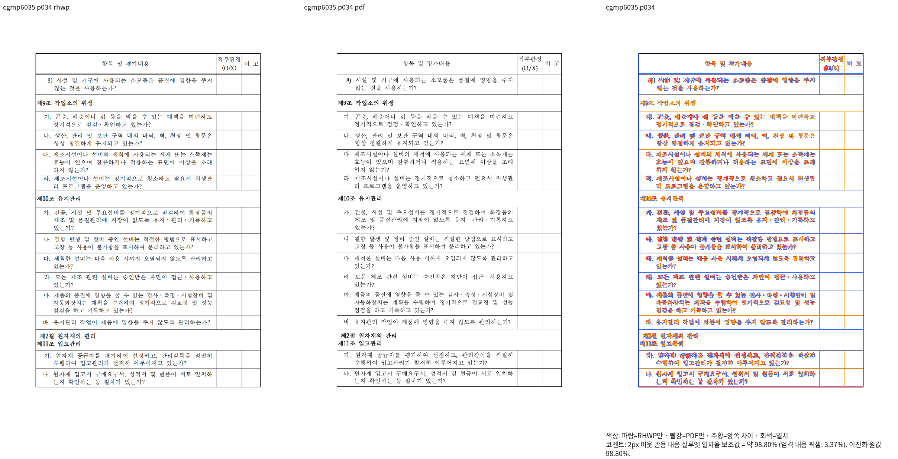
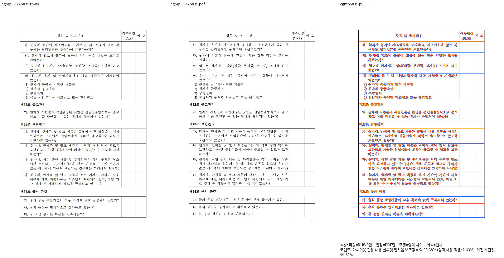

# CGMP 완료 행의 의미 검사 보정

- 생산 Rust: `7749d712ca338d1883cc092d8020133b312082f4`.
- 원본: `samples/issue6035/cgmp_evaluation_table.hwpx`, SHA256
  `0f03119d6ac3e19f74fc9fcec5315ac6ed436bab5abffd0804e9cf3350dd747a`.
- 독립 한컴2020 Print:
  `pdf/semanticist21-20261008/cgmp-original-v97/cgmp_evaluation_table-0f03119d6ac3-2020.pdf`,
  SHA256 `08ae67334ed2cb690dc25f5447d9c7204044a5b313e026fb20f4147de0182d4a`.
- 현재 Native/fresh WASM 모두 전48쪽/Print48쪽, 최저47쪽93.64014%, 미달·누락0.
  전체48쪽 decoded RGBA도 같다. fresh WASM SHA256은
  `6741509894054ff51881f01d78603ba364a5f670c45ef93fa12171b30651c09b`.
- 34/35쪽을 양 backend의 같은 배율 review로 직접 읽었다. 원자재 입고 행은34쪽에서
  끝나고35쪽은 다음 원본 행부터 시작한다. Native36/47쪽도 직접 읽었다.
- 기존 검사5개 중4PASS/1FAIL. 실패는 완료 행에도 비어 있지 않은 부분 endCut을
  요구하는 전제였다. 해당1개만 완료 셀의 전체 원본 내용/포함, 다음 행의 시작,
  다음 쪽의 완료 행 셀 중복 부재로 교정했다. 공유 split_pair와 나머지4개는 유지한다.
  최종 포맷된 정식 소스로5/5PASS를 확인했으며 전체nextest의 통과로 확대하지 않는다.
- 각주/본문 소속·전체 쪽수·변경 영역을 점수와 별도로 확인했다.47쪽의 글꼴 굵기와
  raster 차이는 남는다. 명령/TSV/log/실제 도구 SHA/전후 검사 source hash는 ignored
  `output/pr-review/semanticist21-20261008/final-code-validation-v449/`에 보존한다.

## Native

## fresh WASM

