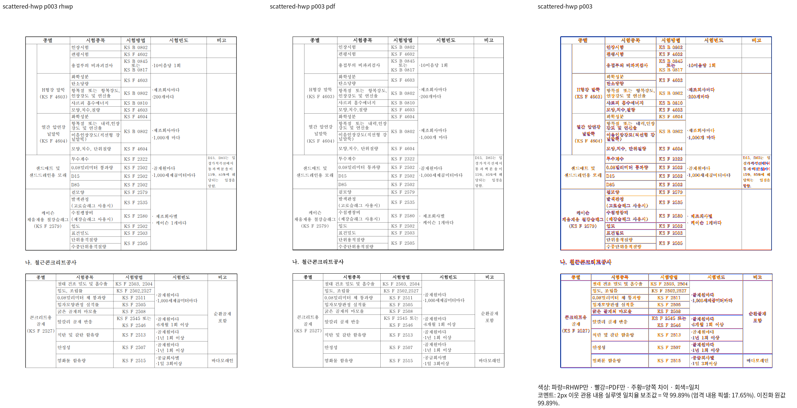

# CI 표 이어받기 보정 증거

생산 소스 `9591883177d902ed3e2fa239fe047f602c05c7d3`, 고정 base `22317614b03722e95349a1d3d71c86923363c6f5`. 커밋 전 같은 생산 바이트로 만든 공용 dev 바이너리의 source hash와 최종 커밋 일치를 v459에 보존한다.

산재 표 HWPX는 독립 한컴 Print52쪽과 Native52쪽이 같고, 전쪽 최저37쪽92.60853%·미달/누락0이다. 3쪽99.88979%, 상단 표의 종료 행·외곽과 뒤 제목/표의 소속·내용을 직접 판독했다. HWP도 전52쪽 최저37쪽92.60853%·미달/누락0이며3/4/46쪽을 직접 판독했다. fresh WASM도 HWP/HWPX 각각 전52쪽 최저37쪽92.60853%·미달/누락0이다. 두 형식의3쪽과 변경 경계/최저 쪽은 직접 판독 또는 현재 Native PNG와 전체RGBA 동일성으로 연결했다. 관련 Rust191개 및 세 Clippy·workspace build·정책은 통과했으며, 다른 문서의 최종 비교도 완료했고 총178 TSV·978쪽/backend에서 미달·누락·쪽수 불일치0이다. 원격 새 exact-head CI는 push 후 별도로 확인한다. 원문 TSV: https://gist.github.com/jangster77/1efd96731b845480bc1b8f38344d6d6e/b2596295b382ff4585bf28ed40efe6a3ab568cba.

입력: `samples/task1716/table_scattered_header_rowbreak.hwpx`. 독립 Print: `pdf/task1716/table_scattered_header_rowbreak-hwpx-2020.pdf`, profile print, compat2022, full embedded fonts, DPI96. 명령·입력/PDF/바이너리·font 해시·52쪽 TSV 원문과 실행 로그: ignored `output/pr-review/semanticist21-20261008/shared-row-plan-v459/`.

HWP 입력은 `samples/table_scattered_header_rowbreak.hwp`, 독립 Print는 `pdf/table_scattered_header_rowbreak-2024.pdf`이며 compat2024를 사용한다. HWPX는 위 compat2022를 사용하며 source/font/package hash와 실제 명령은 TSV manifest에 각각 보존한다.
