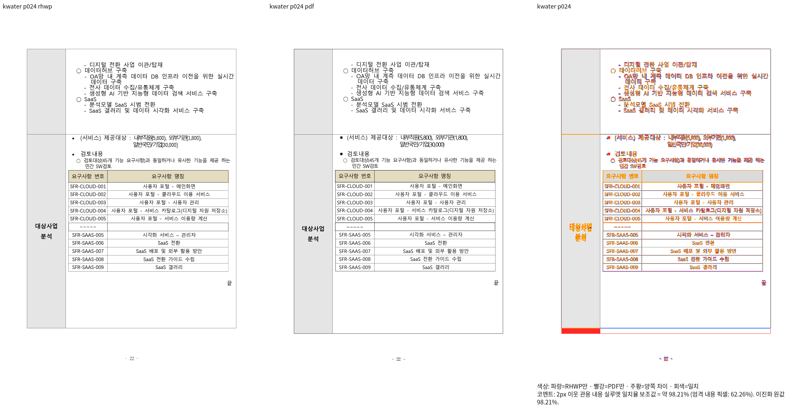
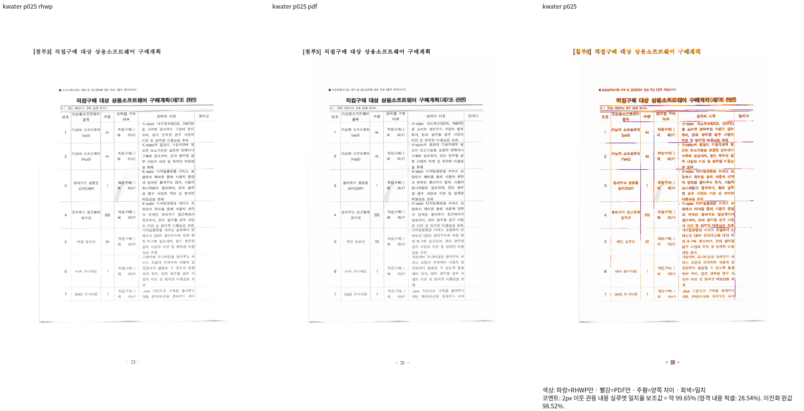

# 저장 셀 프레임의 이중 계상 보정 — 검증 진행 중

고정 base: `552f5228d2dbfd6046c838f14241704f1bcb8a05`.
원본: `samples/hwpx/k-water-rfp.hwpx`, SHA256 `036ae73c4982696b9aad50c43a1c47f50871d1447aef3209e058f1b30fa2fc14`.
독립 한컴 Print: `pdf/hwpx/k-water-rfp-hwpx-2020.pdf`,27쪽.
입력은 PDF 추가 commit `ce808b588fd43698fd105f0be0320921c83a829c`의 바이트와 같다.

측정된 표가 호스트 앞의 저장 프레임에 포함될 때 저장 문단·표 원점과 내용 끝을 같은 결과로 반환한다.
호스트 원점 아래에 이미 앞에 있는 표 높이를 다시 더하던 fallback을 사용하지 않는다.
새 분기는 원본 줄·앞/뒤 문단과 실제 바깥 상자의 폐쇄 조건을 모두 만족하고,
모든 표가 같은 조건이며 전체 셀 사다리가 되감기지 않을 때만 적용한다.
부분 저장 정보·다른 앵커·명시적 새 쪽/단·편집 정보는 이 계약의 범위 밖이다.

Native build exit0, 전체 쪽수28→27, #157 원본2쪽 유지, 기존 #157 정식 검사1PASS다.
영향24쪽98.20912%,25쪽99.64755%, Print와 전체 쪽수27/27이다.
24쪽 표·중첩 표·끝 표시는 같은 쪽으로 복원됐지만 표 하단 높이 차이는 남아 있다.
직접 판독으로 이 차이를 확인했으며 높은 점수로 완료 또는 승인 처리하지 않는다.
전27쪽 Native/fresh·확대 판독과 전체 회귀/lint는 아직 완료하지 않았다.

source/CLI SHA·명령·결과는 ignored `regression-root-cause-batch-v448/closed-cell-frame-build-result.json`,
`closed-cell-impact-plan.json`, `kwater-closed-cell-boundary-result.json`,
`kwater-closed-cell-pages.json`, `issue157-closed-cell-run.log`에 기록한다.
이 증적은 신규 회귀 추가의 선행 조건을 충족했다는 선언이 아니며 K-water 신규 검사를 추가하지 않았다.

