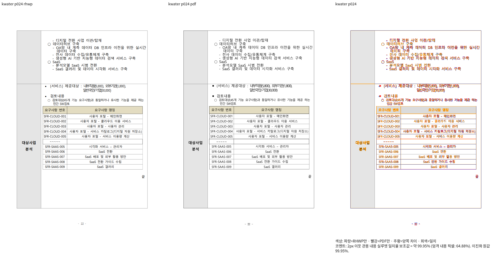
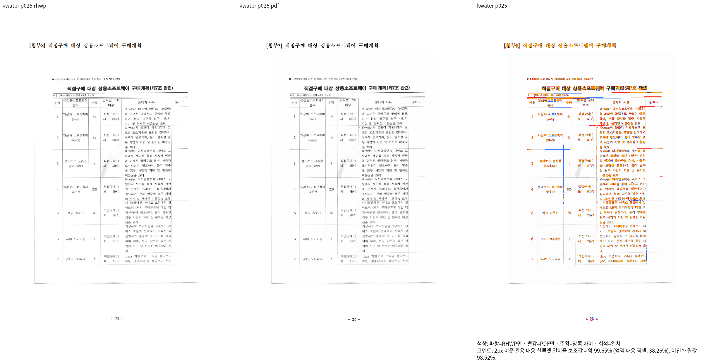
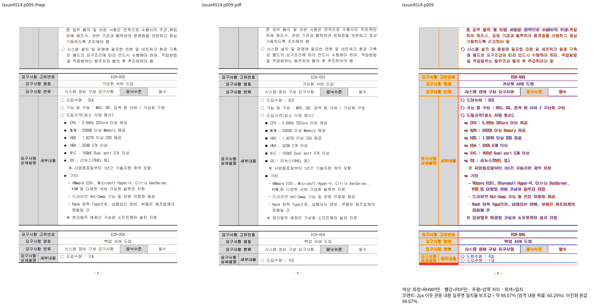
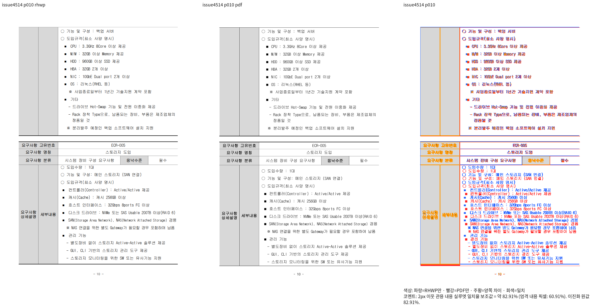
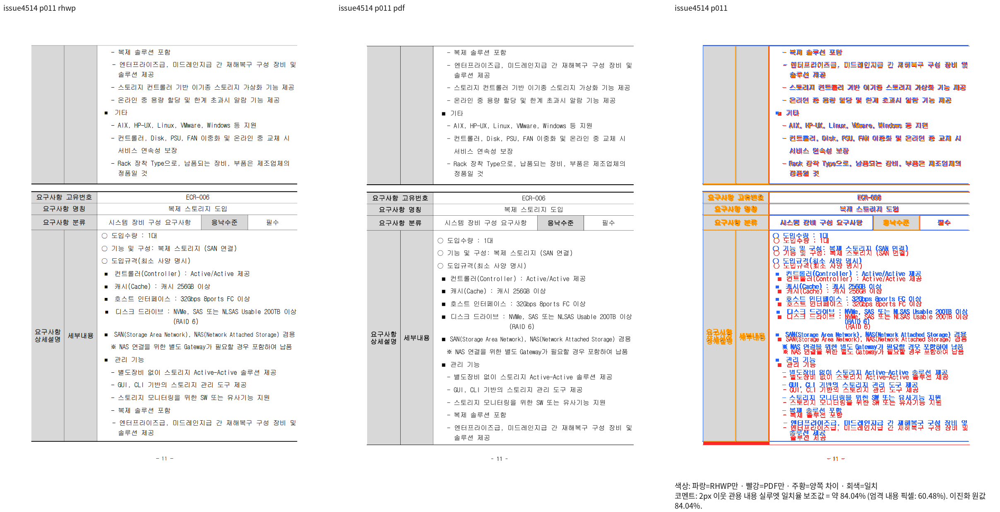

# 닫힌 셀 프레임·장식 표 내용 컷의 Native 경계 증거

생산 코드: `7749d712ca338d1883cc092d8020133b312082f4`.
고정 base: `552f5228d2dbfd6046c838f14241704f1bcb8a05`.
같은 코드의 immutable CLI로 실제 재출력했다. 실행·입력/Print/CLI hash·파일별 source hash·argv는 ignored
`regression-root-cause-batch-v448/closed-row-overlay-batch-visual-plan.json`에 보존한다.

## K-water

- 입력 `samples/hwpx/k-water-rfp.hwpx`, SHA-256 `036ae73c4982696b9aad50c43a1c47f50871d1447aef3209e058f1b30fa2fc14`.
- 독립 Print `pdf/hwpx/k-water-rfp-hwpx-2020.pdf`, 양쪽 전체 쪽수27/27.
- Native 선택24쪽99.94889%,25쪽99.64755%, 미달/누락0.
- 새24쪽 review를 직접 열어 두 행의 이어받기·중첩12행 표·`끝`·하단 빈 밴드·외곽선을 대조했다.
  기존 잘못된 하단선964.95px에서 현재982.35px으로 수정됐고 Print981.16667px과2px 이웃 안이다.
- 전체27쪽 Native와 현재fresh는 별도 최종 실행 중이다. 선택 두 쪽을 전쪽/fresh 완료로 보고하지 않는다.

## #4514 기존 미달 문서의 현재 행 소실 보정

- 입력 `samples/issue4514/sample1-repro.hwp`, SHA-256 `72d3be39c8af8779387e7657cb9cd5823fda62dff1c8700ab1bfe73592baf793`.
- 독립 Print `pdf/issue4514/sample1-repro-hwp-2020.pdf`, SHA-256 `939ff6aa74c887179214577150e7a9cbf5cb746969f2041a0a7c606d3c93f0ed`.
- Native9쪽98.06674%,10쪽82.91036%,11쪽84.03715%, 전체 쪽수46/46.
- ECR-004의 `도입수량`은9쪽에, `기능 및 구성`부터10쪽에 소유한다. 단순히 전체 행을 다음 쪽에서
  반복하던 base와 현재 변경의 행 소실을 구분했다. ECR-005 뒷 본문은11쪽에 이어진다.
- 이전 검사의3쪽 핀은 독립 Print의11쪽ECR-005를 누락시키는 잘못된 기대다. [#7808](https://github.com/edwardkim/rhwp/issues/7808)의
  기존 미달 범위로 그 핀만 이관하고 정확한 전46쪽 무겹침·연속 소속·ECR-004 두 조각/이웃 관계는 유지했다.
  현재 정식 소스 실행1PASS는 해당 관계의 증거이며 **전쪽90% 통과의 증거가 아니다**.
- 10/11쪽의 간격 차이와 전쪽 미달은 #7808에서 미해결이다. 이 문서를 완료·90% 통과로 표시하지 않는다.
  현재fresh/전쪽 완료도 미검증이다.9/10쪽 review를 직접 열었고11쪽은 추가 증거로 보존했다.

