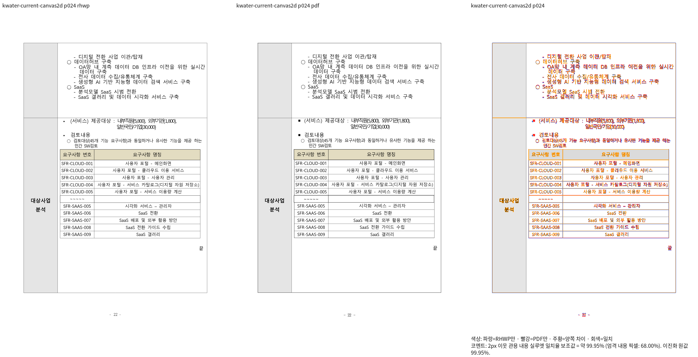
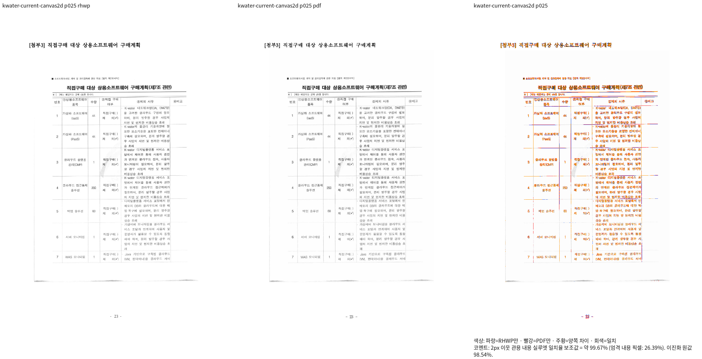
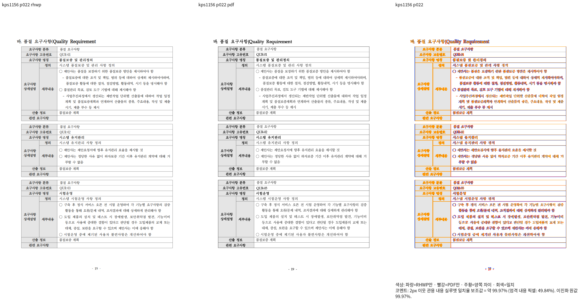
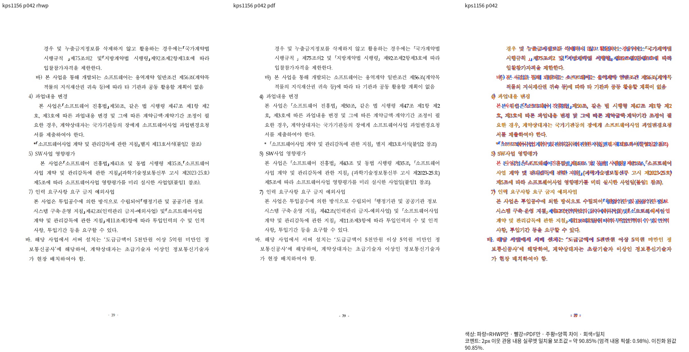

# 현재 producer의 fresh WASM과 실제 Canvas2D 증거

생산 Rust `7749d712ca338d1883cc092d8020133b312082f4`, 현재 최적화 WASM
`6741509894054ff51881f01d78603ba364a5f670c45ef93fa12171b30651c09b`를 검증했다.
원본/Print 경로·해시·전체 페이지의 실제 명령·TSV·로그는 통합 리뷰 진행186과 ignored v449에 연결한다.

- KPS Native/fresh 각 전77쪽/Print77쪽, 최저42쪽90.85010%, 미달·누락0.
  75쪽 RGBA는 같고22쪽은331픽셀,42쪽은1픽셀이 다르다. fresh22/42쪽 review를 직접
  읽어 표/내용 순서·글줄 소속과 줄바꿈을 확인했다.22쪽99.96707%,42쪽90.85010%.
- 원PR의 편집/정상대조24쌍·27쪽은 Native/fresh 모두 최저92.07644%, 미달·누락0,
  전체27쪽 RGBA도 같다. 이 자료를 전체Rust/Skia 완료로 확대하지 않는다.
- 실제 Studio Canvas2D의 K-water24쪽99.94940%,25쪽99.66933%, 전체 쪽수27/Print27쪽.
  응답 JS/WASM 해시와pageerror0을 확인했다.24쪽의 표 바닥·뒤 내용,25쪽의 다음 첨부 소속을
  직접 읽었다. 이 두 쪽 consumer 검증은 전27쪽 Native/fresh 대조를 대체하지 않는다.
- 같은 현재 Native24쪽의 font-face 바이트/선언을 공급했다. 기존 로컬bold/한양신명조 선언은
  미설치로 실패할 수 있다. 검사 스크립트의 처음 두 시도는 모든font.load가 성공해야 한다는
  전제로NetworkError였다. 성공으로 재분류하지 않고 시도 기록을 보존한다.
  필요한 face의 상태를 기록하고 canonical `recoverUnavailableLocalBoldFaces`로
  이미 로드된 맑은 고딕 regular의 synthetic bold 선택을 복구한 뒤 실제 출력을 재캡처했다.
  선언·glyph·좌표를 임의로 삭제/수정하지 않았다. unavailable 한양신명조는 기존 webfont/fallback
  계약과 실제 출력으로 확인하며 모두 실제 원face가 로드됐다고 보고하지 않는다.
- Native Skia와 나머지 필수 전쪽/전체 회귀는 현재 진행 중이며 개별PR은 아직 머지보류다.

## 실제 Canvas2D

## fresh WASM SVG

