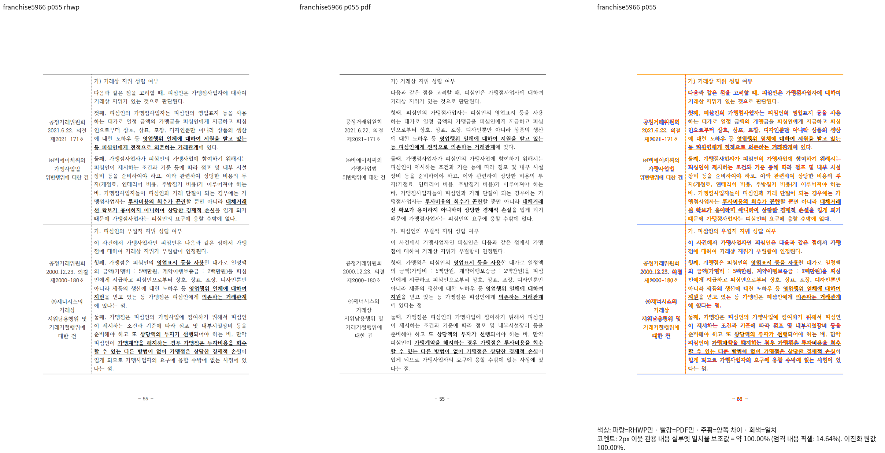
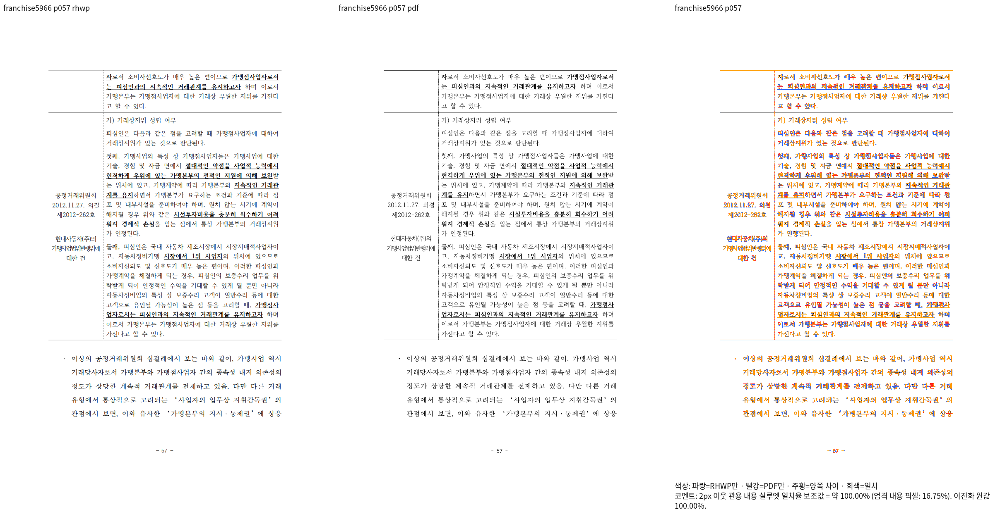
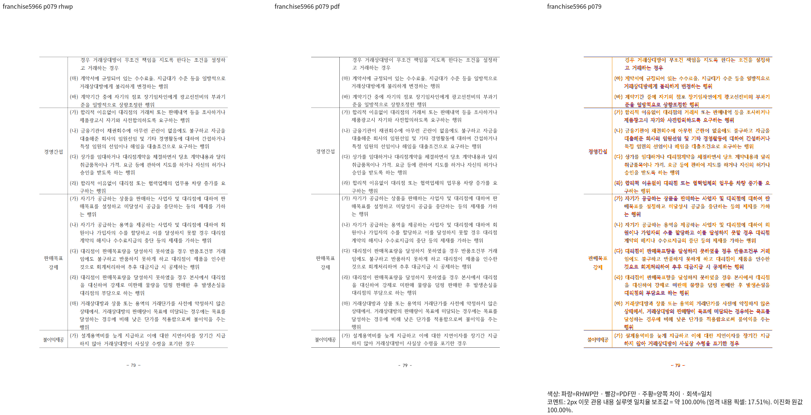
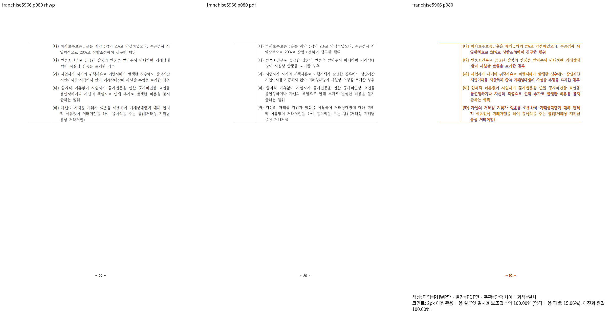

# 저장 종료 프레임의 선택 줄 정렬 — Native 경계

생산 `7f04c48cd395086ed59c08565f343d3f9e1b013d`, 공용 dev Native CLI의 새6쪽 비교,
exit0·296.619초·source guard=true다. 같은 원본·독립 한컴2020 Print를 사용한다.

| 쪽 | 2px 이웃 관용 내용 실루엣 일치율 |
| --- | --- |
| 55 | 99.99889% |
| 56 | 99.99893% |
| 57 | 99.99882% |
| 78 | 99.99907% |
| 79 | 99.99881% |
| 80 | 99.99655% |

79쪽의 예약/소유·선택 줄 구성이 뒤의 전진 높이 분기에 덮어쓰이지 않도록 수정했다.
마지막 오른쪽 두줄의 올바른 정렬과 원본 줄바꿈/셀 포함/다음 쪽 내용 보존을 직접 확인했다.
나머지5쪽은 같은 새 source로 다시 캡처했고 직전 PNG와 RGBA·render tree가 같다.
이 결과는 전142쪽 또는 fresh WASM·전체 회귀의 통과를 의미하지 않는다.

[명령·입력·실행 파일/PNG 해시](provenance.json),
[새 캡처의 구조/픽셀 비교](selected-visible-structural-and-pixel-comparison.json).
