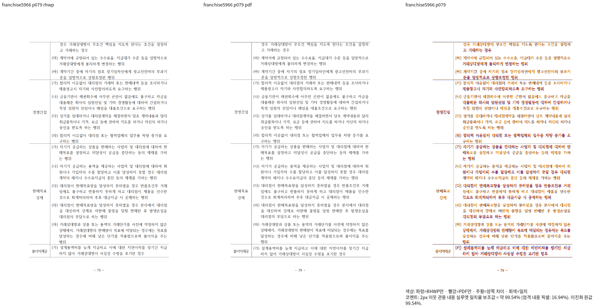

# 가맹사업 저장 앞 띠·프레임 보정의 Native 경계 비교

생산 소스 `f8495824b0380337eaab17f3ec625d55746190d3`, Native exit0·181.551초,
동일 원본 HWP·독립 한컴2020 Print와6쪽 비교다. 실제 PNG를 모두 열어 판독했다.
fresh·전142쪽·최종 전체 검증의 완료를 의미하지 않는다.

| 쪽 | 2px 이웃 관용 내용 실루엣 일치율 | 직접 판독 |
| --- | --- | --- |
| 55 | 99.99889% | 두 완료 행의 저장 앞 띠·강조·문단/셀 내용 순서 정합 |
| 56 | 99.99893% | 완료 행·부분 컷의 앞 간격, 마지막 줄/외곽 보존 |
| 57 | 99.99882% | 앞쪽 continuation 그대로, 완료 행/뒤 문단의 간격 정합 |
| 78 | 99.99907% | 첫 저장 상자·앞 행의 첫 띠와 제목 보존 |
| 79 | 99.53600% | 반복 하단은 복구됐으나 마지막 오른쪽 두줄의 정렬 차이 추가 보정 중 |
| 80 | 99.99655% | 수정 전과 render tree가 같으며 남은12줄/쪽끝/뒤 빈 공간 보존 |

원본·Print·실제 명령·출력 해시는 [provenance](provenance.json),
셀 높이·줄 수·이전 대비 첫 줄 위치는 [구조 대조](structural-differences.json)에 있다.
절대 좌표를 새 회귀 기대값으로 등록하지 않았다. 79쪽의 알려진 잔여 차이를
90% 또는 높은 점수로 면제하지 않으며 생산 결과의 소유 사실을 배치에 직접 전달하도록 보완한다.
