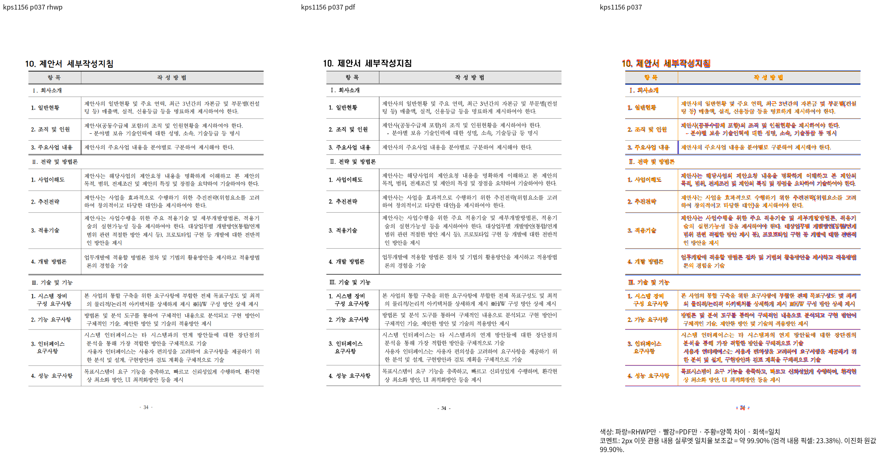
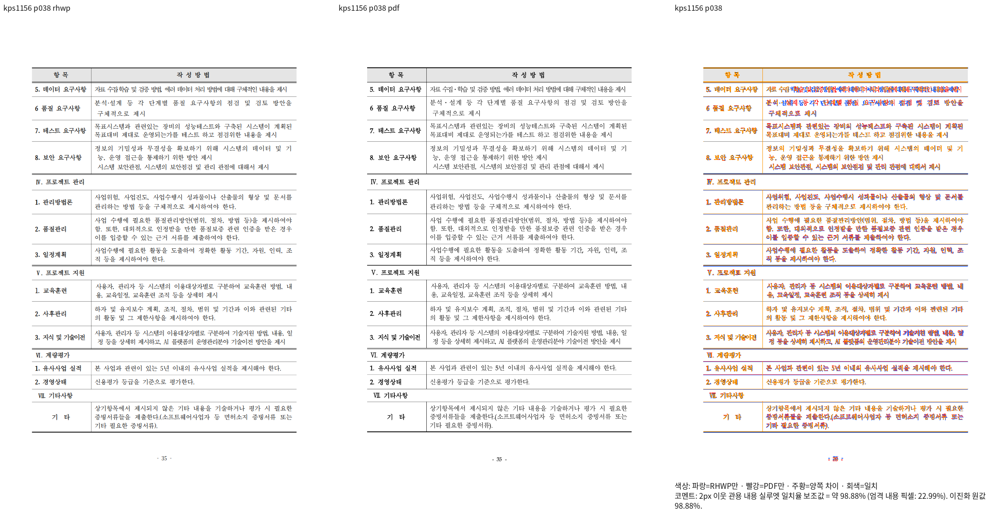
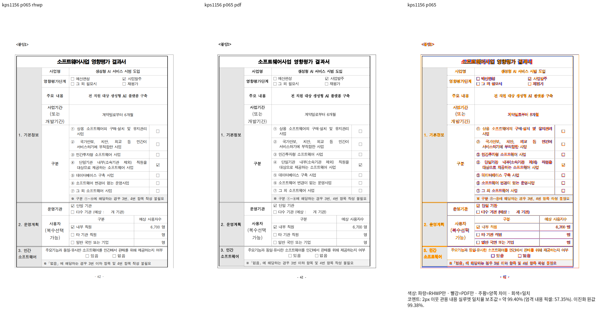
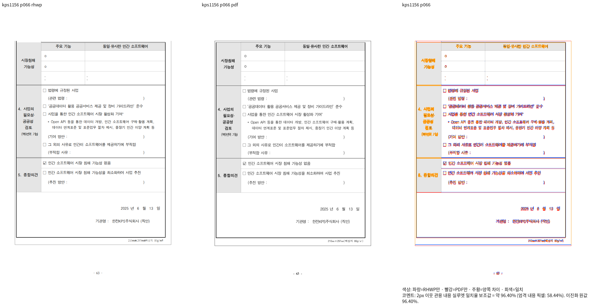

# KPS 원본 행과 병합 라벨의 관계 검증

Production: `58b63a927587ebaf1ee5e60dd497d7d208868905`, base: `552f5228d2dbfd6046c838f14241704f1bcb8a05`.

- 원본: `samples/kps-ai.hwp`, SHA256 `9b0fceb3d96956f27c893e15a72a1ad94f7ee005bd581381a1aadfcb1f57a7b9`.
- 독립 한컴 Print: `pdf/kps-ai-2022.pdf`, SHA256 `7c064fd290368369a3c8eaa7d7b03668c46fb4dfe0fc18ba52d00456ffe01d28`.
- Native/fresh 각각77/77쪽, PDF77쪽, 최저42쪽90.85010%, 90% 미만·누락0.
- Fresh WASM SHA256 `25faec9f8f337cbcdaf439a564ffceea60b7237baf7abcec8bb41ec6275a58d9`.
- 양 backend 전77쪽 RGBA가 같으므로 같은 review/overlay를 한 벌 보존한다.

## 직접 판독과 독립 기대값

37쪽의 마지막 항목은 `4. 성능 요구사항`이고38쪽의 반복 머리행 다음 항목은 `5. 데이터 요구사항`이다.
65쪽의 병합 셀 라벨은 `3. 민간 / 소프트웨어`,66쪽은 `시장침해 / 가능성`이다.
원본 라벨 문단의 저장 줄이3840HU에서0HU로 재시작하는 경계가 이 분할과 대응한다.
표 외곽·다음 쪽 머리행·라벨 소속과 글줄 포함을 같은 쪽의 독립 Print로 직접 확인했다.
98.88%인38쪽 첫 줄의 일부 글리프 간격 잔차는 보존하며 점수와 직접 판독을 구분한다.

기존 `rows=0..16`과 `x<175/y<200` 검사는 같은 정상 출력에서 실제 실패했다.
정정한 원본 소유·내용 순서/누락/중복·셀 포함 검사는 실제 정식 소스를 current library에 링크해
각 파일2PASS(1156의 기존 synam 대조군 포함), 합계4PASS다. 전체 Cargo/nextest 완료를 뜻하지 않는다.

## 실행 기록

ignored `output/pr-review/semanticist21-20261008/regression-root-cause-batch-v448/`의
`scoped-frame-direct-documents-plan.json`, `scoped-frame-fresh-visual-plan.json`,
Native/fresh `kps1156/silhouette.tsv`, `scoped-frame-kps-native-fresh-identity.json`,
`kps-contract-before-after-intake.json`, `kps-relational-validation-results.json`과 compile/run 로그에 연결한다.
공용 `target/pr-review`를 사용했다. 원본·PDF는 저장소에 존재하며 변경하지 않았다.

## 대표 review

