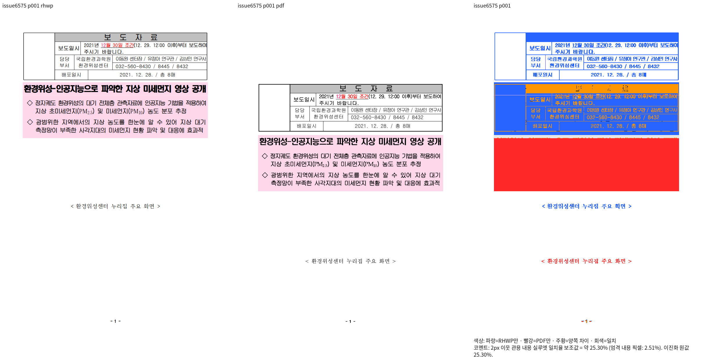
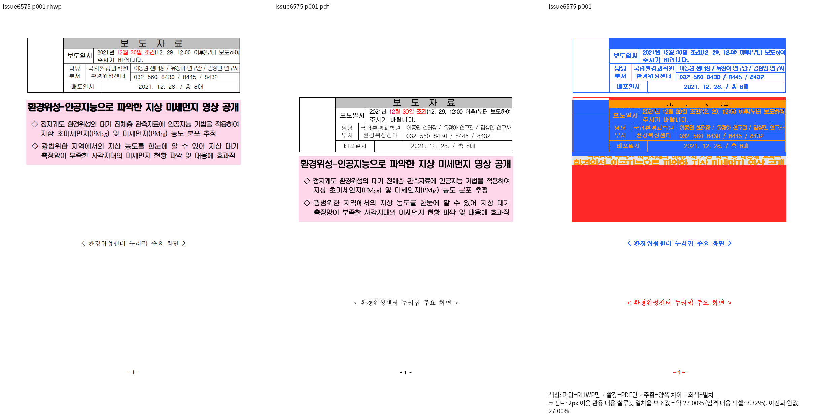

# 수동 축약 fixture #6575의 기존 미달 증거

- base: `552f5228d2dbfd6046c838f14241704f1bcb8a05` (`upstream/devel` 고정).
- 현재 Rust source: `d7a13ef732ffe410b290d2868c6f01fe7060907c`; 도구 변경 head: `f1461af1f1c398d1e299fbbe9959898a772140b4`.
- 기존 활성 검사: `tests/cases/issue_6575_tac_picture_line_top.rs`. base에 입력과 검사 존재를 `git cat-file -e`로 확인했다.
- 원래 입력: `samples/issue6575/tac_picture_line_top.hwpx` / SHA-256 `ae4c01001405de8deb2332cab5f469896a3b5ca12b18c1c28a48ff9719cadf85`.
- 독립 한컴 2020 Print: `pdf/semanticist21-20261008/tac-caption-independent-print-v358/tac-picture-line-top-ae4c01001405-2020.pdf` / SHA-256 `c56fdb74c26611ae6b4c3cf1f1b1ad8e01f1e14b248ddf44c4c6c0bd2d0d3d11`. 같은 축약 입력에서 만든 1쪽 PDF다.
- Native 전체 1쪽: base **25.29586%**, 현재 **26.99995%**; 양쪽 모두 1/1쪽, 미달 1쪽, 누락 0쪽.
- fresh WASM은 이 축약 fixture에서 미실행이다. Native 기존 미달 증거로 이관하며, 양 backend 통과로 보고하지 않는다.
- #6575 원래 이슈는 전체 원본 문서의 다른 범위를 해결한 닫힌 이슈다. 동일 축약 파일·미해결 원점 차이의 열린 이슈를 검색했으나 없었다.

- 이관 이슈: [#7864](https://github.com/edwardkim/rhwp/issues/7864) (#7445 하위 이슈).

## 직접 판독

원본 구역·그림 문단을 발췌하고 그림을 1×1 stub으로 바꾼 입력이다. base와 현재 모두 머리 표·분홍 본문·캡션이 독립 Print보다 크게 위에 있다. 현재 분홍 본문 간격 변화가 원래 큰 원점 차이를 해결하지 않는다.
전체 원본의 해결 결과를 이 축약 입력의 정상 출력 증거로 대신하지 않는다. 이관은 출력 결함의 해결이 아니다.




## 보존과 복원 조건

공유 parser·codec 입력이므로 원래 `samples/` 파일 및 IR baseline은 바이트 그대로 유지한다.
부적합한 활성 렌더링 검사만 등록 이슈 범위로 이관한다. 이전 검사 본문은 `.rs.txt`로 보존했다.
독립 PDF와 Native/fresh WASM 전쪽 최저 90% 이상, 직접 확대 판독을 마친 뒤 관계형 회귀를 복원한다.
현재 변경으로 발생한 별도 회귀는 구현에서 해결하며 이 이관으로 면제하지 않는다.

## 재현 명령

```bash
venv/bin/python scripts/visual_sweep.py --rhwp-bin /home/tsjang/rhwp/output/pr-review/semanticist21-20261008/regression-root-cause-batch-v448/new-base-rhwp --embed-fonts full --compat 2022 --silhouette-only --out /home/tsjang/rhwp/output/pr-review/semanticist21-20261008/regression-root-cause-batch-v448/new-base-issue6575 --font-path output/pr-review/semanticist21-20261008/verified-declared-faces-v91 --font-path /usr/local/share/fonts/hancom-office-2020/Hwp --font-path /usr/local/share/fonts/hancom-office-2020/All --font-path /usr/local/share/fonts/hancom-office-2020/Install --font-path output/pr-review/semanticist21-20261008/verified-font-supply --font-path /usr/local/share/fonts/hwp-convert-mcp-survey --font-path output/pr-review/semanticist21-20261008/verified-ms-font-supply-v61/faces --file-target issue6575 samples/issue6575/tac_picture_line_top.hwpx pdf/semanticist21-20261008/tac-caption-independent-print-v358/tac-picture-line-top-ae4c01001405-2020.pdf
```

```bash
venv/bin/python scripts/visual_sweep.py --rhwp-bin /home/tsjang/rhwp/output/pr-review/semanticist21-20261008/regression-root-cause-batch-v448/closed-cell-frame-rhwp --embed-fonts full --compat 2022 --silhouette-only --out /home/tsjang/rhwp/output/pr-review/semanticist21-20261008/regression-root-cause-batch-v448/current-d7-issue6575 --font-path output/pr-review/semanticist21-20261008/verified-declared-faces-v91 --font-path /usr/local/share/fonts/hancom-office-2020/Hwp --font-path /usr/local/share/fonts/hancom-office-2020/All --font-path /usr/local/share/fonts/hancom-office-2020/Install --font-path output/pr-review/semanticist21-20261008/verified-font-supply --font-path /usr/local/share/fonts/hwp-convert-mcp-survey --font-path output/pr-review/semanticist21-20261008/verified-ms-font-supply-v61/faces --file-target issue6575 samples/issue6575/tac_picture_line_top.hwpx pdf/semanticist21-20261008/tac-caption-independent-print-v358/tac-picture-line-top-ae4c01001405-2020.pdf
```

## 자산 SHA-256

| 자산 | SHA-256 |
| --- | --- |
| `base-overlay_001.png` | `7d55ef02f2aa8d0501cca5734e9005e674e1ee4f15b9ff751100465946a9b06e` |
| `base-review_001.png` | `ccefc4082ce7db5fa7cbd4974e71904826b0ba571e7d10e506ce885a0b9b3f22` |
| `current-overlay_001.png` | `966eab77cc31585abd27cbe98709b0805388a48190a3a2393650f6f4e5336291` |
| `current-review_001.png` | `0027bb8d0d85b79f0ad3b5668f5e2b6107e8d03abad92f49d8d1e85fff8ded8b` |
| `independent-hancom2020-print.pdf` | `c56fdb74c26611ae6b4c3cf1f1b1ad8e01f1e14b248ddf44c4c6c0bd2d0d3d11` |
| `issue_6575_tac_picture_line_top.rs.txt` | `2e9277dfb6a4c6d185b44091cff9777764ab30ec29c2c233a57cc9a2efb0dfca` |
| `tac_picture_line_top.hwpx` | `ae4c01001405de8deb2332cab5f469896a3b5ca12b18c1c28a48ff9719cadf85` |
