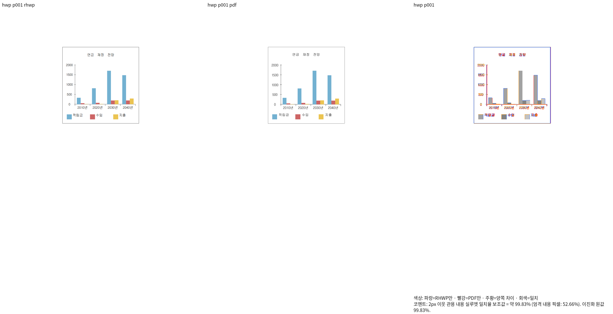
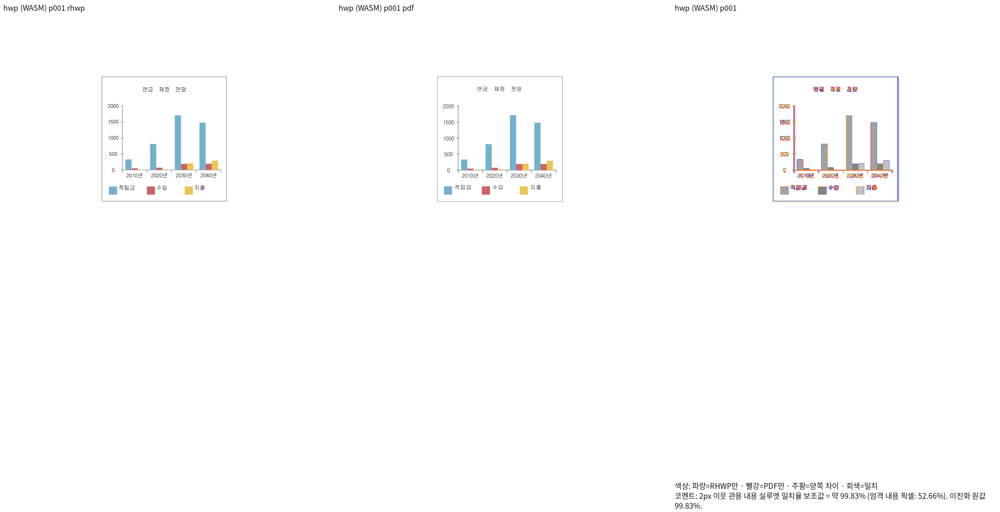

# OLE 차트의 소유 텍스트 배치 검증(v446)

원본은 사용자가 분리한 `samples/hwpx/143E433F503322BD33-ole.hwp`와 `.hwpx`다.
기준은 `pdf/143E433F503322BD33-ole-2024.pdf`와 같은 원본의 독립2024 one-up Print다.

| 전체1/1쪽 | Native | fresh WASM |
| --- | ---: | ---: |
| HWP / 사용자 PDF | 99.83461% | 99.83461% |
| HWPX / 사용자 PDF | 99.83461% | 99.83461% |
| HWP / 독립 Print | 99.91386% | 99.91386% |
| HWPX / 독립 Print | 99.91386% | 99.91386% |
| 원래 HWP / 대응2020 Print | 97.05704% | 97.05704% |
| 원래 HWPX / 독립2020 Print | 97.78626% | 97.78626% |

모든 대상의 Native/fresh 실제 RGBA가 동일하며 미달·누락·쪽수 불일치는 없다.
전체 TSV/실행 로그/입력·PDF·전체 Rust source hash/명령은 ignored
`output/pr-review/semanticist21-20261008/ole-text-layout-final-v446/`에 보존한다.
Native CLI SHA256은 `70adad665c81d17d5dd6109c088fd2fc066aeab5f3334fc1c72125fff88d7d6d`,
JS는 `691e4fd480cf4e04f9e599ca7c7a4802ad87b2c141fba93bf94111f4144dcb3b`,
최적화 WASM은 `2e06a6f1d43fd6e0e482bd74372188cbc6f78773c55062806969f70830c4f42b`다.
루트 pkg와 Studio public JS/WASM 해시가 같다. 공용 target/pr-review를 재사용했다.

공식 TextLayout의 가운데 정렬과 owning paint 사각형을 소비한다.
저장 root 좌표와 글꼴/마커의 물리 크기를 구분해 범례 상자와 글자 원점을 계산한다.
절대 픽셀 좌표나 문서 ID 예외를 추가하지 않았다.
새 회귀의 기대값은 공식 TextLayout·독립 Print의 정렬/마커 관계에서 정하며,
수정 전 커밋의 실제 painter는 숫자를 끝 정렬하여 같은 계약에서 FAIL한다.
현재 생산 공개 API는 HWP/HWPX 모두 PASS한다. 이 before/after는 독립 painter 링크 진단이며
정식 nextest는 새 OLE1개·#1156 관계/워터마크2개·SO-SUEOP HWP 1쪽3개가6/6 통과했다.
기존 SO-SUEOP HWPX 1쪽 검사도 별도로1/1 통과했다.
fmt·세 Clippy·workspace build·고정 base manifest/unit 정책은 모두 통과했다.
명령과 최종 로그는 같은 ignored 증거 디렉터리의 `qualified-test-validation-plan.json`,
`focused-nextest.log`, `hwpx-first-page-nextest-plan.json`, `hwpx-first-page-nextest.log`에 보존한다.

숫자·범주·제목·범례의 같은 좌표 확대를 직접 판독했다. 한컴 PDF의 글자별 전진 보정과
두 기준 PDF의 숫자 기준선1.2pt 차이는 별도 관측으로 보존하며 글꼴 누락 예외로 면제하지 않는다.
이 증거는 다른 원본·편집 저장본의 전체 검증이나 PR 전체 완료를 대신하지 않는다.

[생산/소비 경로·보류 범위·검증 원문](../../../archives/semanticist21_20261008_integrated_review.md#진행168--ole-소유-배치축-정렬범례-간격-보정v444v445)

## 실제 새 캡처

| 형식 | Native | fresh WASM |
| --- | --- | --- |
| HWP |  |  |
| HWPX |  |  |
