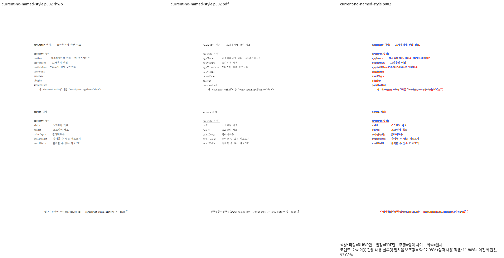
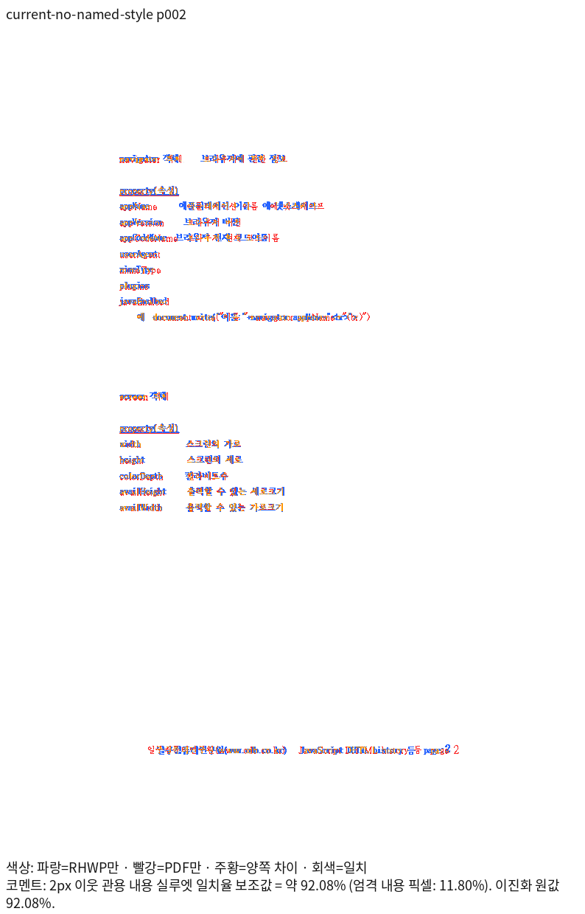
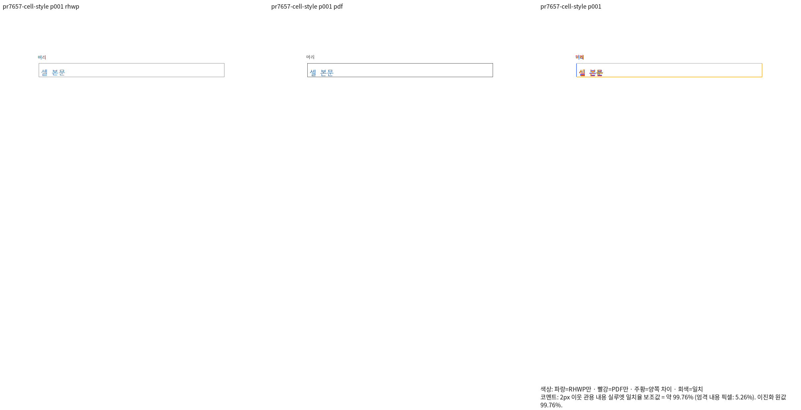
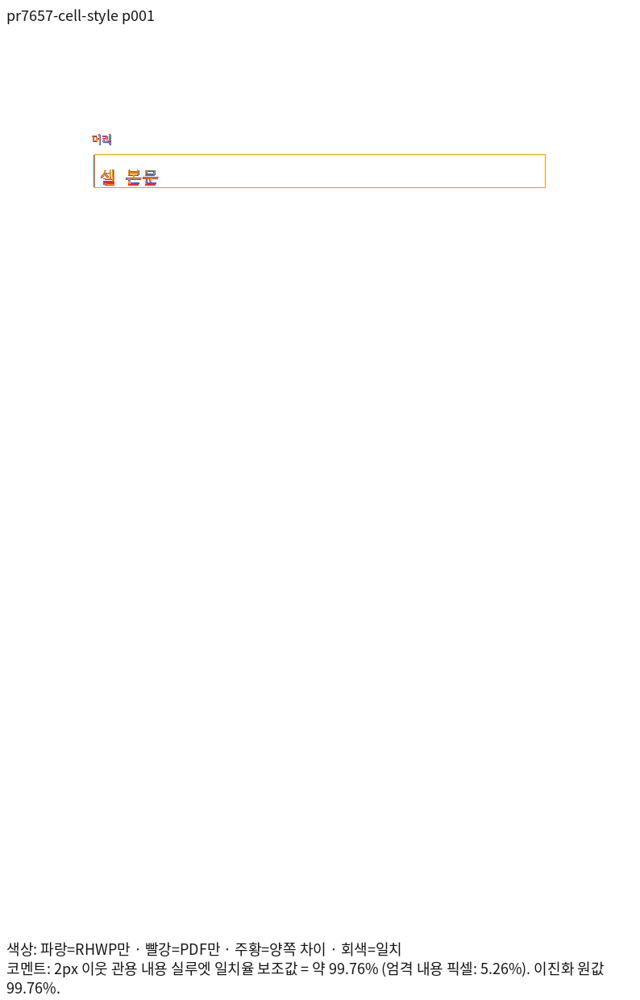

# 원 PR 편집·정상 대조의 최신 양 backend 검증

생산 Rust: `7f04c48cd395086ed59c08565f343d3f9e1b013d`. Native CLI SHA-256: `2552cecd315dea914451af6c52c77757c9dc6418cf066135bdece4ae08c10e7a`.

Fresh WASM SHA-256: `460a928d8423b17b150eee98f4408af330682512f0d0806a78d4cc709316586a`; root/pkg와 Studio/public 일치.

24쌍·27쪽 Native/fresh 모두 미달·누락0, 최저92.07644%. 두 backend의 새 캡처27쪽 모두 decoded RGBA가 같다. Native27쪽은 이전에 판독한 출력과도 같다. 이전 PNG를 새 실행으로 재사용하지 않았다.

실행 로그·전체 TSV·소스/입력/Print/패키지 해시는 ignored `output/pr-review/semanticist21-20261008/final-code-validation-v451/`의 original-edited 계획/결과에 보존한다. 이 범위의 통과는 공통 보정 문서의 전쪽 검증·전체 Rust 회귀·원격 CI의 완료를 뜻하지 않는다.

## no-named-style-p002

- 입력: `mydocs/pr/assets/semanticist21-20261008/current-print-inputs-v175/additional-edited-note-style-missing-named-style-v175.hwpx`; SHA-256 `6b4f6a375029dcb0c9def5b4443683d1b55cf09acbdb9cb9ab87ac2d94888edb`.
- 독립 Print PDF: `pdf/semanticist21-20261008/new_note_paragraph_style-0462-6b4f6a375029-2020.pdf`; SHA-256 `778594c4e099ec86ddaa825f1dd307c195c4ffe49b842a5082df0c15274d6828`.
- 대표2쪽: 92.07644%.
- 명령: `venv/bin/python scripts/visual_sweep.py --rhwp-bin <위 immutable CLI> --embed-fonts full --compat 2022 --silhouette-only --file-target <key> <입력> <PDF> --wasm-pkg pkg --out <v451/original-edited-fresh>`; 실제 font-path/전체 argv는 실행 계획에 보존.

## pr7657-cell-style-p001

- 입력: `mydocs/pr/assets/semanticist21-20261008/pr7657-batched-correction-v406/after/counter-02-visible-style.hwpx`; SHA-256 `8ebbea4fa2349165a036ab6a7d832d7b475ce001cccd4715458cd4ed8d4703e6`.
- 독립 Print PDF: `pdf/semanticist21-20261008/original-pr7657-after-v406/counter-02-visible-style-8ebbea4fa234-2020.pdf`; SHA-256 `38a281f126f2fe383639d3b8f1c9932317bcf9d6153d9fffe9ce52c9eb61fb6c`.
- 대표1쪽: 99.76088%.
- 명령: `venv/bin/python scripts/visual_sweep.py --rhwp-bin <위 immutable CLI> --embed-fonts full --compat 2022 --silhouette-only --file-target <key> <입력> <PDF> --wasm-pkg pkg --out <v451/original-edited-fresh>`; 실제 font-path/전체 argv는 실행 계획에 보존.

## 직접 판독

스타일 이름 없는 원본2쪽은 문단 소속·내용 순서·탭/줄바꿈·두 본문 묶음과 꼬리말의 배치를 대조했다. 글꼴 획과 글자 폭의 잔여 차이는 있으며 큰 배치 변화·누락·중복은 없다. #7657 셀 서식 보존 대조군은 머리말과 표의 앞뒤 순서, 셀 본문 색·밑줄·테두리를 대조했다. 미세한 테두리 래스터 차이는 남지만 셀 소속·내용 순서와 서식 보존은 같다. 수식이 없는 두 대표 쪽이며 원 PR의 수식 사례 검증을 대신하지 않는다.
