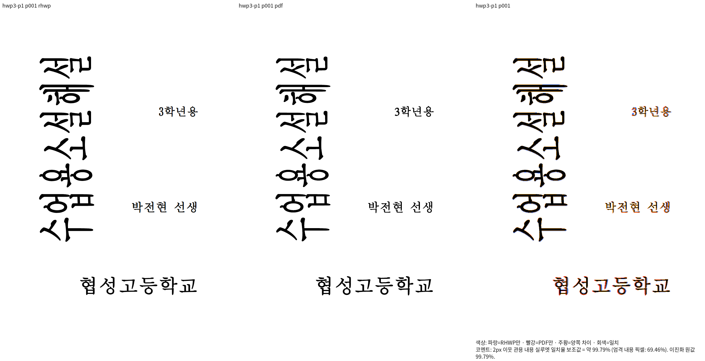

# SO-SUEOP 양형식 첫쪽의 글꼴 공급·전진 보정

원본 `samples/SO-SUEOP.hwp`·`.hwpx`를 각 형식의 기존 독립 한컴 Print PDF와 비교했다.
파일명에 적힌 연도를 Creator 연도나 조판 세대로 대신하지 않았으며 입력·기준·생산 소스와
WASM 해시는 [실행 증거](provenance.json)에 연결한다. 이 증거의 범위는 **각 원본의 첫쪽**이다.

| 원본 첫쪽 | Native | fresh WASM | Native/fresh 픽셀 |
| --- | --- | --- | --- |
| HWP | 99.79294% | 99.79294% | 동일 |
| HWPX | 99.95935% | 99.95935% | 동일 |

## 보정 근거와 경로

원본 HWP3의 휴먼명조 HFT 굵은 글자 전진과 HCI Tulip 숫자 전진은 독립 PDF의 프로그램에서
확인한 값이다. `legacy_font_advances.rs`는 실제 HWP3 provenance와 원 face를 확인하고,
측정 경로에서 그 전진을 사용한다. 검증된 TTF 공급이 선언된 경우에는 HFT 전진을 적용하지 않는다.
문서 ID나 픽셀 좌표로 글자를 이동하지 않는다.

SVG 글꼴 파일 조회는 실제 휴먼명조 HMKMM 원 face를 모든 공급 루트에서 먼저 찾고,
원 face가 없는 경우에 기존 대체 face로 넘어간다. 같은 원 face 사이의 호출자 루트 순서는
보존한다. 설치 파일의 정확한 SHA와 face 증거는 실행 기록에 남기고 글꼴 바이트는 커밋하지 않는다.
이미 성공한 Native/fresh 빌드를 사용하며 이 시각 검증을 위해 추가 wasm-opt를 실행하지 않았다.

## 직접 판독

OLE 제목의 두 축, 학년 숫자와 뒤 글자, 교사명 간격, 학교명 굵은 글자 전진을
같은 좌표의 2배 이미지에서 읽었다. 겹침·누락·뒤 글자 이탈은 보이지 않는다.
글꼴 윤곽과 래스터 가장자리 차이는 남아 완전 일치로 보고하지 않는다.

### HWP

[독립 확대 비교](hwp3-p1-enlarged.png) · [overlay](hwp3-p1-overlay.png)

### HWPX

[독립 확대 비교](hwpx-p1-enlarged.png) · [overlay](hwpx-p1-overlay.png)

## 정식 회귀와 남은 범위

[HWP 세 검사](../../../../../tests/cases/so_sueop_hwp_first_page_regression.rs)는
원본 HWP의 첫쪽만 고정하며 OLE의 원본 소유영역과 독립 전진 비율을 검사한다.
기존 [HWPX 첫쪽 검사](../../../../../tests/cases/so_sueop_hwpx_first_page_ole_title_regression.rs)는 유지한다.
두 소스는 정식 파생 suite에 등록했고 v430에서 원래 #7657 의미 검사와 함께
**일곱 검사 모두 통과**했다. HWP 세 검사, HWPX 한 검사, 기존 의미 세 검사다.
실제 nextest run ID는 `352380aa-2fdb-440a-8dee-5d877290a54e`, exit0이다.
고정 base manifest 정책도 exit0이며 파생 suite·manifest는 커밋하지 않는다.

정식 HWP 소스 자체를 공용 캐시에 남아 있는 v406 library와 현재 v423 library에
직접 링크한 v434도 컴파일0/0을 확인했다. 같은 세 검사에서 수정 전은1PASS/2FAIL,
수정 후는3PASS다. 이 단계에서 새로 검출한 결함은 학교명·숫자의 전진 두 계약이다.
OLE 제목은 v406에서 이미 보정됐으므로 이번 단계 이전에도 통과했다.
기존 OLE 보정의 독립 전후 증거와 이번 전진 보정의 검출 증거를 구분한다.

#7807의 다른 쪽과 #7657 편집 저장본의 미달, 셀 높이, 초기18개 PR의 전체 필수 검증은
별도로 남는다. 이 첫쪽 결과를 전체 문서의 해결이나 이슈 종료·PR 수용으로 확대하지 않는다.
