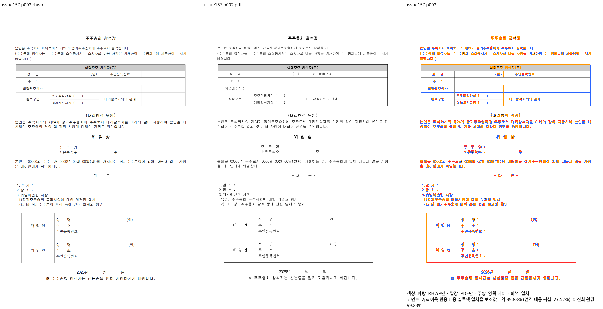
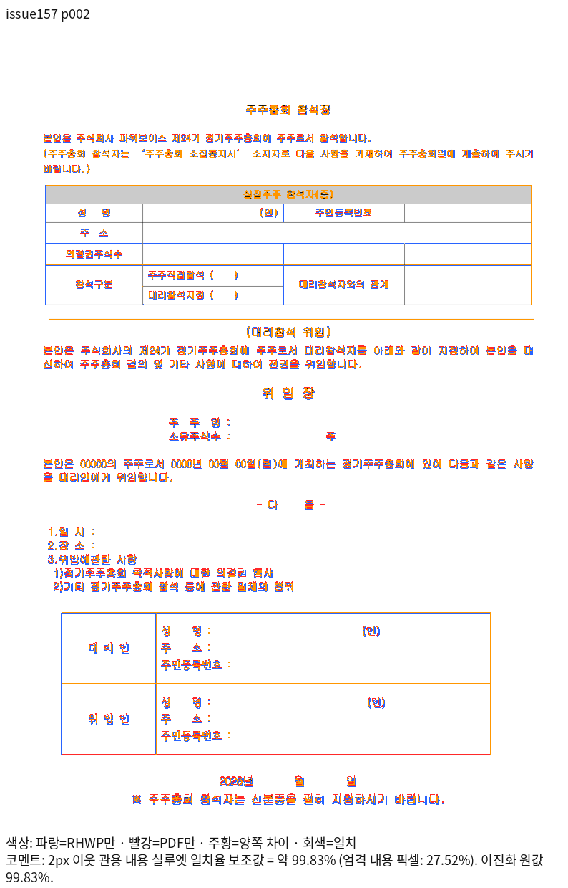

# 저장 단의 표 뒤 공백 호스트 검증

Production source: `58b63a927587ebaf1ee5e60dd497d7d208868905`.
Base: `552f5228d2dbfd6046c838f14241704f1bcb8a05`.

- 입력: `samples/hwpx/hancom-hwp/issue_157.hwp`, SHA256
  `64b06fc23ffb76260a50ef7fb60384516f751833f0e3263c66aa3f97bf385b44`.
- 독립 한컴2020 Print: `pdf/semanticist21-20261008/remaining-failures-independent-print-v366/issue157-64b06fc23ffb-2020.pdf`,
  SHA256 `41daa922d8437ea98cee6a12b347764337c14afae4b75af3f6818530ac9d9ab2`.
  기존 커밋의 동일 원본·기준을 재사용한다. 새 입력으로 바꾸지 않았다.
- Native CLI SHA256: `5dd5fff8a36938f7bf0dfc8160391aace5bf042e124c72f8335ea8952b0c4ac7`.
- 루트 fresh WASM SHA256: `25faec9f8f337cbcdaf439a564ffceea60b7237baf7abcec8bb41ec6275a58d9`.
  공용 `target/pr-review`에서 `scripts/wasm-pack-locked.sh --target web --out-dir pkg`를 실행했고,
  루트 `pkg`와 Studio public의 JS/WASM hash도 각각 같다.

양쪽 모두 전체2쪽·독립 Print2쪽이며 2px 관용 실루엣은
1쪽99.74326% / 2쪽99.82668%, 미달·누락0이다. 두 쪽의 Native/fresh RGBA가 각각 완전히 같다.
2쪽 대표 review/overlay PNG도 Native와 fresh가 같은 파일 바이트이므로 공통 대표 한 벌을 보존한다.
같은 배율에서 상·하단 표 외곽, 앞뒤 본문과 공백 호스트, 위임 제목, 날짜와 마지막 안내문의
배치·내용 보존을 직접 대조했다. 글리프 raster의 작은 색상 차이는 엄격 픽셀 점수와 별도로 남는다.

정식 소스는 `tests/cases/issue157_stored_before_host_frame.rs`다.
원본에서 참석자 표의 소유 문단을 찾고 앞 본문→표→공백 호스트→위임 제목의 포함·겹침 관계와
독립2쪽의 내용 보존을 검사한다. 절대 화면 좌표나 SVG hash를 기대값으로 사용하지 않는다.
이 동일 테스트 소스를 실제 새 base library와 보정 library에 직접 링크했다.
컴파일은 양쪽 exit0, 실행은 base1FAIL/exit101(표와 공백 호스트 겹침), 보정1PASS/exit0이다.
이 개별 정식 소스 실행은 전체 nextest 성공을 뜻하지 않는다. 전체 회귀·lint·다른 대상의 최종 gate는 남아 있다.

실행 조건은 Print·compat2022·DPI96·full 원본 글꼴 임베딩이다.
명령과 source/입력/패키지 해시·전쪽 TSV·실행 로그는 ignored
`output/pr-review/semanticist21-20261008/regression-root-cause-batch-v448/`의
`scoped-frame-{plan,commit,fresh-visual-plan}.json`,
`scoped-frame-{native-issue157,issue157-fresh}/issue157/silhouette.tsv`,
`issue157-formal-{before,after}-result.json`에 기록했다.

