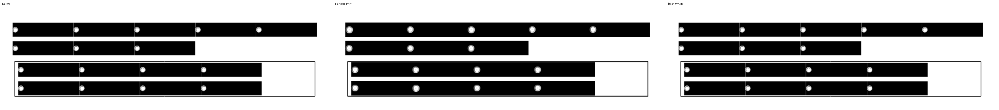
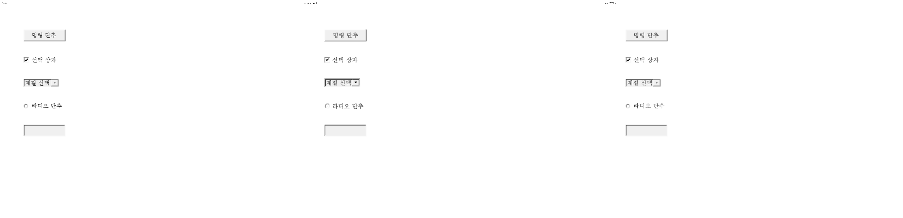

<!-- 미게시 초안. 통합 뒤 실제 PR·merge SHA·CI URL로 변수 세 개를 채우고 이미지의 devel 포함을 확인한다. -->

검토 및 통합 완료했습니다. 기여해 주셔서 감사합니다.

같은 위치 형제 Form의 복사·붙여넣기·삭제·논리 주소를 보존했습니다. 본문 8개와 셀 8개가 각각 한 번 표시되고 실제 WASM 캐럿·두 줄 선택·양쪽 저장 재열기가 일치했습니다.

통합 과정에서 확인한 보존·보정 사항은 다음과 같습니다. 기존 [#8093](https://github.com/edwardkim/rhwp/pull/8093)/[#8187](https://github.com/edwardkim/rhwp/pull/8187) 공통 논리 API·필드 거부 원자성·NBSP와 schema 35를 유지했습니다. generated control-only row는 완전한 원시 스트림·빈 text/offset·증가하는 실제 줄 컷을 인증한 경우에만 수용하도록 했습니다. 셀 leading 경계를 앞줄 끝이 선점하지 않게 하고 선택이 실제 Form/TextLine 소유를 소비하게 했습니다.

통합 PR: [#8548]({{integration_pr_url}}) · [merge commit](https://github.com/edwardkim/rhwp/commit/{{merge_sha}}) · [최신 head CI]({{ci_url}}). 원 기여 commit과 원 head를 통합 history에 보존했습니다.

이 PR의 대조 입력 전쪽 최저 raw는 Native 99.60%, fresh WASM 99.58%입니다. 전쪽 수·원본·독립 한컴 Print·직접 확대 판독과 실제 API/저장 검증은 [개별 검토](https://github.com/edwardkim/rhwp/blob/{{merge_sha}}/mydocs/pr/pr_8235_review.md)에서 구분했습니다.

이번 silhouette-only 비교는 전쪽 raw·쪽수와 직접 판독으로 판단했습니다. `pixel_match`·`visual_accuracy_proxy_percent`·일반 `flagged` 분류는 산출하지 않았으므로 해당 값의 통과로 표시하지 않았습니다.

[Visual Sweep 검증 절차](https://github.com/edwardkim/rhwp/blob/{{merge_sha}}/mydocs/manual/verification/visual_sweep_guide.md#github-merge-comment)와 해당 TSV·글꼴 공급·판독 근거를 함께 남겼습니다.

