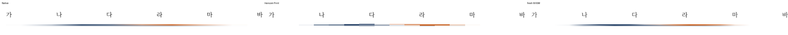

<!-- 미게시 초안. 통합 뒤 실제 PR·merge SHA·CI URL로 변수 세 개를 채우고 이미지의 devel 포함을 확인한다. -->

검토 및 통합 완료했습니다. 기여해 주셔서 감사합니다.

원본 두 검사는 devel에서도 통과했다. 실제 남은 경계인 여섯 글자 뒤 넓은 그림이 단독 마지막 줄로 넘어가면 devel은 끝 TextRun이 없어 캐럿 높이가 12px로 바뀐다. 후보는 논리 끝 7의 빈 런과 본문의 13.3px을 유지한다. 새 관계 검사는 base FAIL/후보 PASS다.

메인터너 쪽에서 최신 devel과의 충돌과 다음 경계를 보정했습니다. 이미 반영된 text_logical_starts와 #8517 빈 그림 host 메트릭을 유지하고, 그림으로 끝나는 물리 줄의 끝 글자 상자를 공통 inline flow 계획에서 생산한다. 표로 끝나는 문단의 issue_6776 계약에는 적용하지 않는다.

통합 PR: {{integration_pr_url}} · merge: {{merge_sha}} · 최신 head CI: {{ci_url}}. 원 기여 commit과 원 head를 통합 history에 보존했습니다.

이 PR의 대조 입력 전쪽 최저 raw는 Native 92.90%, fresh WASM 96.56%입니다. 전쪽 수·원본·독립 한컴 Print·직접 확대 판독과 실제 API/저장 검증은 [개별 검토](https://github.com/edwardkim/rhwp/blob/{{merge_sha}}/mydocs/pr/pr_8281_review.md)에서 구분했습니다.

[Visual Sweep 검증 절차](https://github.com/edwardkim/rhwp/blob/{{merge_sha}}/mydocs/manual/verification/visual_sweep_guide.md#github-merge-comment)와 해당 TSV·글꼴 공급·판독 근거를 함께 남겼습니다.

