<!-- 미게시 초안. 통합 뒤 실제 PR·merge SHA·CI URL로 merge SHA·CI run ID 변수를 채우고 이미지의 devel 포함을 확인한다. -->

검토 및 통합 완료했습니다. 기여해 주셔서 감사합니다.

한컴 30도 저장본과 새 90/270도·양방향 대칭·30도+너비 변경이 저장 재열기에서 같은 꼭짓점·열린 변·중심 관계를 유지했습니다. 반복 no-op과 역회전·대칭, 크기 변경의 snapshot undo를 구분해 검증했습니다.

통합 과정에서 확인한 보존·보정 사항은 다음과 같습니다. 선행 d55209cc17 → [#8319](https://github.com/edwardkim/rhwp/pull/8319) af6bb05b26의 회전 외곽 common 폭과 회전 전 current 폭 계약을 보존했습니다. group_geometry의 같은 배치 frame과 원본 잔여 affine을 합성하고 실제 변환 점의 bbox를 발행하도록 했습니다. 회전 외곽 폭을 local 폭으로 다시 적용하는 잘못된 테스트 전제를 수정했습니다.

통합 PR: [#8548](https://github.com/edwardkim/rhwp/pull/8548) · [merge commit](https://github.com/edwardkim/rhwp/commit/{{merge_sha}}) · [최신 head CI](https://github.com/edwardkim/rhwp/actions/runs/{{ci_run_id}}). 원 기여 commit과 원 head를 통합 history에 보존했습니다.

이 PR의 대조 입력 전쪽 최저 raw는 Native 100.00%, fresh WASM 100.00%입니다. 전쪽 수·원본·독립 한컴 Print·직접 확대 판독과 실제 API/저장 검증은 [개별 검토](https://github.com/edwardkim/rhwp/blob/{{merge_sha}}/mydocs/pr/pr_8287_review.md)에서 구분했습니다.

이번 silhouette-only 비교는 전쪽 raw·쪽수와 직접 판독으로 판단했습니다. `pixel_match`·`visual_accuracy_proxy_percent`·일반 `flagged` 분류는 산출하지 않았으므로 해당 값의 통과로 표시하지 않았습니다.

[Visual Sweep 검증 절차](https://github.com/edwardkim/rhwp/blob/{{merge_sha}}/mydocs/manual/verification/visual_sweep_guide.md#github-merge-comment)와 해당 TSV·글꼴 공급·판독 근거를 함께 남겼습니다.

원 PR의 주장 입력·쪽과 대응하는 최신 devel 검증 증적입니다. Native의 동일 렌더링 source 재사용과 새 최적화 WASM 실행을 [최신 검증](https://github.com/edwardkim/rhwp/blob/{{merge_sha}}/mydocs/pr/assets/semanticist21-20261103/rebase-validation.md)에서 구분했습니다.

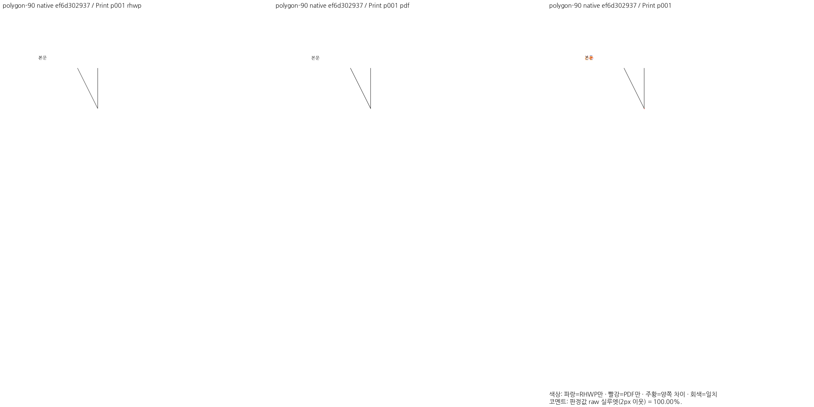

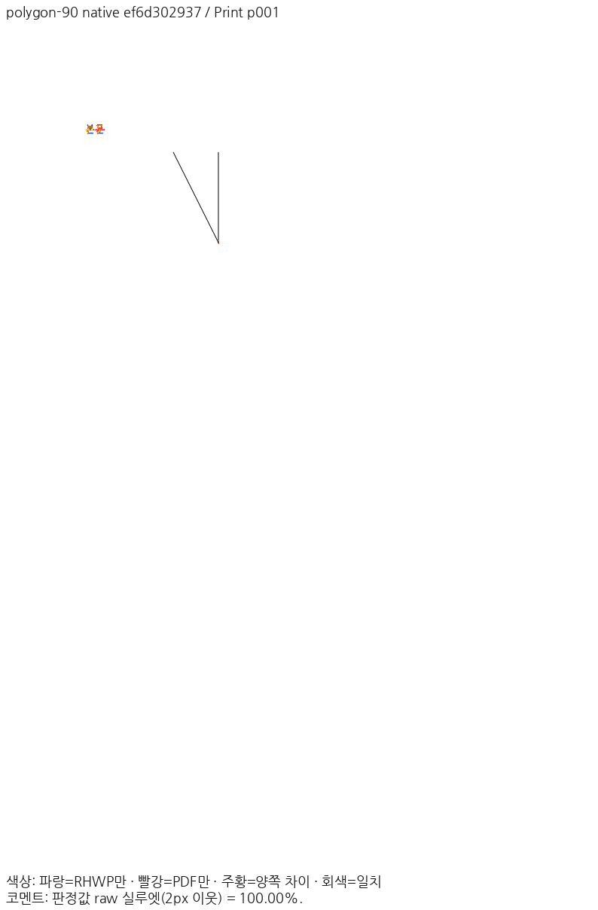

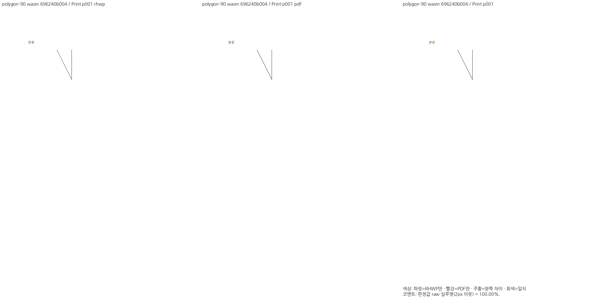

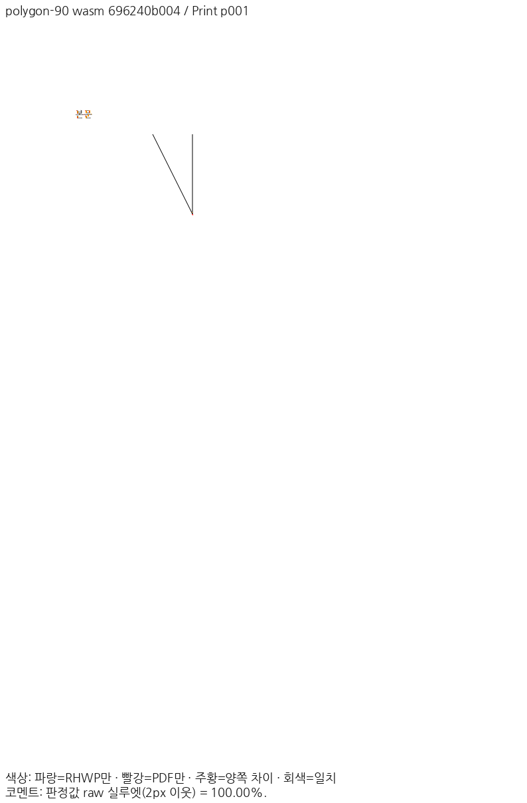

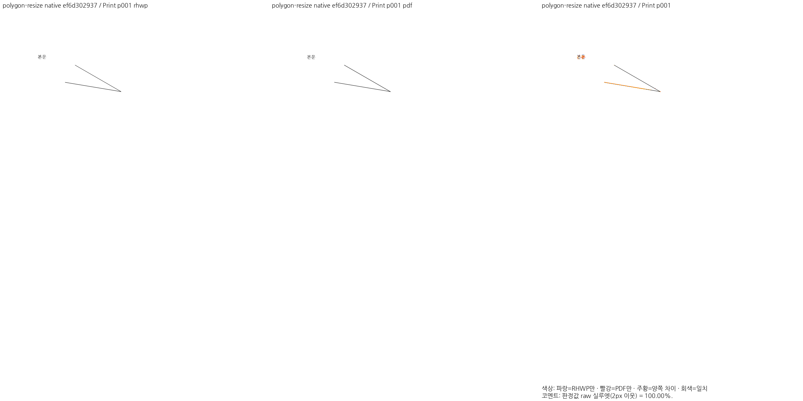

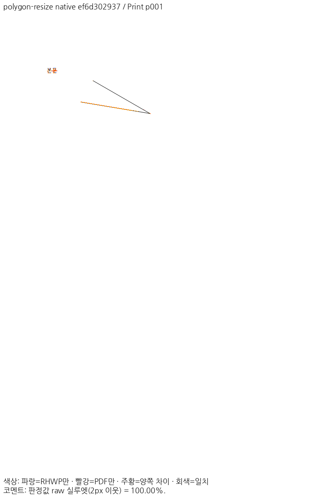

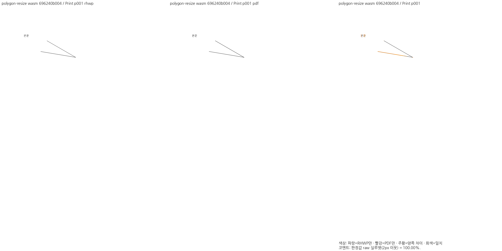

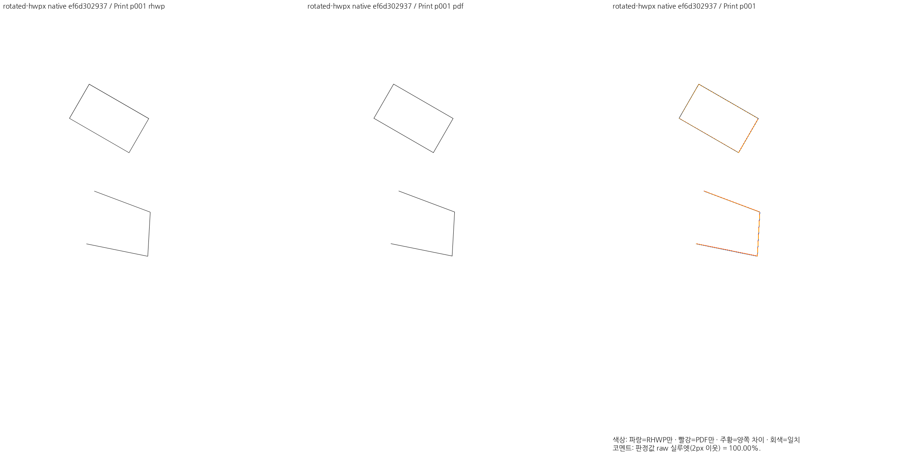

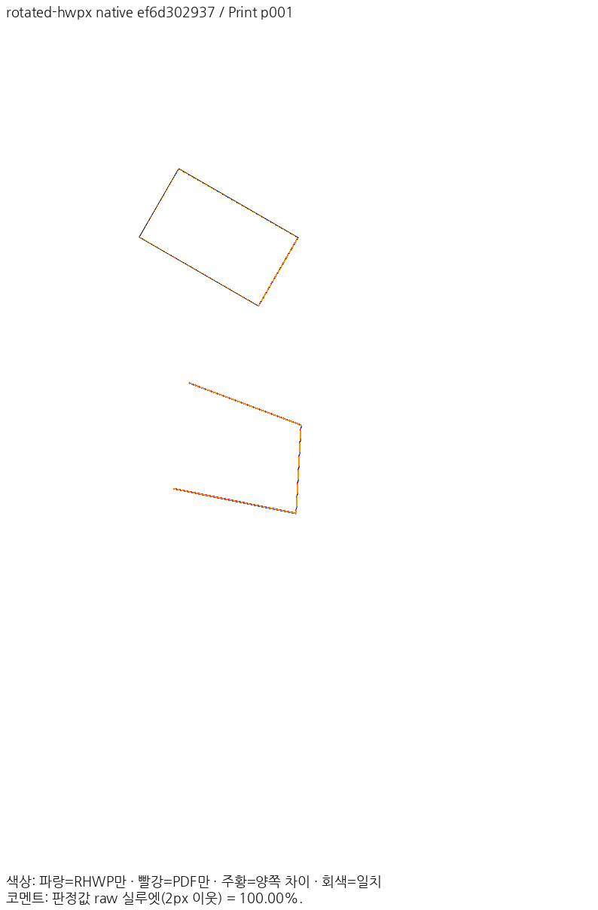

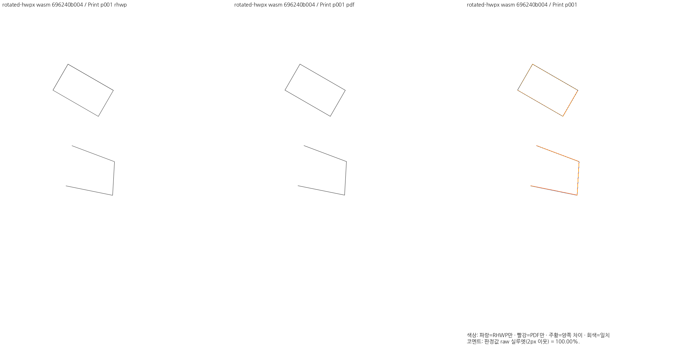

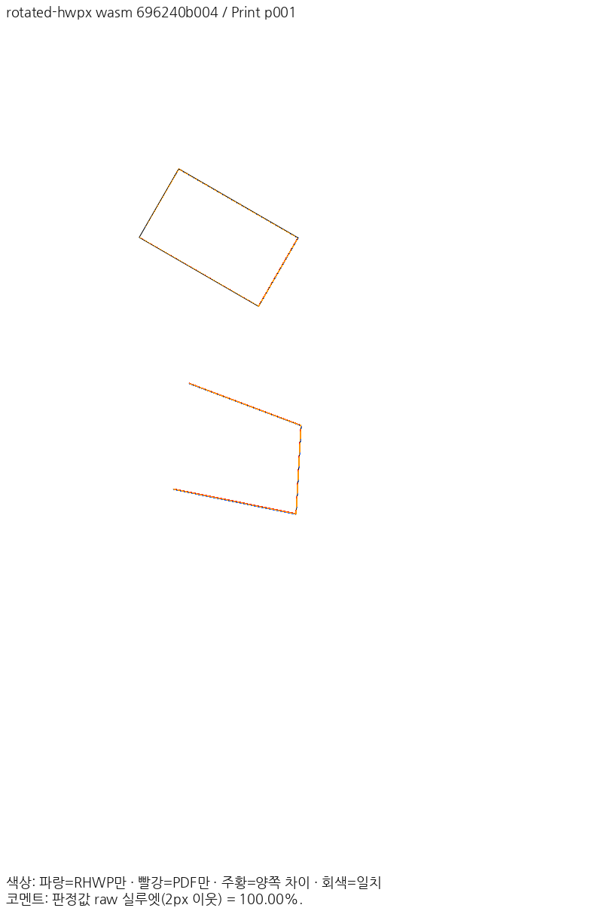
