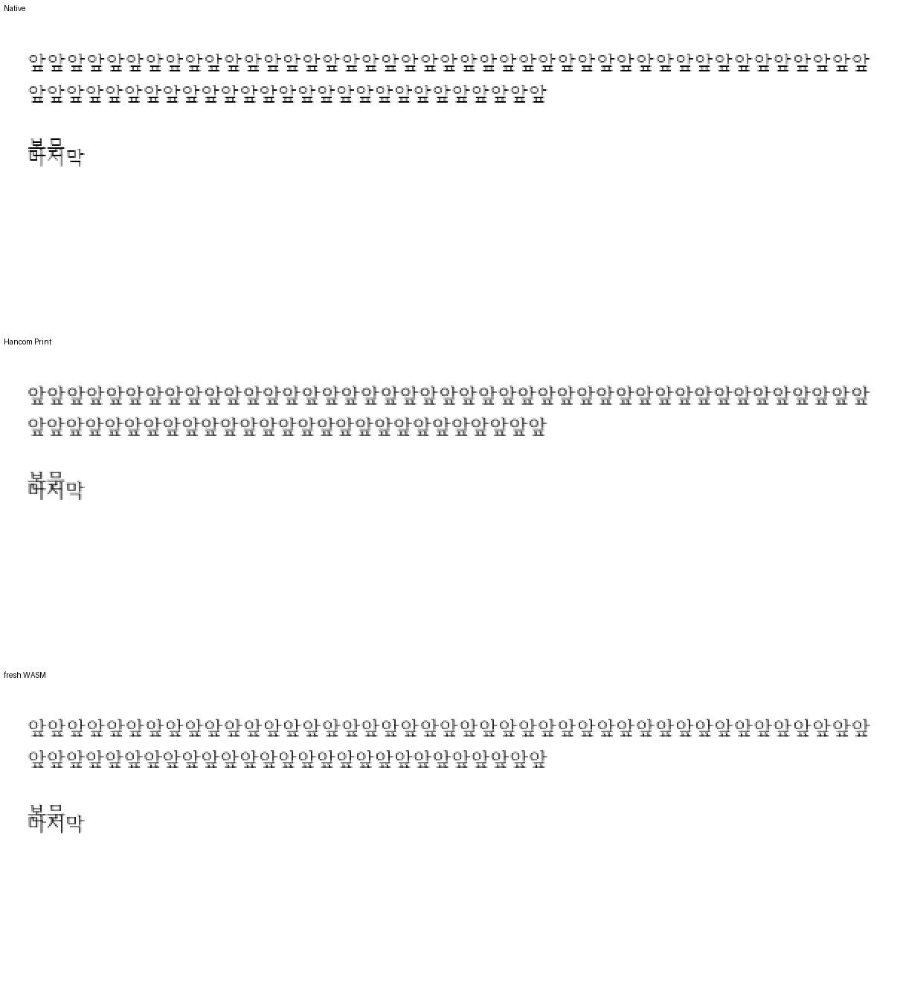

<!-- 미게시 초안. 통합 뒤 실제 PR·merge SHA·CI URL로 변수 세 개를 채우고 이미지의 devel 포함을 확인한다. -->

검토 및 통합 완료했습니다. 기여해 주셔서 감사합니다.

머리말 프레임을 넘는 마지막 문단도 한컴 출력처럼 표시한다. 빈 문단과 마지막 텍스트를 생략하지 않으며 본문과 의도적으로 겹치는 원본 배치를 clamp로 숨기지 않는다.

메인터너 쪽에서 최신 devel과의 충돌과 다음 경계를 보정했습니다. 기존 HF 배치·정렬 규칙에서 마지막 문단을 소비하게 했다. HF caret/hit-test의 소유와 본문 클릭 소유를 함께 확인했다. 새 테스트의 JSON 키는 실제 공개 반환값 paragraphIndex를 사용한다.

통합 PR: {{integration_pr_url}} · merge: {{merge_sha}} · 최신 head CI: {{ci_url}}. 원 기여 commit과 원 head를 통합 history에 보존했습니다.

이 PR의 대조 입력 전쪽 최저 raw는 Native 100.00%, fresh WASM 100.00%입니다. 전쪽 수·원본·독립 한컴 Print·직접 확대 판독과 실제 API/저장 검증은 [개별 검토](https://github.com/edwardkim/rhwp/blob/{{merge_sha}}/mydocs/pr/pr_8293_review.md)에서 구분했습니다.

[Visual Sweep 검증 절차](https://github.com/edwardkim/rhwp/blob/{{merge_sha}}/mydocs/manual/verification/visual_sweep_guide.md#github-merge-comment)와 해당 TSV·글꼴 공급·판독 근거를 함께 남겼습니다.

