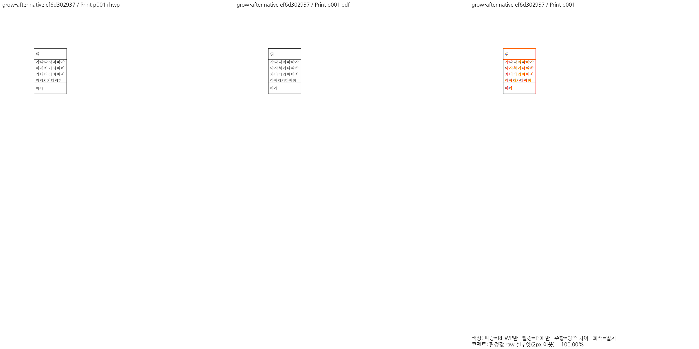
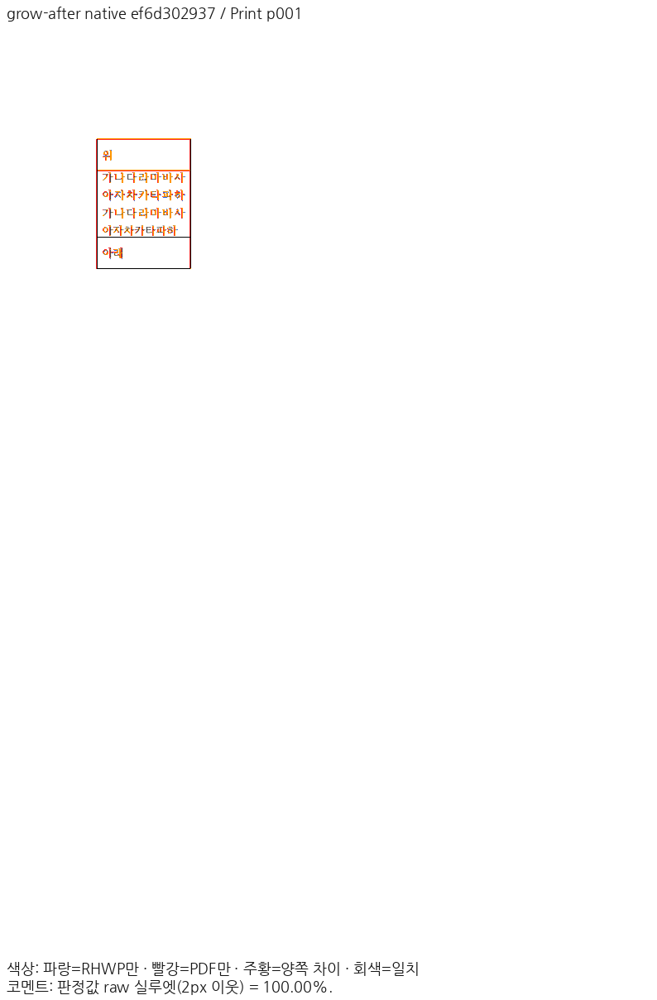
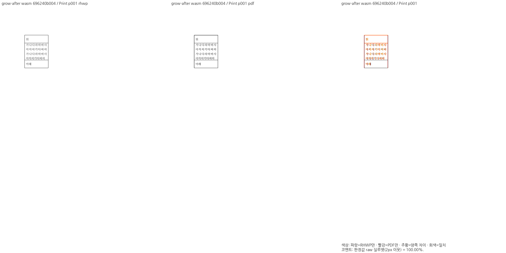
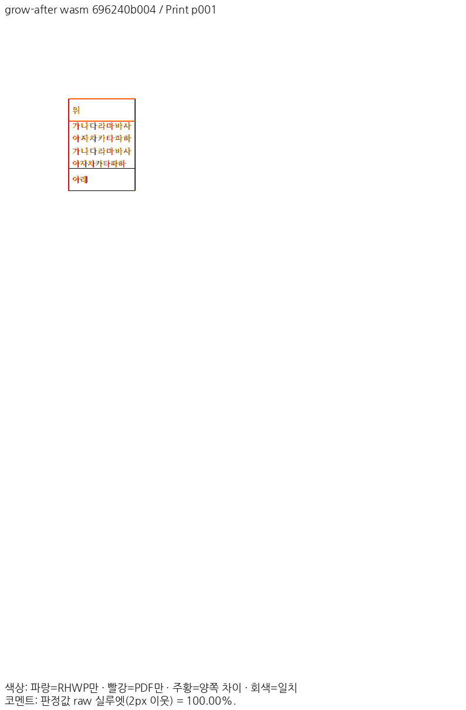
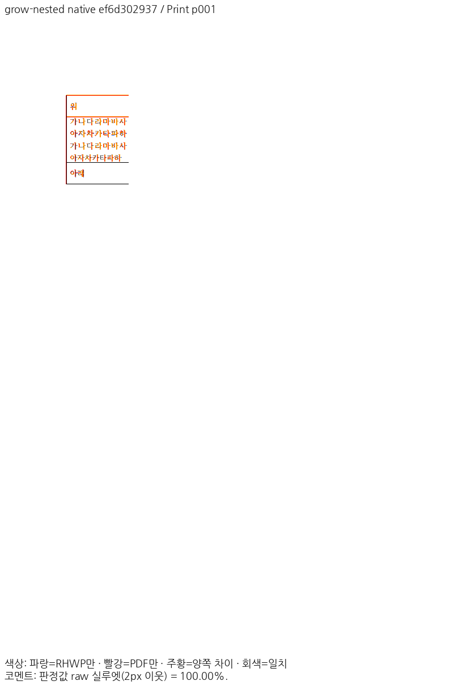
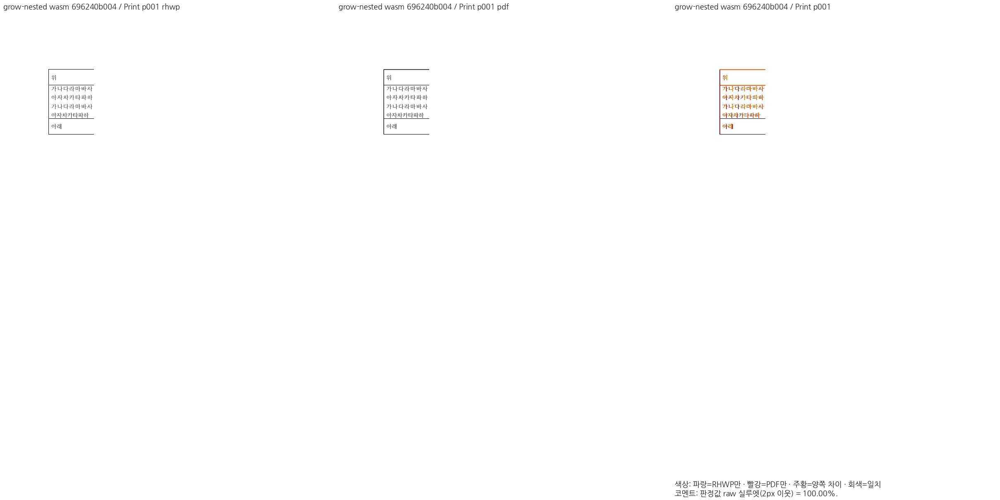
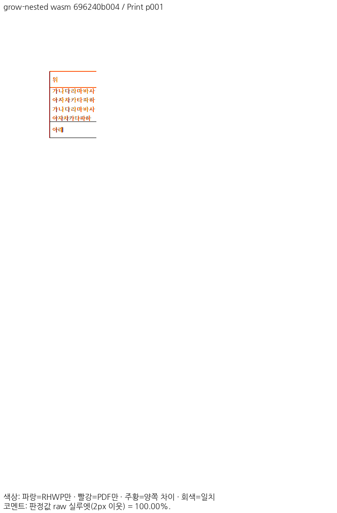

<!-- 미게시 초안. 통합 뒤 실제 PR·merge SHA·CI URL로 merge SHA·CI run ID 변수를 채우고 이미지의 devel 포함을 확인한다. -->

검토 및 통합 완료했습니다. 기여해 주셔서 감사합니다.

본문과 중첩 표에서 실제로 늘어난 common height를 저장 사본에 반영하면서 원본 cellSz·live IR은 유지했습니다. 중첩 편집의 child 8502 HU가 저장에서 11748 HU로 바뀌어야 하는 누락을 추가로 해결했습니다. paint가 이미 맞아도 저장 XML을 별도로 검증했습니다.

통합 과정에서 확인한 보존·보정 사항은 다음과 같습니다. 현재 Storage 기반 snapshot·HWPX lineage·되감김 프레임을 유지했습니다. clean 저장 태그를 보존한 재조판도 현재 LineSeg.text_start와 짝지어진 layout_space_metrics의 발행 출처로 인증하도록 했습니다. 무편집 child는 원래 높이를 유지했습니다.

통합 PR: [#8548](https://github.com/edwardkim/rhwp/pull/8548) · [merge commit](https://github.com/edwardkim/rhwp/commit/{{merge_sha}}) · [최신 head CI](https://github.com/edwardkim/rhwp/actions/runs/{{ci_run_id}}). 원 기여 commit과 원 head를 통합 history에 보존했습니다.

이 PR의 대조 입력 전쪽 최저 raw는 Native 100.00%, fresh WASM 100.00%입니다. 전쪽 수·원본·독립 한컴 Print·직접 확대 판독과 실제 API/저장 검증은 [개별 검토](https://github.com/edwardkim/rhwp/blob/{{merge_sha}}/mydocs/pr/pr_8298_review.md)에서 구분했습니다.

이번 silhouette-only 비교는 전쪽 raw·쪽수와 직접 판독으로 판단했습니다. `pixel_match`·`visual_accuracy_proxy_percent`·일반 `flagged` 분류는 산출하지 않았으므로 해당 값의 통과로 표시하지 않았습니다.

[Visual Sweep 검증 절차](https://github.com/edwardkim/rhwp/blob/{{merge_sha}}/mydocs/manual/verification/visual_sweep_guide.md#github-merge-comment)와 해당 TSV·글꼴 공급·판독 근거를 함께 남겼습니다.

원 PR의 주장 입력·쪽과 대응하는 최신 devel 검증 증적입니다. Native의 동일 렌더링 source 재사용과 새 최적화 WASM 실행을 [최신 검증](https://github.com/edwardkim/rhwp/blob/{{merge_sha}}/mydocs/pr/assets/semanticist21-20261103/rebase-validation.md)에서 구분했습니다.

