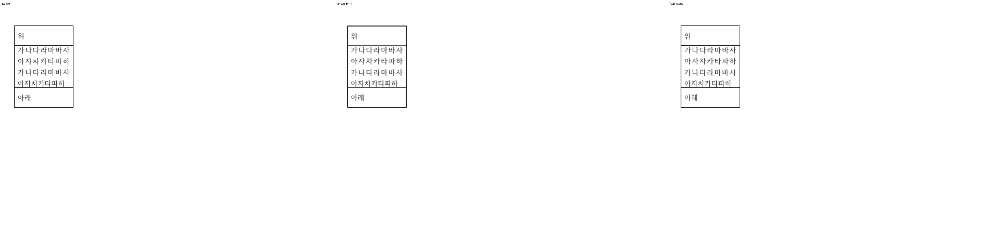
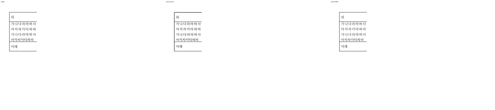

<!-- 미게시 초안. 통합 뒤 실제 PR·merge SHA·CI URL로 변수 세 개를 채우고 이미지의 devel 포함을 확인한다. -->

검토 및 통합 완료했습니다. 기여해 주셔서 감사합니다.

본문과 중첩 표에서 실제로 늘어난 common height를 저장 사본에 반영하고 원본 cellSz·live IR은 유지한다. 중첩 편집의 child 8502 HU가 저장에서 11748 HU로 바뀌어야 하는 누락을 추가로 해결했다. paint가 이미 맞아도 저장 XML을 별도로 검증한다.

메인터너 쪽에서 최신 devel과의 충돌과 다음 경계를 보정했습니다. 현재 Storage 기반 snapshot·HWPX lineage·되감김 프레임을 유지했다. clean 저장 태그를 보존한 재조판도 현재 LineSeg.text_start와 짝지어진 layout_space_metrics의 발행 출처로 인증한다. 무편집 child는 원래 높이를 유지한다.

통합 PR: {{integration_pr_url}} · merge: {{merge_sha}} · 최신 head CI: {{ci_url}}. 원 기여 commit과 원 head를 통합 history에 보존했습니다.

이 PR의 대조 입력 전쪽 최저 raw는 Native 100.00%, fresh WASM 100.00%입니다. 전쪽 수·원본·독립 한컴 Print·직접 확대 판독과 실제 API/저장 검증은 [개별 검토](https://github.com/edwardkim/rhwp/blob/{{merge_sha}}/mydocs/pr/pr_8298_review.md)에서 구분했습니다.

[Visual Sweep 검증 절차](https://github.com/edwardkim/rhwp/blob/{{merge_sha}}/mydocs/manual/verification/visual_sweep_guide.md#github-merge-comment)와 해당 TSV·글꼴 공급·판독 근거를 함께 남겼습니다.

