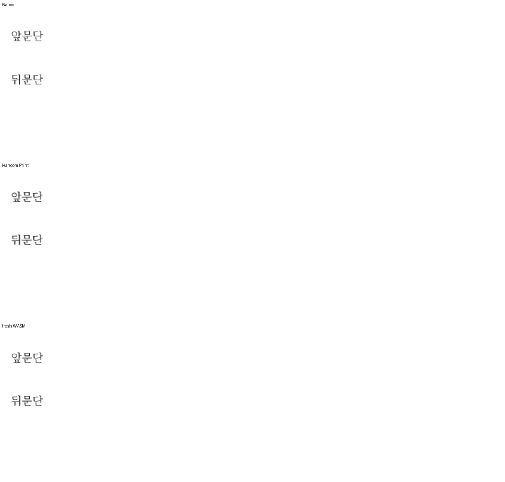

<!-- 미게시 초안. 통합 뒤 실제 PR·merge SHA·CI URL로 변수 세 개를 채우고 이미지의 devel 포함을 확인한다. -->

검토 및 통합 완료했습니다. 기여해 주셔서 감사합니다.

무저장 문단의 합성 줄과 후속 저장 줄 사이의 공간·vpos 델타를 연결했습니다. 연속 무저장 문단의 순서·빈 줄 점유와 후속 본문 이동을 보존했습니다.

통합 과정에서 확인한 보존·보정 사항은 다음과 같습니다. 기존 reset/context와 Storage 예산 전달을 유지하고 composer의 source-unit 정책을 되돌리지 않았습니다. 순수 줄 구성 계약과 실제 간격 편집·재열기의 시각 검증을 구분했습니다.

통합 PR: [#8548]({{integration_pr_url}}) · [merge commit](https://github.com/edwardkim/rhwp/commit/{{merge_sha}}) · [최신 head CI]({{ci_url}}). 원 기여 commit과 원 head를 통합 history에 보존했습니다.

이 PR의 대조 입력 전쪽 최저 raw는 Native 100.00%, fresh WASM 100.00%입니다. 전쪽 수·원본·독립 한컴 Print·직접 확대 판독과 실제 API/저장 검증은 [개별 검토](https://github.com/edwardkim/rhwp/blob/{{merge_sha}}/mydocs/pr/pr_8299_review.md)에서 구분했습니다.

이번 silhouette-only 비교는 전쪽 raw·쪽수와 직접 판독으로 판단했습니다. `pixel_match`·`visual_accuracy_proxy_percent`·일반 `flagged` 분류는 산출하지 않았으므로 해당 값의 통과로 표시하지 않았습니다.

[Visual Sweep 검증 절차](https://github.com/edwardkim/rhwp/blob/{{merge_sha}}/mydocs/manual/verification/visual_sweep_guide.md#github-merge-comment)와 해당 TSV·글꼴 공급·판독 근거를 함께 남겼습니다.

