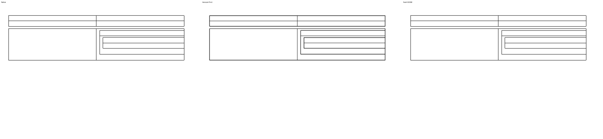
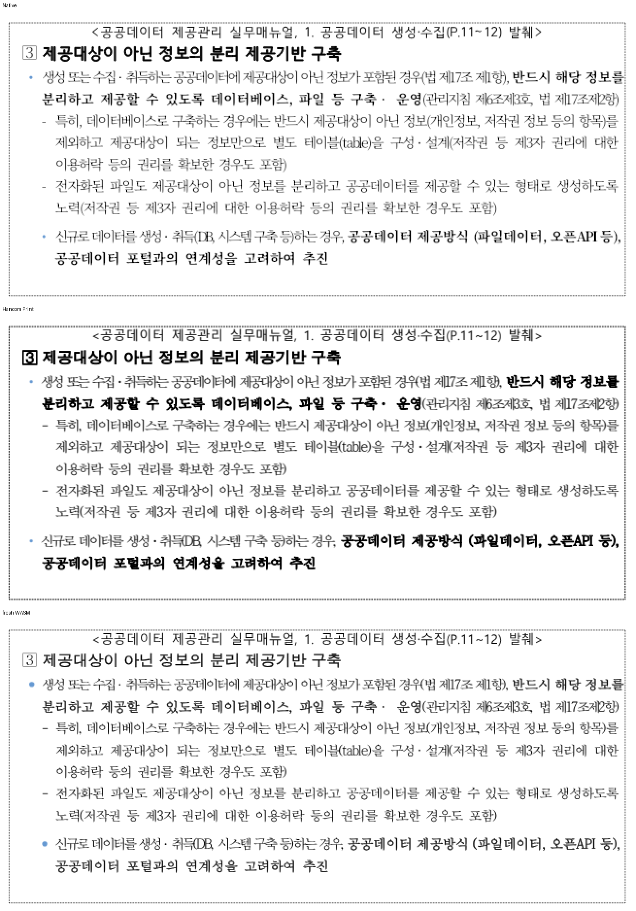

<!-- 미게시 초안. 통합 뒤 실제 PR·merge SHA·CI URL로 변수 세 개를 채우고 이미지의 devel 포함을 확인한다. -->

검토 및 통합 완료했습니다. 기여해 주셔서 감사합니다.

실제 hit-test가 조상 셀 clip의 교집합을 소비해 보이지 않는 중첩 텍스트를 선택하지 않습니다. paint는 바꾸지 않았습니다. rowbreak 16쪽의 과거 hidden-line 전제는 최신 [#8187](https://github.com/edwardkim/rhwp/pull/8187)에서 이미 해소됐음을 분리했습니다.

통합 과정에서 확인한 보존·보정 사항은 다음과 같습니다. c33037bf2f → [#8187](https://github.com/edwardkim/rhwp/pull/8187) 3724ab9dc4의 현재 분할·가시 배치를 보존했습니다. 없어져야 한다는 기존 전제 대신 실제 가시 내용·꼬리 보존·셀 경로·클릭 소유를 검사했습니다. 중첩 표는 임의 y 문턱 대신 원본 표 순서로 선택했습니다.

통합 PR: [#8548]({{integration_pr_url}}) · [merge commit](https://github.com/edwardkim/rhwp/commit/{{merge_sha}}) · [최신 head CI]({{ci_url}}). 원 기여 commit과 원 head를 통합 history에 보존했습니다.

이 PR의 대조 입력 전쪽 최저 raw는 Native 92.88%, fresh WASM 92.88%입니다. 전쪽 수·원본·독립 한컴 Print·직접 확대 판독과 실제 API/저장 검증은 [개별 검토](https://github.com/edwardkim/rhwp/blob/{{merge_sha}}/mydocs/pr/pr_8308_review.md)에서 구분했습니다.

이번 silhouette-only 비교는 전쪽 raw·쪽수와 직접 판독으로 판단했습니다. `pixel_match`·`visual_accuracy_proxy_percent`·일반 `flagged` 분류는 산출하지 않았으므로 해당 값의 통과로 표시하지 않았습니다.

[Visual Sweep 검증 절차](https://github.com/edwardkim/rhwp/blob/{{merge_sha}}/mydocs/manual/verification/visual_sweep_guide.md#github-merge-comment)와 해당 TSV·글꼴 공급·판독 근거를 함께 남겼습니다.

